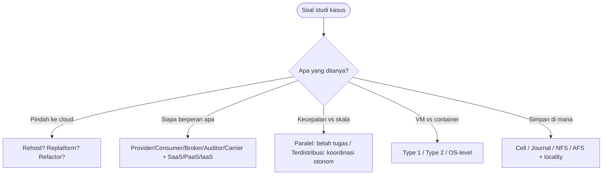

# Cloud Infrastructure | Sesi UTS: Latihan Soal

> **Mata Kuliah:** Cloud Infrastructure | **Sesi:** UTS Prep | **Status:** Materi UTS

---

## 🔑 Cues
- Strategi migrasi: rehost, replatform, refactor
- Peran ekosistem dan model layanan
- Paralel versus terdistribusi
- Hypervisor type 1 versus type 2
- Cell, journal, NFS, AFS, locality

---

## 📖 Materi Utama

### 1. Lima titik kisi-kisi dalam satu pandangan
- **Strategi migrasi:** memindahkan data/aplikasi/unsur bisnis ke cloud. **Rehosting (lift and shift)** tanpa ubah kode; **replatforming** dengan sedikit optimasi tanpa merombak arsitektur; **refactoring** merombak arsitektur demi fitur cloud-native. Motifnya: biaya, skalabilitas, fleksibilitas.
- **Ekosistem:** provider menyediakan (contoh AWS, Google Cloud), consumer memakai, broker mengatur pemakaian–performa–penghantaran, auditor menilai independen, carrier mengangkut konektivitas. Modelnya SaaS (software), PaaS (platform), IaaS (infrastructure), DBaaS (database).
- **Paralel vs terdistribusi:** paralel membelah instruksi ke banyak prosesor satu sistem demi kecepatan; terdistribusi mengoordinasi komputer-komputer otonom berjaringan agar tampak satu sistem demi skala dan ketersediaan. Keduanya memakai **latency hiding** — menutup beda laju CPU–memori–I/O lewat rekayasa arsitektural.
- **Virtualisasi:** hypervisor (VMM) melahirkan VM. **Type 1 bare-metal** duduk langsung di hardware (Xen, ESXi) — efisien dan aman; **Type 2 hosted** hidup di atas OS (VirtualBox, VMware Workstation) — mudah pasang, ber-overhead OS. Container ber-virtualisasi di level OS (ringan), VM di level hardware (isolasi kuat).
- **Storage:** **cell** memetakan fisik ke blok/sektor; **journal** menyimpan seluruh riwayat perubahan. **NFS** berbagi file client-server di LAN; **AFS** mengejar skala lewat caching. **Data locality** — dekatkan data ke CPU/RAM — penting karena bandwidth disk lokal jauh melampaui jaringan.

### 2. Bank soal jawab singkat
- **Soal 1 — Ekosistem:** sebutkan dan jelaskan 3 peran utama ekosistem.
- > Jawaban: **Provider** menyediakan layanan hardware/software; **consumer** (pengguna/organisasi) memakainya untuk kebutuhan bisnis; **carrier** mengangkut konektivitas antara keduanya.
- **Soal 2 — Virtualisasi:** beda Type 1 dan Type 2 beserta contoh.
- > Jawaban: **Type 1** langsung di hardware fisik tanpa OS host — efisien dan aman (ESXi, Xen). **Type 2** sebagai aplikasi di atas OS host (Windows/Linux) — mudah instal namun ber-overhead (VirtualBox, VMware Workstation).
- **Soal 3 — Storage:** jelaskan data locality dan urgensinya.
- > Jawaban: menempatkan data sedekat mungkin ke unit proses. Karena bandwidth disk lokal jauh lebih besar dari jaringan, latensi turun dan aplikasi I/O-intensive melesat.
- **Soal 4 — Paralel vs terdistribusi:** beda fokus keduanya.
- > Jawaban: paralel mengejar **kecepatan eksekusi** lewat belahan tugas serentak; terdistribusi mengejar **koordinasi** sumber daya terpisah geografis menjadi kesatuan stabil dan skalabel.

---

## Library Diagram & Arsitektur

*Peta triage soal UTS: kenali kata kunci, jatuhkan ke titik kisi-kisi yang tepat.*

---

## 🛠️ Use Case / Implementasi Nyata
- **Skenario:** Rental konsol kampus kebanjiran penyewa saat libur — antrean menumpuk, satu mesin kasir mati total 3 hari seperti Netflix 2008.
- **Masalah yang Diatasi:** Infrastruktur tunggal tanpa cadangan (single point of failure) plus penskalaan manual.
- **Keuntungan:** Pelajarannya tiga arah — refactor ke microservices dengan auto-scaling (Netflix→AWS), infrastruktur didefinisikan sebagai kode agar update 8 server tak mengulang tragedi Knight Capital **$440 juta dalam 45 menit (2012)**, dan arsip transaksi memakai journal agar bisa rollback seperti pelajaran PDN 2024.

---

## 🗂️ Konsep Kunci

| Istilah | Definisi | Contoh / Catatan |
|---------|----------|-----------------|
| Rehosting | Pindah tanpa ubah kode | Lift and shift |
| Replatforming | Optimasi ringan tanpa rombak arsitektur | Jalan tengah migrasi |
| Refactoring | Rombak arsitektur cloud-native | Microservices Netflix di AWS |
| Single point of failure | Satu titik mati melumpuhkan semua | Outage S3 US-East-1 Feb 2017 |
| Immutable infrastructure | Ganti VM baru, bukan patch lama | Lawan tragedi Knight Capital |
| Magic Pocket | Storage mandiri Dropbox eksa-skala | Reverse migration dari S3 |
| Journal recovery | Kembali ke snapshot sehat | Obat ransomware PDN 2024 |

---

## 📊 Tabel Ringkasan

| Kasus | Pelajaran kisi-kisi |
|-------|---------------------|
| Netflix 2008 (mati 3 hari → AWS microservices, auto-scaling) | Migrasi + ekosistem |
| Knight Capital 2012 ($440 juta/45 menit, dead code 1 dari 8 server) | IaC + immutable infra |
| Dropbox Magic Pocket (eksabyte keluar dari S3) | Storage + strategi biaya |
| MapReduce & GFS Google → Hadoop | Paralel + distributed storage |
| S3 outage Feb 2017 (typo billing US-East-1) | Interdependency, multi-region |
| Tokopedia WIB (flash sale, auto-scaling + container) | IaaS + virtualisasi ringan |
| PDN ransomware 2024 (backup + audit) | Journal storage + auditor |

---

## ⚠️ Catatan Penting
> **UTS berbentuk studi kasus** — tiap jawaban teori wajib ditempeli kalimat "strategi X cocok karena kondisi Y".

> **IaaS vs PaaS vs SaaS** adalah fondasi analisis ekosistem — kuasai sebelum menghafal kasus.

---

## 📝 Materi Tambahan (Visual Insights)
- Kisi-kisi papan tulis: (1) strategi migrasi, (2) ekosistem, (3) paralel–terdistribusi, (4) virtualisasi, (5) storage — susun jawaban mengikuti urutan ketemu soalnya, bukan urutan kisi-kisi.
