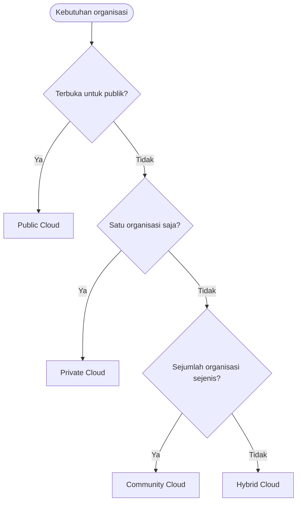

# Cloud Infrastructure | Sesi 01: Introduction to Cloud

> **Mata Kuliah:** Cloud Infrastructure | **Sesi:** 01 | **Status:** Materi UTS

---

## 🔑 Cues
- Definisi NIST cloud computing
- Karakter komputasi berpusat jaringan
- Model deployment: public, private, hybrid, community
- Thin client dan data sovereignty
- Service availability

---

## 📖 Materi Utama

### 1. Cara berpikir baru: komputasi berpusat jaringan
- Siklus CPU, media simpan, dan bandwidth diperlakukan sebagai stok bersama, bukan milik satu mesin.
- Fasilitas berbagi data bawaan membuat kerja kolaboratif jadi pola default, bukan pengecualian.
- Mayoritas aplikasi modern bersifat intensif jaringan: logikanya hidup dari pertukaran data terus-menerus.
- Akses umum memakai *thin client* — perangkat bersumber daya kecil yang menumpang kekuatan di sisi jaringan.

### 2. Definisi acuan (NIST)
- Cloud computing adalah model akses jaringan yang merata, nyaman, dan sesuai permintaan ke kumpulan sumber daya terkonfigurasi (jaringan, server, storage, aplikasi, layanan).
- Ciri operasionalnya: penyediaan cepat dan pelepasan ringan, dengan usaha manajemen minimal serta sedikit interaksi ke penyedia.

### 3. Memilih model gelar dari sudut kebutuhan
- **Pakai milik bersama bila terbuka untuk umum:** *public cloud* — satu penyelenggara membuka layanannya ke masyarakat luas.
- **Pakai ruang tertutup bila satu organisasi:** *private cloud* — khusus satu organisasi, boleh di-host internal maupun eksternal.
- **Campur keduanya bila butuh dua sifat sekaligus:** *hybrid cloud* — gabungan dua model atau lebih.
- **Patungan bila beberapa organisasi sejenis:** *community cloud* — dipakai bersama sejumlah organisasi, umumnya di-host eksternal.
- Isu turunannya: *data sovereignty* — data tersebar di lokasi dan pengelola berbeda sehingga memunculkan persoalan hukum lokasi data.

---

## Library Diagram & Arsitektur

*Alur bantu-pilih model gelar dari sifat kebutuhan, bukan bagan layanan generik.*

---

## 🛠️ Use Case / Implementasi Nyata
- **Skenario:** Panitia penerimaan mahasiswa baru butuh portal pendaftaran yang hidup hanya 2 bulan setahun.
- **Masalah yang Diatasi:** Membeli server fisik untuk beban musiman berarti membayar setahun penuh untuk pemakaian sesaat.
- **Keuntungan:** Pola *pay-as-you-go* — sewa kapasitas saat pendaftaran dibuka, lepas setelah ditutup, skala naik-turun mengikuti pendaftar.

---

## 🗂️ Konsep Kunci

| Istilah | Definisi | Contoh / Catatan |
|---------|----------|-----------------|
| NIST cloud model | Akses on-demand ke pool sumber daya terkonfigurasi | Provisioning cepat, manajemen minimal |
| Thin client | Titik akses ringan yang menumpang komputasi jaringan | Browser web |
| Data sovereignty | Persoalan yurisdiksi akibat data tersebar multi-pengelola | Lokasi simpan menentukan hukum berlaku |
| Hybrid | Komposisi dua model cloud atau lebih | Sensitif di private, fluktuatif di public |

---

## 📊 Tabel Ringkasan

| Model | Pengguna | Hosting |
|-------|----------|---------|
| Public | Masyarakat umum | Penyelenggara layanan |
| Private | Satu organisasi | Internal atau eksternal |
| Hybrid | Campuran | Kombinasi lokasi |
| Community | Beberapa organisasi | Umumnya eksternal |

---

## ⚠️ Catatan Penting
> **Ketersediaan bukan janji mutlak** — pemadaman listrik pusat data atau putusnya kabel serat optik bawah laut bisa memutus layanan yang secara teori selalu aktif.

---

## 📝 Materi Tambahan (Visual Insights)
- Sesi ini fondasi kisi-kisi **Analisis Ekosistem Cloud**: kuasai beda keempat model gelar sebelum masuk ke peran aktor ekosistem di Sesi 02.
