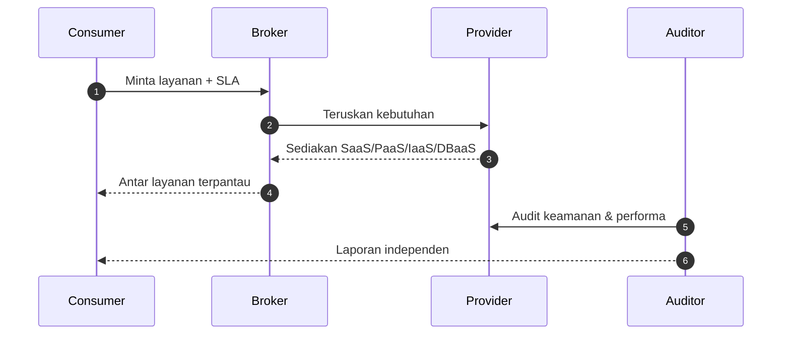

# Cloud Infrastructure | Sesi 02: Cloud Ecosystem

> **Mata Kuliah:** Cloud Infrastructure | **Sesi:** 02 | **Status:** Materi UTS (Kisi-kisi: Cloud Ecosystem Analysis)

---

## 🔑 Cues
- Lima peran ekosistem cloud
- Batas tanggung jawab SaaS, PaaS, IaaS, DBaaS
- Infrastructure as Code: Ansible, Terraform
- Interoperabilitas dan vendor lock-in
- Shared responsibility

---

## 📖 Materi Utama

### 1. Siapa berperan apa di ekosistem
- **Service consumer** memakai layanan; **service provider** menyediakannya.
- **Carrier** menjadi perantara konektivitas antara keduanya.
- **Broker** mengatur pemakaian, performa, dan penghantaran layanan.
- **Auditor** menilai independen — keamanan dan performa — tanpa terikat transaksi.

### 2. Membaca model layanan dari sisi kendali pengguna
- **SaaS:** pengguna sekadar memakai aplikasi via browser (contoh: CRM, tanda tangan digital); infrastruktur dasar bukan urusannya.
- **PaaS:** pengguna men-deploy aplikasi buatannya sendiri dengan bahasa dan perkakas yang didukung provider; urusan runtime dipegang platform.
- **IaaS:** pengguna mendapat bahan mentah komputasi (processing, storage, network) dan memegang kendali OS serta aplikasi di atasnya.
- **DBaaS:** database hidup di infrastruktur provider; nilai jualnya skalabilitas instan plus dukungan *failover*.
- Cara cepat mengingat: makin ke bawah (SaaS → PaaS → IaaS), kendali pengguna makin besar dan tanggung jawab operasional ikut berpindah ke pengguna.

### 3. Infrastruktur ditulis, bukan diklik
- **Infrastructure as Code (IaC):** server, OS, dan koneksi database didefinisikan lewat bahasa deskriptif tingkat tinggi.
- **Ansible:** mesin otomatisasi IT open-source.
- **Terraform:** otomatisasi pengelolaan sumber daya lintas banyak provider.
- Lawan dari pola ini adalah konfigurasi manual — sumber klasik *human error* (lihat kasus Knight Capital di catatan latihan UTS).
- Risiko pengikatnya: **vendor lock-in**, ketika pengguna sulit pindah karena ketergantungan pada satu penyedia; akarnya soal interoperabilitas.

---

## Library Diagram & Arsitektur

*Alur peran ekosistem: broker menengahi, auditor menilai dari luar transaksi.*

---

## 🛠️ Use Case / Implementasi Nyata
- **Skenario:** Kelompok mahasiswa lomba hackathon 48 jam harus demo aplikasi web ke juri.
- **Masalah yang Diatasi:** Menyiapkan server, runtime, dan database dari nol memakan separuh waktu lomba.
- **Keuntungan:** Dengan PaaS, tim cukup push kode dan langsung dapat URL demo; DBaaS menanggung failover tanpa konfigurasi manual.

---

## 🗂️ Konsep Kunci

| Istilah | Definisi | Contoh / Catatan |
|---------|----------|-----------------|
| Broker | Pengatur pemakaian, performa, penghantaran layanan | Negosiator antara consumer dan provider |
| Auditor | Penilai independen keamanan dan performa | Di luar jalur transaksi |
| DBaaS | Database di atas infrastruktur provider | Skalabilitas instan, failover |
| Vendor lock-in | Ketergantungan pada satu penyedia | Isu interoperabilitas |
| IaC | Infrastruktur sebagai file konfigurasi | Ansible, Terraform |

---

## 📊 Tabel Ringkasan

| Model | Yang diurus pengguna | Pengguna tipikal |
|-------|----------------------|-----------------|
| SaaS | Hanya memakai aplikasi | End user |
| PaaS | Kode dan data aplikasi | Developer |
| IaaS | OS, runtime, aplikasi | SysAdmin / developer lanjut |
| DBaaS | Skema dan query | Pemilik aplikasi data |

---

## ⚠️ Catatan Penting
> **Keamanan adalah tantangan paling signifikan** dalam komputasi awan — tanpa kepercayaan pengguna, model layanan secanggih apa pun tidak diadopsi.

> **Ujian meminta analisis batas tanggung jawab** — latih menjawab "siapa mengurus apa" untuk tiap model pada studi kasus.

---

## 📝 Materi Tambahan (Visual Insights)
- Fokus UTS **Cloud Ecosystem Analysis**: petakan setiap studi kasus ke lima peran plus satu model layanan, lalu nyatakan garis tanggung jawabnya (shared responsibility).
