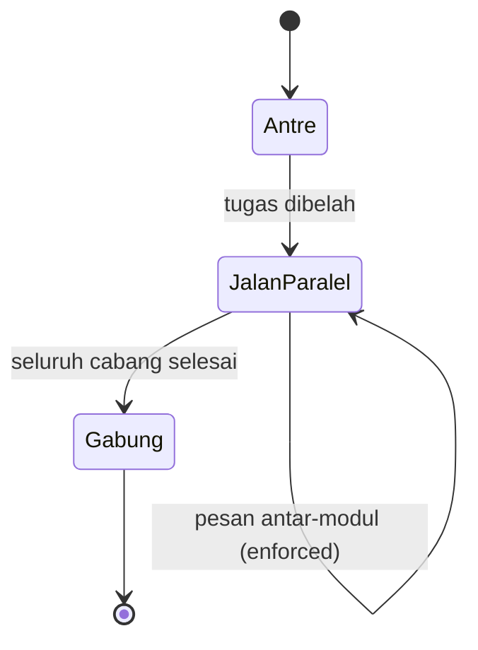

# Cloud Infrastructure | Sesi 03: Parallel Processing and Distributed Computing

> **Mata Kuliah:** Cloud Infrastructure | **Sesi:** 03 | **Status:** Materi UTS (Kisi-kisi: Parallel and Distributed Computing)

---

## 🔑 Cues
- Tiga subsistem arsitektur komputer
- Bandwidth versus latency
- Paralelisme data, thread, task
- Sistem terdistribusi dan middleware
- Modularitas soft versus enforced

---

## 📖 Materi Utama

### 1. Anatomi mesin: tiga subsistem
- Arsitektur komputer menjelaskan fungsionalitas, organisasi, dan implementasi sistem.
- **CPU:** mentransformasi data. **Memory:** menyimpan data. **I/O:** berbicara dengan dunia luar.
- Ketiganya berkecepatan beda jauh — sumber segala persoalan performa.

### 2. Menyembunyikan kelambatan
- **Bandwidth** = jumlah operasi per satuan waktu; **latency** = jeda mulai–selesai satu operasi.
- Strategi arsitektur intinya *latency hiding*: menutup lambatnya memori dan I/O dengan buffering data plus rekayasa arsitektural.
- Tiga muka paralelisme: **data-level** (belah data jadi blok besar, jalankan program sama di blok beda — SPMD), **thread-level** (banyak thread menutup latensi memori dan I/O), **task-level** (tugas komputasi berat berjalan serentak).

### 3. Dari satu mesin ke banyak mesin
- Sistem terdistribusi = kumpulan komputer yang dihubungkan jaringan plus perangkat lunak distribusi (*middleware*) pengoordinasi aktivitas.
- Sifatnya: tiap simpul **otonom**, titik kendali dan titik kegagalannya **banyak**, dan sistemnya **skalabel**.
- Perbedaan ujian: paralel mengejar performa dalam satu sistem; terdistribusi mengejar kerja sama banyak sistem otonom.
- Cara modul berbicara menentukan ketahanan: **soft modularity** memanggil modul via shared-memory/prosedur sambil menyembunyikan detail implementasi; **enforced modularity** memaksa modul hanya bertukar pesan — kesalahan sulit merambat sehingga sistem lebih kuat.

---

## Library Diagram & Arsitektur

*Siklus hidup tugas paralel: belah, jalankan serentak dengan pesan, gabung saat semua cabang tiba.*

---

## 🛠️ Use Case / Implementasi Nyata
- **Skenario:** Laboratorium kampus merender animasi 3D tugas akhir 10 menit.
- **Masalah yang Diatasi:** Render sekuensial di satu PC memakan waktu semalaman.
- **Keuntungan:** Frame dipecah per kelompok (data parallelism) ke lab-lab kosong; middleware menggabung hasilnya pagi hari.

---

## 🗂️ Konsep Kunci

| Istilah | Definisi | Contoh / Catatan |
|---------|----------|-----------------|
| Latency hiding | Menutup lambatnya memori/I/O | Buffering + rekayasa arsitektur |
| SPMD | Program sama, data beda, jalan serentak | Wujud data-level parallelism |
| Middleware | Perangkat lunak koordinasi sistem terdistribusi | Antara OS dan aplikasi |
| Enforced modularity | Modul hanya boleh bertukar pesan | Kesalahan tidak merambat |
| Meltdown / Spectre | Celah hardware via optimasi arsitektural | Mengeksploitasi branch prediction |

---

## 📊 Tabel Ringkasan

| Sudut | Paralel | Terdistribusi |
|-------|---------|---------------|
| Tujuan | Performa satu sistem | Skala dan ketersediaan banyak sistem |
| Simpul | Tidak otonom | Otonom |
| Kegagalan | Titik tunggal dominan | Banyak titik kegagalan |
| Contoh teknik | SPMD, multithreading | Middleware + message passing |

---

## ⚠️ Catatan Penting
> **Meltdown dan Spectre** mengeksploitasi optimasi arsitektural seperti branch prediction — bukti latency hiding punya harga keamanan.

---

## 📝 Materi Tambahan (Visual Insights)
- Kisi-kisi UTS menuntut bedakan paralel vs terdistribusi dalam studi kasus infrastruktur global — hafalkan sumbu bedanya (performa vs koordinasi otonom).
