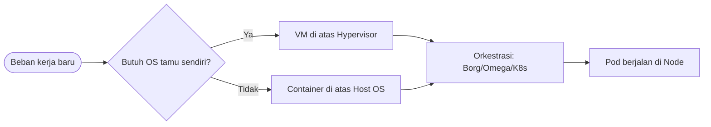

# Cloud Infrastructure | Sesi 04: Cloud Hardware and Software

> **Mata Kuliah:** Cloud Infrastructure | **Sesi:** 04 | **Status:** Materi UTS

---

## 🔑 Cues
- Warehouse-scale computer
- Hierarki server, rak, sel
- VM versus container dan Docker
- Borg, Omega, Quasar
- Kubernetes: master, node, pod

---

## 📖 Materi Utama

### 1. Komputer sebesar gudang
- **Warehouse-scale Computer (WSC):** ribuan server bertindak sebagai satu komputer raksasa.
- Jaringannya berlapis: server dirangkai ke rak, rak dirangkai ke sel/array.
- Dua tantangan bawaan: skala infrastrukturnya raksasa dan *mean-time to failure* (MTTF) tiap komponennya rendah — kegagalan adalah kejadian harian, bukan musibah.

### 2. Memilih kemasan beban kerja
- **Virtual Machine:** berat dan kurang portabel; berjalan di atas hypervisor dan membawa OS tamu sendiri tiap instance.
- **Container:** ringan dan portabel; berbagi kernel OS host sehingga aplikasi terisolasi tanpa overhead satu OS penuh per aplikasi.
- **Docker** mengemas software beserta filesystem lengkapnya (code, runtime, tools) agar konsisten lintas lingkungan.
- Kaidah pilih: butuh isolasi sekelas hardware → VM; butuh deploy cepat dan rapat → container.

### 3. Siapa mengatur ribuan mesin
- **Borg (Google):** mengelola ribuan job dari ribuan aplikasi di banyak cluster.
- **Omega:** penerus Borg memakai *shared cluster state* demi skalabilitas lebih tinggi.
- **Quasar:** manajemen cluster yang sadar QoS.
- **Kubernetes (K8s):** orkestrasi open-source aplikasi kontainer — deployment, scaling, load balancing, logging, monitoring.
- Peran di K8s: **master** mengatur cluster; **minion/node** mengerjakan job nyata; **pod** — grup kontainer terjadwal di host yang sama — adalah unit terkecil yang bisa di-deploy.

---

## Library Diagram & Arsitektur

*Keputusan kemasan lalu orkestrasi: VM atau container bermuara ke penjadwal cluster yang sama.*

---

## 🛠️ Use Case / Implementasi Nyata
- **Skenario:** Kantin kampus punya aplikasi kasir yang update menunya tiap minggu.
- **Masalah yang Diatasi:** Versi di laptop developer selalu beda dengan versi di mesin kasir.
- **Keuntungan:** Image container menjamin yang dites sama persis dengan yang jalan di kasir; K8s menggulirkan update tanpa mematikan layanan.

---

## 🗂️ Konsep Kunci

| Istilah | Definisi | Contoh / Catatan |
|---------|----------|-----------------|
| WSC | Kumpulan server raksasa sebagai satu komputer | Hierarki server–rak–sel |
| MTTF | Rata-rata waktu menuju kegagalan komponen | Rendah di skala gudang |
| Pod | Unit deploy terkecil Kubernetes | Satu atau lebih kontainer |
| Hypervisor | Lapisan menjalankan VM | VMware, KVM |
| Borg / Omega | Pengelola cluster Google | Omega pakai shared state |

---

## 📊 Tabel Ringkasan

| Aspek | VM | Container |
|-------|----|-----------|
| Berat | Berat (bawa Guest OS) | Ringan (berbagi kernel) |
| Portabilitas | Rendah | Tinggi |
| Isolasi | Kuat (level hardware) | Cukup (level OS) |
| Contoh | KVM, VMware | Docker di K8s |

---

## ⚠️ Catatan Penting
> **Container menang efisiensi** karena tidak membayar harga satu Guest OS per instance — ini jembatan ke topik Arsitektur Virtualisasi di UTS.

---

## 📝 Materi Tambahan (Visual Insights)
- Kuasai pasangan konsep **VM vs container** plus peran pod — keduanya muncul berulang di kisi-kisi poin 4 (Virtualization Architecture).
