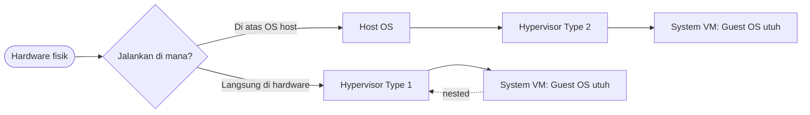

# Cloud Infrastructure | Sesi 05: Cloud Resource Virtualization

> **Mata Kuliah:** Cloud Infrastructure | **Sesi:** 05 | **Status:** Materi UTS (Kisi-kisi: Virtualization Architecture)

---

## 🔑 Cues
- Multiplexing, aggregation, emulation
- Process VM versus system VM
- Hypervisor type 1 dan type 2
- Full, para, nested virtualization
- Eucalyptus, OpenNebula, OpenStack

---

## 📖 Materi Utama

### 1. Empat cara menyulap sumber daya
- Virtualisasi menyimulasikan antarmuka objek fisik lewat: **multiplexing** (satu fisik jadi banyak virtual — contoh prosesor melayani banyak thread), **aggregation** (banyak fisik jadi satu virtual — contoh RAID), **emulation** (fisik tipe A menyamar jadi tipe B — contoh disk fisik mengemulasi RAM), dan **kombinasi multiplexing–emulation** (contoh memori virtual dengan paging).

### 2. Dua keluarga mesin virtual
- **Process VM:** lahir untuk satu proses, mati bersamanya — contoh JVM.
- **System VM:** menyajikan sistem utuh yang bisa menjalankan OS-nya sendiri.
- Pengelolanya, **hypervisor (VMM)**, ada dua tipe: **Type 1 native/bare-metal** menempel langsung di hardware (ESXi, Xen, KVM); **Type 2 hosted** hidup sebagai aplikasi di atas OS host (VirtualBox, VMware Workstation).

### 3. Derajat kejujuran terhadap Guest OS
- **Full virtualization:** hardware diabstraksi penuh, Guest OS tanpa modifikasi.
- **Paravirtualization:** Guest OS dimodifikasi agar sadar sedang divirtualkan — imbalannya efisiensi.
- **Nested virtualization:** hypervisor berjalan di dalam VM yang sendiri berjalan di atas hypervisor lain — berguna untuk simulasi cloud.
- Fakta implementasi: **KVM** adalah virtualisasi berbasis hardware yang terintegrasi ke kernel Linux.
- Platform open-source: **Eucalyptus** (kompatibel EC2/S3, untuk korporasi besar), **OpenNebula** (cocok lab uji dengan sedikit server), **OpenStack** (proyek NASA & Rackspace, populer untuk private cloud dengan dashboard web ekstensif).

---

## Library Diagram & Arsitektur

*Dua jalur hypervisor menuju System VM yang sama; garis putus-putus menandai nested.*

---

## 🛠️ Use Case / Implementasi Nyata
- **Skenario:** Asisten lab butuh modul praktikum Linux untuk 40 PC Windows.
- **Masalah yang Diatasi:** Dual-boot 40 mesin memakan waktu dan rawan merusak partisi.
- **Keuntungan:** Hypervisor Type 2 (VirtualBox) menyajikan Linux sebagai aplikasi — instal sekali, impor image ke semua PC.

---

## 🗂️ Konsep Kunci

| Istilah | Definisi | Contoh / Catatan |
|---------|----------|-----------------|
| Multiplexing | Satu fisik jadi banyak virtual | Thread di atas prosesor |
| Aggregation | Banyak fisik jadi satu virtual | RAID disk |
| Emulation | Fisik tipe A menyamar jadi B | Disk mengemulasi RAM |
| Nested VM | VM di dalam VM | Simulasi cloud |
| KVM | Virtualisasi di kernel Linux | Berbasis hardware |

---

## 📊 Tabel Ringkasan

| Dimensi | Pilihan A | Pilihan B |
|---------|-----------|-----------|
| Hypervisor | Type 1: langsung di hardware (ESXi, Xen, KVM) | Type 2: di atas OS (VirtualBox, Workstation) |
| Teknik | Full: Guest OS utuh tanpa modifikasi | Para: Guest OS dimodifikasi, lebih efisien |
| Platform | Eucalyptus: kompatibel EC2/S3 | OpenStack: private cloud populer / OpenNebula: lab kecil |

---

## ⚠️ Catatan Penting
> **KVM terintegrasi ke kernel Linux** — detail implementasi ini sering jadi pembeda jawaban soal virtualisasi.

> **Ujian menagih beda fungsional Type 1 vs Type 2 plus VM vs container** — jawab dengan sumbu "di mana hypervisor duduk".

---

## 📝 Materi Tambahan (Visual Insights)
- Pelajari juga implementasi teknis QEMU, KVM, Xen — kisi-kisi meminta sampai level cara kerja, bukan sekadar nama.
