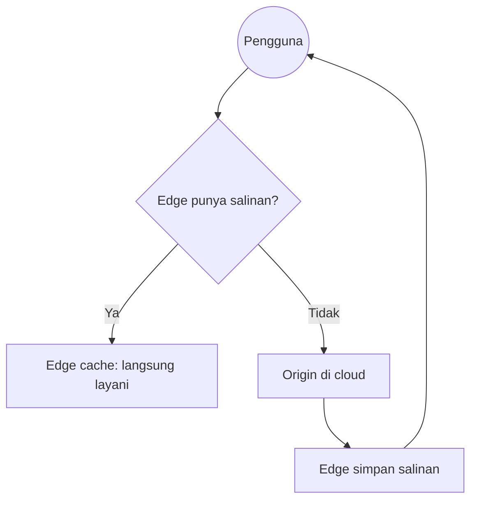

# Cloud Infrastructure | Sesi 06: Cloud Access and Cloud Interconnection Networks

> **Mata Kuliah:** Cloud Infrastructure | **Sesi:** 06 | **Status:** Materi UTS (Pendukung Kisi-kisi: Cloud Migration)

---

## 🔑 Cues
- Tier 1, 2, 3 dan IXP
- Kehabisan IPv4 dan migrasi IPv6
- Named Data Network
- Fair Queueing versus CBQ
- CDN dan edge cache

---

## 📖 Materi Utama

### 1. Peta kekuasaan jaringan
- **Tier 1** menjangkau jaringan lain tanpa membayar IP transit (contoh: AT&T, Verizon).
- **Tier 2** ber-peering namun tetap membeli transit untuk sebagian internet.
- **Tier 3** membeli hak transit dari jaringan lain (biasanya Tier 2).
- **IXP (Internet Exchange Point)** adalah infrastruktur fisik tempat ISP bertukar trafik langsung — biaya dan latensi turun sekaligus.

### 2. Alamat habis, paradigma bergeser
- IPv4 mentok di sekitar **4,3 miliar alamat** (sudah habis); IPv6 membuka ruang **3,4 × 10^38 alamat**.
- Bekal IPv6: **SLAAC** (stateless address auto-configuration) dan dukungan wajib **IPsec**.
- **NDN (Named Data Network)** melangkah lebih jauh: merujuk data lewat nama, bukan alamat IP lokasi — pas untuk data center cloud tempat data direplikasi dan paling efisien diambil dari storage terdekat secara konkuren.

### 3. Mengatur antrean dan mendekatkan konten
- **Fair Queueing (FQ):** antrean aliran data digilir round-robin demi keadilan.
- **Class-Based Queueing (CBQ):** memberi jaminan bandwidth ke aplikasi pilihan (contoh: VoIP, video streaming).
- **CDN** mengirim data lewat *edge cache server* terdekat pengguna, untuk konten statis (HTML, gambar) maupun live media (streaming real-time); hasilnya skalabilitas, keandalan, dan keamanan dari lonjakan trafik mendadak.

---

## Library Diagram & Arsitektur

*Logika layan-atau-ambil CDN: edge menjawab bila bisa, mengambil ke origin bila perlu.*

---

## 🛠️ Use Case / Implementasi Nyata
- **Skenario:** Final turnamen e-sport ditonton 2 juta orang bersamaan.
- **Masalah yang Diatasi:** Satu server origin pasti tumbang diserbu request serentak.
- **Keuntungan:** Stream live diduplikasi ke edge-edge lokal; origin hanya melayani segelintir edge, bukan jutaan penonton.

---

## 🗂️ Konsep Kunci

| Istilah | Definisi | Contoh / Catatan |
|---------|----------|-----------------|
| Peering | Tukar-menukar trafik antar jaringan | Relasi antar ISP |
| IXP | Titik tukar trafik fisik | Pemangkas biaya dan latensi |
| SLAAC | Konfigurasi alamat otomatis tanpa server | Fitur IPv6 |
| Edge server | Server dekat populasi pengguna | Node CDN |
| CBQ | Jaminan bandwidth per kelas aplikasi | VoIP, video streaming |

---

## 📊 Tabel Ringkasan

| Mekanisme | Prinsip | Untuk apa |
|-----------|---------|-----------|
| FQ | Round-robin adil | Keadilan antar aliran |
| CBQ | Jatah bandwidth dijamin | Aplikasi sensitif latensi |
| CDN statis | Cache HTML/gambar di edge | Beban origin turun |
| CDN live | Replikasi stream real-time | Skala penonton masif |
| NDN | Nama data, bukan alamat | Ambil replika terdekat |

---

## ⚠️ Catatan Penting
> **Migrasi cloud gagal tanpa interkoneksi bagus** — strategi pemindahan dataset besar ke cloud bertumpu pada kualitas jaringan, bukan sekadar kapasitas storage tujuan.

---

## 📝 Materi Tambahan (Visual Insights)
- Kaitkan materi ini ke **Cloud Migration Strategy** (kisi-kisi UTS poin 1): tulis argumen transfer data (bandwidth, latensi, edge) di tiap jawaban migrasi.
