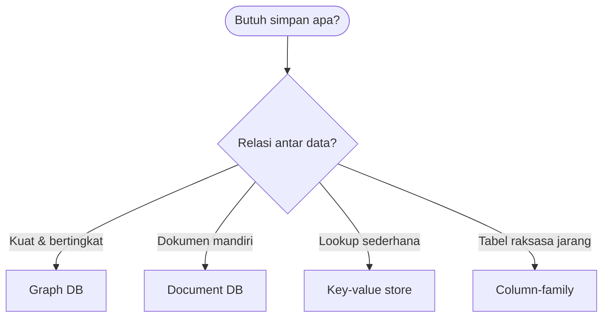

# Cloud Infrastructure | Sesi 07: Cloud Data Storage

> **Mata Kuliah:** Cloud Infrastructure | **Sesi:** 07 | **Status:** Materi UTS (Kisi-kisi: Cloud Storage Architecture)

---

## 🔑 Cues
- Cell storage versus journal storage
- NFS, SAN, AFS (Venus dan Vice)
- Empat tipe NoSQL
- Data locality
- Sharding dan consistency

---

## 📖 Materi Utama

### 1. Dua filsafat menyimpan
- **Cell storage:** penyimpanan dipetak jadi sel-sel seragam (blok/sektor); tiap objek menempati satu sel.
- **Journal storage:** menyimpan seluruh riwayat variabel lewat manajer jurnal; pengguna tak menyentuh sel penyimpanan langsung — cocok untuk pemulihan ke titik waktu (lihat kasus PDN di latihan UTS).

### 2. Berbagi file di skala cloud
- **NFS:** berbagi file client-server di LAN; kelemahan klasiknya *single point of failure*.
- **SAN:** blok penyimpanan terpusat yang fleksibel dikonfigurasi untuk cloud.
- **AFS:** workstation memakai agen **Venus** untuk men-cache file dari server **Vice** — dirancang untuk armada workstation besar.

### 3. Memilih NoSQL dari bentuk hubungan data
- NoSQL lepas dari model relasional dan nyaman di cluster besar.
- **Key-value:** pasangan kunci–nilai berbasis index (hash table) untuk lookup cepat.
- **Document:** nilai berupa data terstruktur/semi-terstruktur (JSON/XML).
- **Column-family:** tabel raksasa nan jarang (*sparse*) disimpan per famili kolom.
- **Graph:** verteks = entitas, edge = hubungan — juara untuk query pertemanan bertingkat.
- Dua kata pendamping wajib: **sharding** (data disebar multi-server) dan **consistency** (replika harus sepakat).
- Hukum performa: bandwidth disk lokal melampaui bandwidth jaringan (**data locality**), dan membaca dari memori lokal dua kali lebih cepat daripada membaca disk lokal.

---

## Library Diagram & Arsitektur

*Pemilih NoSQL berbasis bentuk data, bukan merek produk.*

---

## 🛠️ Use Case / Implementasi Nyata
- **Skenario:** Aplikasi angkatan kampus ingin fitur "teman dari teman jurusan sama".
- **Masalah yang Diatasi:** Join relasional bertingkat makin dalam makin lambat.
- **Keuntungan:** Graph DB menjawab traversal pertemanan dalam sekali jalan, plus sharding menanggung jutaan edge.

---

## 🗂️ Konsep Kunci

| Istilah | Definisi | Contoh / Catatan |
|---------|----------|-----------------|
| Journal storage | Simpan riwayat, bukan nilai akhir saja | Dasar point-in-time recovery |
| Venus / Vice | Agen cache di workstation / server AFS | Arsitektur AFS |
| Sharding | Sebar data ke banyak server | Penyeimbang beban NoSQL |
| Consistency | Kesepakatan isi antar replika | Kunci database terdistribusi |
| Data locality | Dekatkan data ke pemroses | Bandwidth lokal > jaringan |

---

## 📊 Tabel Ringkasan

| Tipe NoSQL | Cocok untuk | Contoh isi |
|------------|-------------|------------|
| Key-value | Cache, sesi | Token → profil |
| Document | Katalog semi-terstruktur | JSON produk |
| Column-family | Tabel sparse raksasa | Metrik time-series |
| Graph | Jaringan hubungan | Mahasiswa–pertemanan |

---

## ⚠️ Catatan Penting
> **Data locality menentukan nasib aplikasi I/O-intensive** — pindahkan komputasi ke data, bukan sebaliknya.

---

## 📝 Materi Tambahan (Visual Insights)
- Kisi-kisi **Cloud Storage Architecture** meminta kapan memakai file vs database vs object — jawab lewat sumbu pola akses (hierarki file, query terstruktur, blob skala web).
