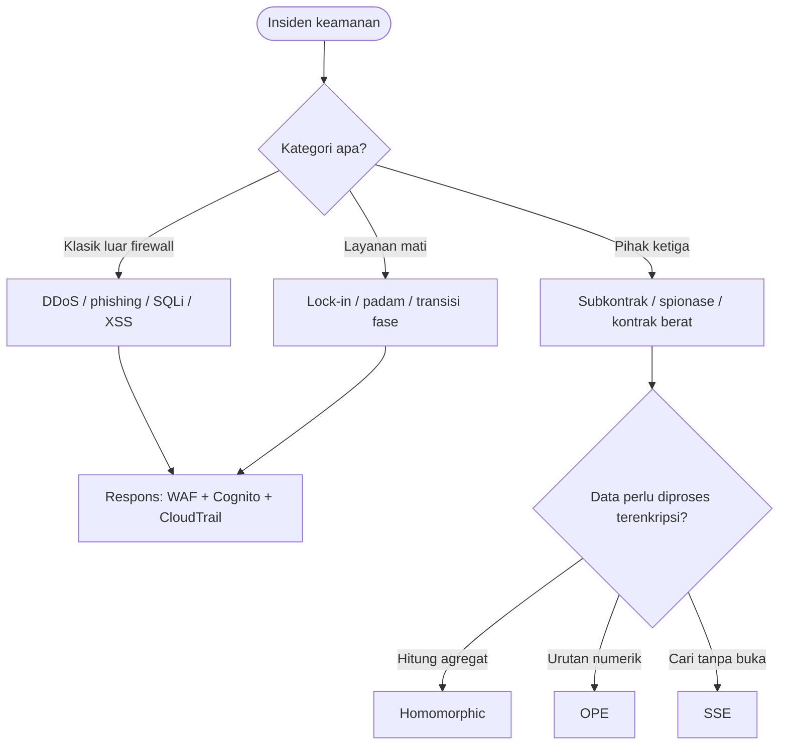

# Cloud Infrastructure | Sesi 08: Cloud Security

> **Mata Kuliah:** COSC6100001 - Cloud Infrastructure | **Sesi:** 08 | **Status:** Materi UAS

---

## 🔑 Cues
- Tiga kategori risiko cloud
- Model 3 aktor dan 6 serangan
- Window of vulnerability
- Homomorphic, OPE, SSE
- Ancaman hypervisor vs VM dan tools AWS

---

## 📖 Materi Utama

### 1. Peta risiko: dari klasik sampai titipan pihak ketiga
- **Ancaman tradisional:** sudah ada sebelum cloud (DDoS, phishing, SQL injection, XSS), namun makin sulit ditangani karena sebagian infrastruktur koneksi user berada di luar firewall sendiri; autentikasi–otorisasi individu pun tidak otomatis berlaku untuk enterprise.
- **Ancaman ketersediaan:** data lock-in yang melumpuhkan bisnis saat kejadian langka, fenomena transisi fase khas sistem kompleks, hasil komputasi yang tak terjamin benar, serta padam listrik/bencana yang mematikan layanan lama.
- **Ancaman kontrol pihak ketiga:** provider menyubkontrak resource ke pihak yang trust-nya kabur, risiko spionase atas data proprietary, dan kontrak yang membebankan seluruh tanggung jawab keamanan ke user dengan transparansi minim.
- Model permukaan serangan memakai **3 aktor (user, service, cloud infrastructure)** sehingga lahir **6 jenis serangan**; user bisa dihantam dari sisi service (SSL certificate spoofing, serangan browser cache, phishing) maupun dari infrastruktur cloud asli atau yang menyamar.
- Laporan CSA mencatat **11 top threats**, termasuk misconfiguration and inadequate change control, identity and access management, insecure interfaces and APIs, inadequate selection/implementation of cloud security strategy, insecure third-party resources, insecure software development.

### 2. Enkripsi yang tetap bisa dipakai
- **AWS KMS** membuat dan mengendalikan encryption key client, terintegrasi dengan EBS, S3, RDS, Redshift, Elastic Transcoder, WorkMail; tersedia pula Encryption SDK untuk developer.
- Masalah dasarnya: data terenkripsi wajib didekripsi dulu sebelum diproses — terbukalah **window of vulnerability**.
- **Homomorphic encryption** menghapus jendela itu: bertolak dari homomorphism (structure-preserving map f(·) antar dua struktur aljabar sejenis), operasi aritmatika/logika dikerjakan langsung di atas ciphertext dan hasil dekripsinya sama dengan operasi di plaintext.
- **OPE (Order Preserving Encryption)** khusus data numerik: memetakan rentang nilai ke rentang jauh lebih besar dan sparse lewat binary search menurun (Encrypt(K, M/2), lalu M/4 atau 3M/4, hingga Encrypt(K, x)), tiap penetapan memakai negative hypergeometric sampling — terbukti lewat strong induction sebagai random order-preserving function.
- **SSE (Searchable Symmetric Encryption)** untuk database terenkripsi **E** yang di-outsource: client hanya menyimpan key, mengenkripsi query, menerima hasil terenkripsi lalu mendekripsi; kebocoran terbatas pada **query pattern**, nilai eksplisit dan plaintext query tetap terlindungi.

### 3. Keamanan dunia virtual dan sisi AWS
- Layanan keamanan virtual disediakan **hypervisor** atau **dedicated VM**; syaratnya **TCB (Trusted Computing Base)** yang utuh — kalau TCB jebol, seluruh sistem ikut.
- Ancaman **hypervisor-based** (4 umum): resource starvation dan denial of service (konfigurasi buruk), VM side-channel (isolasi tak proper), buffer overflow attacks. Ancaman **VM-based**: rogue/insecure VM (access control tak proper) dan image yang insecure atau ter-tamper di repository.
- Sisi baik virtualisasi: menopang IaaS, reliability naik, policy resource management lebih lugas, intrusion detection lebih baik, secure logging dan intrusion protection, maintenance–testing efisien. Sisi buruk: inventaris fisik dibatasi cost/space/energy/support, ledakan jumlah VM secara kualitatif, dan problem kritis **software lifecycle**.
- Studi Borg 2019: job terjadwal **7x lebih banyak**, dominan high-priority best-effort batch, distribusi heavy-tailed Pareto; utilisasi CPU naik **20–40%**, memory **3–30%**, variansi turun, server >80% berkurang.
- Celah dari rekaman memori: one-time password cleartext (S/KEY bisa di-replay rollback), kebutuhan freshness random/nonce yang rusak saat VM di-rollback, dan trust berbasis identitas seperti **MAC address** untuk memblokir sistem malicious.
- Tools AWS: **CloudTrail** (governance, compliance, auditing, event history console/SDK), **Inspector** (assessment otomatis, finding berprioritas severity, cek network accessibility dan vulnerability EC2), **WAF** (filter exploit/bot, blokir SQL injection/XSS), **Cognito** (identity, deteksi brute-force/fraudulent login, OAuth 2.0/SAML 2.0/OpenID Connect), **CloudHSM** (HSM terkelola, custom key store KMS, load balance dan duplikasi key), **CloudFront** (CDN anti-DDoS, field-level encryption, HTTPS, terintegrasi Shield/WAF/Route 53).
- Empat hal paling konsekuensial AWS: fine-grain identity/access control plus continuous monitoring near real-time, otomasi penekan human error, enkripsi luas (trafik global terenkripsi di physical layer sebelum keluar fasilitas aman), dan kompetensi **AWS Partner Network**.

---

## Library Diagram & Arsitektur

*Triage insiden ke kategori risiko lalu ke teknik enkripsi yang tepat.*

---

## 🛠️ Use Case / Implementasi Nyata
- **Skenario:** Koperasi kampus menyimpan iuran anggota di DB cloud dan ingin rekap bulanan tanpa membuka data mentah.
- **Masalah yang Diatasi:** Rekap konvensional memaksa dekripsi massal — jendela rentan terbuka.
- **Keuntungan:** Agregasi homomorphic menghitung total langsung di ciphertext; SSE melayani pencarian spesifik; CloudTrail mencatat siapa mengakses apa.

---

## 🗂️ Konsep Kunci

| Istilah | Definisi | Contoh / Catatan |
|---------|----------|-----------------|
| Window of vulnerability | Masa rentan saat dekripsi untuk diproses | Ditutup homomorphic encryption |
| Homomorphism | Structure-preserving map f(·) | Fondasi operasi di ciphertext |
| OPE | Enkripsi numerik penjaga urutan | Binary search + hypergeometric sampling |
| SSE | Cari di DB terenkripsi | Bocor hanya query pattern |
| TCB | Basis kepercayaan environment VM | Jebol = semua jebol |
| Data lock-in | Sandera data di satu provider | Risiko availability |

---

## 📊 Tabel Ringkasan

| Kategori | Contoh Ancaman/Tools |
|----------|----------------------|
| Traditional Threats | DDoS, phishing, SQL injection, XSS |
| Availability Threats | Data lock-in, phase transition, system failure |
| Third-Party Threats | Subkontrak resource, provider espionage |
| Encryption Techniques | Homomorphic, OPE, SSE, AWS KMS |
| VM Threats | Resource starvation, side-channel, buffer overflow, rogue VM |
| AWS Security Tools | CloudTrail, Inspector, WAF, Cognito, CloudHSM, CloudFront |

---

## ⚠️ Catatan Penting
> **CSA merilis 11 top threats** — kandidat tanya jawab: misconfiguration, IAM, insecure APIs.

> **Homomorphic encryption** adalah jawaban baku soal menghilangkan window of vulnerability.

> **3 aktor dan 6 serangan** (user, service, infrastructure) — hafalkan sebagai soal konsep.

---

## 📝 Materi Tambahan (Visual Insights)
- Seluruh materi sesi ini dari slide PPT "Cloud Security" (Sesi 08); tidak ada foto pendukung tambahan.
