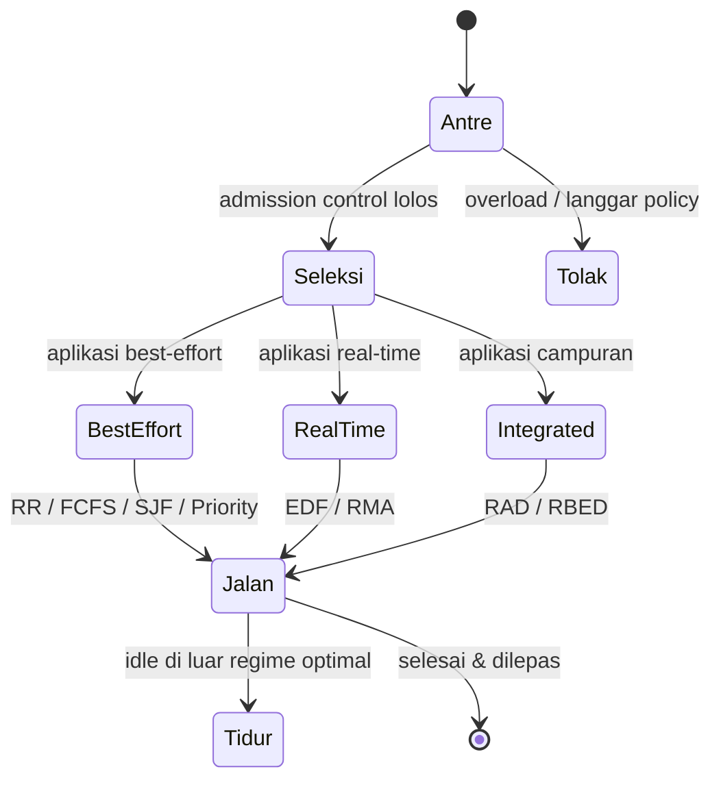

# Cloud Infrastructure | Sesi 09: Cloud Resource Management and Scheduling

> **Mata Kuliah:** COSC6100001 - Cloud Infrastructure | **Sesi:** 09 | **Status:** Materi UAS

---

## 🔑 Cues
- Policy versus mechanism
- Empat mechanism resource management
- Best-effort, real-time, integrated
- Elasticity dan over-provisioning
- Penghematan energi 31 persen

---

## 📖 Materi Utama

### 1. Aturan main dan mesin pelaksananya
- **Policy** menetapkan prinsip panduan; **mechanism** yang mengimplementasikannya.
- Lima kelas policy: admission control (cegah overload/pelanggaran), capacity allocation (bagi resource per instance), load balancing, energy optimization, QoS guarantees.
- Empat mechanism dasar (tujuan: minimisasi cost via minimisasi energi): **control theory** (feedback untuk prediksi lokal dan stabilitas), **machine learning** (tanpa model performa sistem), **utility-based** (butuh model performa penghubung performa user dan cost), **market-oriented/economic** (tanpa model sistem, contoh combinatorial auctions).

### 2. Menjadwalkan menurut sifat aplikasi
- CPU scheduling memvirtualkan prosesor (thread = virtual processor) dan mem-multiplex link komunikasi jadi virtual channel per flow; policy scheduling menjawab kuantitas resource plus timing akses dengan target **efficient, fair, starvation-free**.
- **Batch** mengejar throughput dan turnaround minimum; **real-time** mengejar deadline dan predictability.
- Tiga keluarga algoritma: **best-effort** (round-robin, FCFS, SJF, priority), **real-time** (EDF/Earliest Deadline First, RMA/Rate Monotonic), **integrated** (RAD/Resource Allocation Dispatching, RBED/Rate-Based Earliest Deadline).

### 3. Elastisitas dibayar dengan kelebihan kapasitas
- **Elasticity:** resource dialokasikan saat dibutuhkan dan dilepas saat selesai — user membayar yang dipakai.
- Syaratnya **over-provisioning:** provider menanam infrastruktur di atas kebutuhan tipikal, sehingga utilisasi rata-rata server rendah; asumsi penopangnya adalah admission control efektif plus keyakinan semua aplikasi kecil kemungkinannya melonjak serentak.
- Strategi hemat energi: energy-aware load balancing dan scaling untuk menidurkan server di luar regime optimal, konsentrasi workload ke sedikit disk, **replication (hemat power hingga 31%)**, dan migrasi data via optimasi jangka pendek–panjang.

---

## Library Diagram & Arsitektur

*Siklus job dari pintu admission sampai server ditidurkan kembali.*

---

## 🛠️ Use Case / Implementasi Nyata
- **Skenario:** Server nilai kampus sepi sepanjang semester lalu diserbu saat input nilai akhir.
- **Masalah yang Diatasi:** Kapasitas statis berarti boros 11 bulan atau tumbang 1 bulan.
- **Keuntungan:** Elasticity menambah instance saat pekan nilai, melepasnya setelahnya; job batch transkrip pakai SJF, reminder deadline pakai EDF.

---

## 🗂️ Konsep Kunci

| Istilah | Definisi | Contoh / Catatan |
|---------|----------|-----------------|
| Policy | Prinsip panduan | Admission, capacity, LB, energi, QoS |
| Mechanism | Pelaksana policy | Control theory, ML, utility, market |
| Elasticity | Alokasi saat butuh, lepas saat selesai | Bayar sesuai pakai |
| Over-provisioning | Tanam kapasitas di atas tipikal | Utilisasi rata-rata rendah |
| EDF | Dahulukan deadline terdekat | Real-time |
| RAD / RBED | Penjadwal aplikasi campuran | Best-effort + real-time |

---

## 📊 Tabel Ringkasan

| Tipe Scheduling | Algoritma | Tujuan Utama |
|-----------------|-----------|---------------|
| Best-effort | Round-robin, FCFS, SJF, Priority | Maksimalkan throughput |
| Real-time | EDF, RMA | Penuhi deadline, predictable |
| Integrated | RAD, RBED | Kombinasi keduanya |

---

## ⚠️ Catatan Penting
> Tiga kata kunci objektif scheduling: **efficient, fair, starvation-free** — wajib hafal.

> **Replication menghemat power hingga 31%** — angka spesifik favorit soal.

> Policy = prinsip, mechanism = implementasi — langganan soal pilihan ganda dan essay singkat.

---

## 📝 Materi Tambahan (Visual Insights)
- Seluruh materi sesi ini dari slide PPT "Cloud Resource Management and Scheduling" (Sesi 09); tidak ada foto pendukung tambahan.
