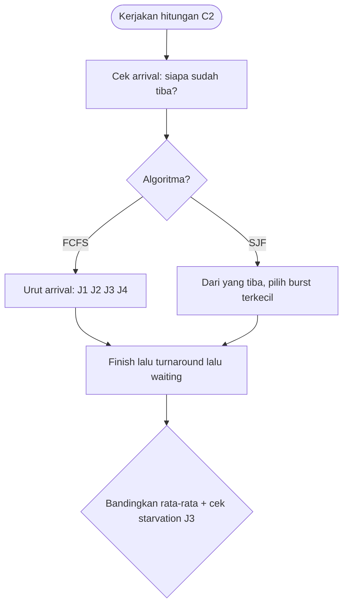

# Cloud Infrastructure | Sesi UAS: Latihan Soal

> **Mata Kuliah:** Cloud Infrastructure | **Kisi-kisi:** Cloud Security, Big Data, Scheduling Algorithm (FCFS, SJF), Cloud Application | **Bentuk Soal:** Essay & Studi Kasus | **Status:** Latihan Soal UAS

---

## 🔑 Cues
- Tiga kategori risiko keamanan
- Window of vulnerability dan homomorphic
- 3V plus persistency dan append-only
- FCFS versus SJF dan starvation
- Stateless, REST vs SOAP, pipeline vs batch

---

## 📖 Materi Utama

### 1. Paket soal A — keamanan
- **A1 (Essay, 10, ±10 mnt):** bedakan traditional threats, availability threats, dan third-party data control, masing-masing satu contoh konkret.
- > Pembahasan: tradisional = klasik pra-cloud yang sulit karena infrastruktur koneksi di luar firewall (DDoS, phishing, SQL injection, XSS). Availability = layanan tak bisa diakses (data lock-in, system failure — misal padam listrik data center berjam-jam). Third-party = data di tangan provider/subkontraktor tak transparan (subkontrak storage tanpa sepengetahuan user).
- **A2 (Essay, 10, ±10 mnt):** apa window of vulnerability dan bagaimana homomorphic menutupnya; bedakan dengan OPE.
- > Pembahasan: jendela rentan saat ciphertext wajib didekripsi untuk diproses. Homomorphic menghitung langsung di ciphertext (hasil dekripsi = operasi di plaintext) sehingga dekripsi tak pernah terjadi. OPE lain tujuan: khusus data numerik agar urutan terjaga untuk sorting/range query, bukan aritmatika kompleks.
- **A3 (Kasus fintech, 15, ±15 mnt):** startup menyimpan transaksi di public cloud dan ingin agregat bulanan tanpa dekripsi penuh. (a) risiko third-party data control, (b) pilih Homomorphic/OPE/SSE, (c) 2 tools AWS.
- > Pembahasan: (a) kontrol fisik di AWS, potensi subkontrak tak terjamin, kontrak membebankan keamanan ke startup. (b) **Homomorphic** — agregat penjumlahan langsung di ciphertext; SSE untuk search spesifik, OPE untuk sorting/range. (c) misal **KMS** (kelola encryption key) + **CloudHSM** (HSM untuk key generation) atau **CloudTrail** (audit akses) + **Inspector** (assessment vulnerability).

### 2. Paket soal B — big data
- **B1 (Essay, 10, ±8 mnt):** 4 karakteristik (3V + persistency) dengan contoh media sosial.
- > Pembahasan: volume (miliaran post/video TikTok harian), velocity (like/comment real-time), variety (caption, gambar, video, lokasi), persistency (post lama tetap bernilai untuk tren).
- **B2 (Essay, 10, ±10 mnt):** mengapa HDFS append-only; kaitkan immutability dan fault tolerance MapReduce.
- > Pembahasan: data immutable → append-only konsisten; MapReduce deterministic → gagal cukup recomputation, lebih murah dari mekanisme update/delete plus replikasi sederhana tanpa konflik.
- **B3 (Kasus e-commerce, 15, ±15 mnt):** gabungkan transaksional + analitik near-real-time ala F1/Spanner/Mesa. (a) peran tiap sistem, (b) keunggulan F1 Query, (c) peran streaming.
- > Pembahasan: (a) Spanner = transaksi pesanan konsisten global, F1 = layer relasional di atasnya, Mesa = agregat analitik skala besar. (b) satu SQL lintas Spanner+Mesa, tanpa gabung manual dan minim inkonsistensi. (c) Kafka/Spark Streaming mengalirkan transaksi ke analitik near-real-time tanpa menunggu batch.

### 3. Paket soal C — scheduling
- **C1 (Essay, 10, ±8 mnt):** beda FCFS vs SJF, plus–minus, starvation.
- > Pembahasan: FCFS = urutan tiba, sederhana dan adil urutan, tapi convoy effect bila job panjang di depan. SJF = burst terpendek dulu, waiting time optimal teori, tapi job panjang bisa starvation bila job pendek terus masuk.
- **C2 (Hitungan, 20, ±20 mnt):** 4 job non-preemptive — J1 (arr 0, burst 8), J2 (1, 4), J3 (2, 9), J4 (3, 5). (a) FCFS: urutan J1,J2,J3,J4; finish 8,12,21,26; turnaround 8,11,19,23; waiting 0,7,10,18; rata-rata waiting **8.75 ms**, turnaround **15.25 ms**. (b) SJF non-preemptive: t=0 hanya J1 → 0–8; t=8 kandidat J2(4),J3(9),J4(5) → J2 8–12; t=12 sisa J3(9),J4(5) → J4 12–17; t=17 → J3 17–26; turnaround 8,11,14,24; waiting 0,7,9,15; rata-rata waiting **7.75 ms**, turnaround **14.25 ms**. (c) SJF lebih efisien rata-ratanya, namun J3 (waiting 15 ms, terbesar) ilustrasi starvation bila job pendek terus menyalip.
- **Petunjuk:** jawab dengan kalimat sendiri; kaitkan kasus ke teori; alokasi total ±100 menit.

### 4. Paket soal D — aplikasi cloud
- **D1 (Essay, 10, ±8 mnt):** stateless server dan skalabilitas.
- > Pembahasan: server tak menyimpan state antar request; tiap request mandiri. Skalabel karena sederhana–robust, request bisa ke server mana pun (load balancing mudah), gagal tinggal resend.
- **D2 (Essay, 10, ±8 mnt):** REST vs SOAP, 2 beda, kapan REST menang.
- > Pembahasan: REST di atas HTTP untuk CRUD (GET/PUT/DELETE), ringan; SOAP XML multi-protokol (HTTP/SMTP/JMS) dengan struktur formal. REST untuk API ringan modern/mobile; SOAP untuk transaksi formal enterprise mapan (misal perbankan SOAP/WSDL).
- **D3 (Kasus EdTech, 20, ±15 mnt):** ribuan video harian ditranscode multi-resolusi + laporan mingguan. (a) klasifikasi pipeline/batch/web, (b) REST vs SOAP via neutrality/extensibility/independence, (c) workflow sequence/AND split.
- > Pembahasan: (a) transcode = **processing pipelines** (data/compute-intensive), laporan mingguan = **batch processing** (periodik terjadwal). (b) **REST** — neutrality ringan via HTTP untuk mobile, extensibility tambah endpoint mudah, independence lintas bahasa mobile tanpa XML ketat. (c) upload→transcode→notifikasi = **sequence**; transcode 360p/720p/1080p paralel = **AND split** lalu **synchronization** sebelum notifikasi.

---

## Library Diagram & Arsitektur

*Prosedur anti-jebakan C2: arrival dulu, burst kemudian.*

---

## 🛠️ Use Case / Implementasi Nyata
- **Skenario:** Kamu konsultan keamanan startup fintech soal A3 yang diminta memilih enkripsi.
- **Masalah yang Diatasi:** Direksi takut rekap bulanan membuka seluruh data nasabah.
- **Keuntungan:** Rekomendasi homomorphic untuk agregat + KMS/CloudTrail untuk kunci dan audit — jawaban kasus yang langsung bisa dikutip ke laporan.

---

## 🗂️ Konsep Kunci

| Istilah | Definisi | Contoh / Catatan |
|---------|----------|-----------------|
| Window of vulnerability | Rentan saat dekripsi untuk diproses | Kunci menuju homomorphic |
| Convoy effect | Job panjang di depan menahan semua | Kelemahan FCFS |
| Starvation | Job panjang tersalip terus | Risiko SJF |
| Stateless | Request mandiri tanpa state | Dasar skalabilitas |
| F1 Query | Satu SQL lintas transaksional–analitik | Spanner + Mesa |

---

## 📊 Tabel Ringkasan

| Job | Arrival | Burst | FCFS finish / waiting | SJF finish / waiting |
|-----|---------|-------|----------------------|---------------------|
| J1 | 0 | 8 | 8 / 0 | 8 / 0 |
| J2 | 1 | 4 | 12 / 7 | 12 / 7 |
| J3 | 2 | 9 | 21 / 10 | 26 / 15 |
| J4 | 3 | 5 | 26 / 18 | 17 / 9 |
| Rata-rata | — | — | waiting 8.75, turnaround 15.25 | waiting 7.75, turnaround 14.25 |

---

## ⚠️ Catatan Penting
> Hitungan FCFS/SJF: **cek arrival dulu** sebelum memilih burst terkecil — jebakan klasik.

> Frasa "tanpa harus mendekripsi" → jawab **Homomorphic Encryption**.

> API mobile/modern → **REST**; transaksi formal enterprise lama → **SOAP**.

> Immutability → HDFS append-only → MapReduce recomputation — rantai jawaban B2.

---

## 📝 Materi Tambahan (Visual Insights)
- Disusun dari kisi-kisi UAS (Security, Big Data, Scheduling FCFS/SJF, Cloud Application); angka hitungan C2 dipertahankan verbatim dari pembahasan asal.
