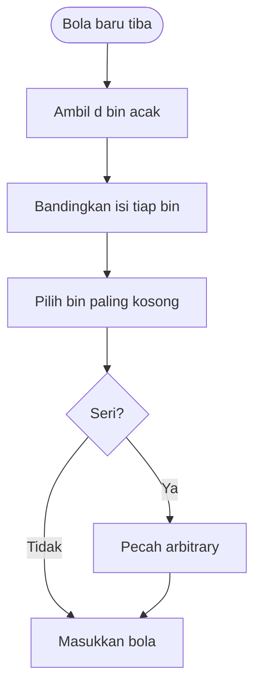

# Cloud Infrastructure | Sesi 10: Cloud Computing

> **Mata Kuliah:** COSC6100001 - Cloud Infrastructure | **Sesi:** 10 | **Status:** Materi UAS

---

## 🔑 Cues
- Model Multi-BSP dan 4d parameter
- Jam logis dan timestamp pesan
- Causal delivery dan pelanggarannya
- Balls-and-bins dan power of two choices
- Algoritma GREEDY dan O(log log n)

---

## 📖 Materi Utama

### 1. Memodelkan mesin multicore berlapis
- **Multi-BSP** adalah model hierarkis berbentuk tree kedalaman d: cache dan memory menjadi node internal, prosesor duduk di daun; substratnya mencakup multiple level cache plus ukuran memory.
- Model depth-d menuntut **4d parameter**; level i (1≤i≤d) membawa **(pi, gi, Li, mi)**: jumlah subkomponen, bandwidth komunikasi, cost sinkronisasi, ukuran memory/cache — menangkap cost komunikasi tak terhindarkan dari **latency (Li)** dan **bandwidth (gi)**.
- Peran tiap simbol: **pi** = komponen level (i−1) di dalam level i (level 1 berisi p1 raw processor; satu langkah komputasi di memory level 1 = satu unit waktu); **gi** = rasio operasi prosesor terhadap word yang ditransmisikan ke parent level (i+1) per unit waktu (g0 = 1 karena memory level 1 secepat prosesor); **Li** = cost barrier synchronization superstep level i antar subkomponen satu komponen (tanpa sinkronisasi lintas cabang); **mi** = word memory level i di luar komponen (i−1) mana pun.
- Algoritma Multi-BSP parameter-free disebut optimal terhadap A bila: optimal dalam parallel dan total computation steps (masing-masing sampai faktor konstanta multiplikatif dan additive lower order terms), optimal dalam parallel communication cost, dan optimal dalam synchronization cost di antara algoritma Multi-BSP.

### 2. Menyepakati waktu tanpa jam global
- Global ordering event antar proses berjauhan **tidak feasible**, apalagi physical clock tak bisa sinkron sempurna karena latency — jawabannya **logical clock**.
- Setiap proses pi memetakan event ke integer positif (LC(e) = variabel lokal event e) dan men-stamp tiap pesan **TS(m) = LC(send(m))**; pertukaran pesan digambar sebagai garis sender→receiver di modified space-time diagram dengan syarat clock condition (Eqs. 10.24 dan 10.25).
- **Receiving** (pesan tiba) dan **delivery** (pesan diserahkan ke proses) adalah operasi berbeda karena network nyata bisa me-reorder; **delivery rule** memutuskan kapan pesan yang sudah tiba boleh diserahkan tanpa asumsi urutan channel.
- **Causal delivery** memperluas FIFO untuk pesan dari banyak sumber: butuh minimal **3 proses** (pi, pj, pk dengan pesan m dan m′) agar pelanggaran meaningful — contohnya m1 dikirim ke p2 setelah m3, padahal m3 lahir dari rantai m1→m2→m3, sehingga penerimaan m1 sesudah m3 melanggar kausalitas.

### 3. Menyeimbangkan beban dengan pilihan ganda
- Rumusan umum: sebar N objek ke P tempat; versi bola: tempatkan m bola ke n<m bin independen uniform random; versi hashing: tempatkan m item berurutan dan ukur waktu pencarian terlama.
- Di sistem terdistribusi: bagi set tugas T ke prosesor-prosesor P ber-rate sama, satu tugas per prosesor per waktu, tanpa preemption, jalan sampai selesai; obat kompleksitasnya **randomization** — beban hampir rata bila tugas cukup banyak dan sebaran durasinya narrow.
- **Balls-and-bins:** load bin = jumlah bolanya; perbaikan didapat bila tiap bola menimbang **2 bin** random lalu memilih yang lebih kosong — inilah **power of two choices** (perbaikan eksponensial), dan melebar ke d pilihan makin baik.
- **GREEDY** merumuskan problem (m, n, d): n bin kosong, m bola berurutan, tiap bola mengambil d pilihan independen uniform random with replacement dan menempati yang paling kosong (tie arbitrary). Strateginya **symmetric** (semua entitas algoritma sama), **asynchronous** (tak menunggu round global, cukup pesan untuk dirinya), versus round **synchronous** yang butuh barrier antar round.
- Buah untuk hashing: 2 hash function yang menaruh item di chain terpendek menekan waktu pencarian maksimum ke **O(log log n)** dengan probabilitas tinggi.

---

## Library Diagram & Arsitektur

*Satu iterasi GREEDY: timbang beberapa bin, isi yang paling ringan.*

---

## 🛠️ Use Case / Implementasi Nyata
- **Skenario:** Panitia festival membagi 5.000 pendaftar ke 20 loket registrasi.
- **Masalah yang Diatasi:** Penunjukan acak satu loket rawan menumpuk di loket sial.
- **Keuntungan:** Tiap pendaftar ditawari 2 loket acak lalu diarahkan ke yang antreannya pendek — cerminan power of two choices.

---

## 🗂️ Konsep Kunci

| Istilah | Definisi | Contoh / Catatan |
|---------|----------|-----------------|
| Multi-BSP depth-d | Tree hierarkis multicore | 4d parameter (pi, gi, Li, mi) |
| Logical clock | Pengganti jam global | TS(m) = LC(send(m)) |
| Causal delivery | FIFO diperluas multi-sumber | Butuh 3 proses untuk violation |
| Power of two choices | Timbang 2 bin, isi yang kosong | Perbaikan eksponensial |
| GREEDY (m,n,d) | d pilihan random with replacement | Tie diputus arbitrary |
| O(log log n) | Waktu cari maksimum hashing 2 fungsi | Probabilitas tinggi |

---

## 📊 Tabel Ringkasan

| Konsep | Parameter/Hasil Kunci |
|--------|------------------------|
| Multi-BSP depth-d | 4d parameter: (pi, gi, Li, mi) |
| Power of 2 choices | Improvement eksponensial pada load balance |
| Hashing w/ 2 hash function | Max search time O(log log n) |
| Load balancing distributed system | No preemption, task run to completion |

---

## ⚠️ Catatan Penting
> **Power of two choices**: 2 pilihan acak mengalahkan 1 pilihan secara eksponensial — inti soal load balancing.

> **Causal violation butuh 3 proses** — dengan 2 proses, FIFO sudah cukup.

> **4d parameter** untuk depth-d — favorit soal numerik cepat.

---

## 📝 Materi Tambahan (Visual Insights)
- Seluruh materi sesi ini dari slide PPT "Cloud Computing" (Sesi 10); tidak ada foto pendukung tambahan.
