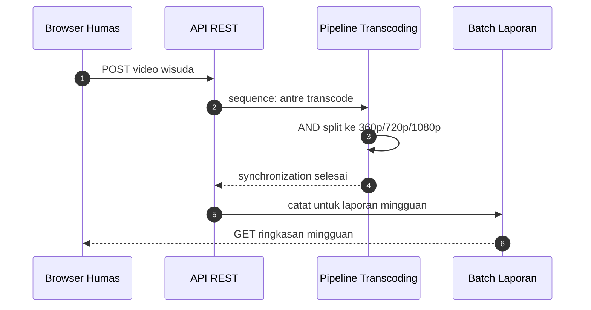

# Cloud Infrastructure | Sesi 11: Cloud Application

> **Mata Kuliah:** COSC6100001 - Cloud Infrastructure | **Sesi:** 11 | **Status:** Materi UAS

---

## 🔑 Cues
- Server stateless dan skalabilitas
- ORB, CORBA, SOAP, REST
- Neutrality, extensibility, independence
- Pola workflow dasar
- Pipeline, batch, web dan HPC di cloud

---

## 📖 Materi Utama

### 1. Gaya arsitektur: sederhana agar skala
- Pengembangan aplikasi cloud terhambat ketidakseimbangan inherent computing–I/O–communication bandwidth, plus tantangan optimasi server vs cost/timing, efek samping infrastruktur bersama, reliability, aplikasi multi-stage, storage data-intensive, metadata, dan logging.
- Basisnya paradigma **client-server** dengan komunikasi **request-response** ke **stateless server**: client tak peduli state server — dapat response berarti server up, gagal berarti kirim ulang nanti. Sifat ini membuatnya simple, robust, dan scalable.
- Tiga pertimbangan memilih gaya: **neutrality** (protokol jalan di transport berbeda — TCP, UDP), **extensibility** (mudah ditambah fungsi seperti security), **independence** (mendukung gaya pemrograman berbeda).

### 2. Bahasa perantara antar komponen
- **ORB:** middleware penerjemah — sisi pengirim mengubah struktur data internal jadi byte sequence, sisi penerima memetakkannya kembali — sehingga komponen beda vendor tersambung seamless.
- **CORBA:** arsitektur ORB berbasis **IDL**; petanya menjangkau C, C++, Java, Smalltalk, Ruby, Lisp, Python; objek lewat by reference, data lewat by value.
- **SOAP:** pesan berformat **XML** di atas TCP (kini juga UDP) atau ditumpangkan ke HTTP, SMTP, JMS; model prosesnya melibatkan sender, receiver, intermediary, originator, ultimate receiver, dan message path; menjadi lapisan dasar Web Services (yang dideskripsikan **WSDL** — catatan slide asal menggandakan isi SOAP di bagian ini).
- **REST:** independen platform dan bahasa, mendukung caching, memakai **HTTP** untuk **CRUD** (GET untuk read, PUT untuk write, DELETE untuk delete); alternatif lebih sederhana dari RPC, CORBA, maupun SOAP/WSDL untuk sistem hypermedia terdistribusi.

### 3. Pola kerja dan lanskap aplikasi
- **Workflow pattern** mengatur relasi temporal antar task; bahasa deskripsi dan mekanisme enactment wajib mendukungnya. Kategorinya: basic, advanced branching & synchronization, structural, state-based, cancelation, multiple instances. Pola dasarnya: sequence, AND split, synchronization, XOR split, XOR merge, OR split, multiple merge, discriminator, N out of M join, deferred choice.
- Beda watak: transaksi database itu kontraktual — menjaga consistent state, short-lived, aksi fixed; workflow cloud itu **best-effort** — agen berusaha mencapai goal state tanpa garansi, state sulit didefinisikan (open system), task bisa long-lasting, dan deskripsi proses bisa berubah di tengah jalan.
- Aplikasi eksisting: **processing pipelines** data-intensive/terkadang compute-intensive (indexing, data mining, image processing, video transcoding, document processing); **batch processing** enterprise (laporan retail harian–tahunan, agregasi transaksi finansial/asuransi/healthcare, inventory korporasi, billing–payroll, nightly build); **web applications** (situs konferensi periodik, promo limited-time, situs yang tidur malam dan auto-scale siang).
- Peluang baru: parallel batch via abstraksi seperti **MapReduce**, aplikasi mobile interaktif multi-sensor dan mashup multi-sumber, serta sains–rekayasa (termasuk MATLAB dan Mathematica di cloud) plus pendidikan.
- **eScience** menyatukan eksperimen–teori–simulasi dengan problem generik: kumpul data eksperimen, kelola volume raksasa, bangun–eksekusi model, integrasi data–literatur, dokumentasi, sharing, preservasi — contoh folding@home. Online data discovery berjalan lima fase: kenali masalah informasi, susun query multi-engine, evaluasi hasil, evaluasi dokumen, bandingkan lintas sumber.
- Bukti HPC: kode **CAM** (weather & climate), **GAMESS** (ab initio quantum chemistry), **GTC** (fusion), **IMPACT-T** (akselerator) diadu antara **Carver** (400-node IBM iDataPlex, quad-core Nehalem 2.67 GHz, 24 GB RAM), **Franklin** (9660-node Cray XT4, Opteron 2.3 GHz, 8 GB), **Lawrencium** (198-node Dell Poweredge, dual quad-core Xeon 2.66 GHz, 16 GB), dan **EC2 m1.large** (4 EC2 Compute Unit dari 2 virtual core × 2 CU, 7.5 GB). Hasilnya: aplikasi communication-intensive terpukul — latency cloud **>70x lebih besar** dari Carver dan bandwidth **>70x lebih kecil**.

---

## Library Diagram & Arsitektur

*Alur kampus: request stateless memicu pipeline paralel lalu dicatat batch.*

---

## 🛠️ Use Case / Implementasi Nyata
- **Skenario:** Biro humas kampus mengunggah rekaman wisuda setiap Sabtu.
- **Masalah yang Diatasi:** Video mentah terlalu berat untuk mahasiswa di kos dengan sinyal pas-pasan.
- **Keuntungan:** Pipeline mentranscode ke tiga resolusi paralel (AND split + synchronization) dan batch mingguan melaporkan jumlah video terproses ke pimpinan.

---

## 🗂️ Konsep Kunci

| Istilah | Definisi | Contoh / Catatan |
|---------|----------|-----------------|
| Stateless server | Tak menyimpan state antar request | Resend bila gagal, mudah scale |
| ORB | Penerjemah struktur data ke byte | Penghubung multivendor |
| CORBA | ORB berbasis IDL | Banyak bahasa, by reference |
| SOAP | Pesan XML multi-protokol | Lapisan Web Services |
| REST | CRUD via HTTP + caching | GET/PUT/DELETE, paling ringan |
| eScience | Eksperimen + teori + simulasi | folding@home |

---

## 📊 Tabel Ringkasan

| Protokol/Middleware | Basis | Catatan |
|---------------------|-------|---------|
| ORB | Byte sequence transform | Antar vendor berbeda |
| CORBA | IDL | C, C++, Java, Python, dll |
| SOAP | XML | Bisa di atas HTTP/SMTP/JMS |
| REST | HTTP (GET/PUT/DELETE) | Paling simple & populer |

| Sistem HPC | Spesifikasi Singkat |
|------------|---------------------|
| Carver | 400-node, Intel Nehalem 2.67GHz |
| Franklin | 9660-node, AMD Opteron 2.3GHz |
| Lawrencium | 198-node, Intel Xeon 2.66GHz |
| Amazon EC2 (m1.large) | 4 EC2 CU, 7.5GB memory |

---

## ⚠️ Catatan Penting
> **REST vs SOAP vs CORBA**: REST paling sederhana karena CRUD langsung di atas HTTP — favorit soal perbandingan.

> Latency EC2 **>70x** Carver, bandwidth **>70x lebih kecil** — angka HPC yang sering keluar.

> Workflow cloud itu **best-effort**, bukan transaksional ketat — bedakan wataknya saat menjawab.

---

## 📝 Materi Tambahan (Visual Insights)
- Seluruh materi sesi ini dari slide PPT "Cloud application" (Sesi 11); tidak ada foto pendukung tambahan.
