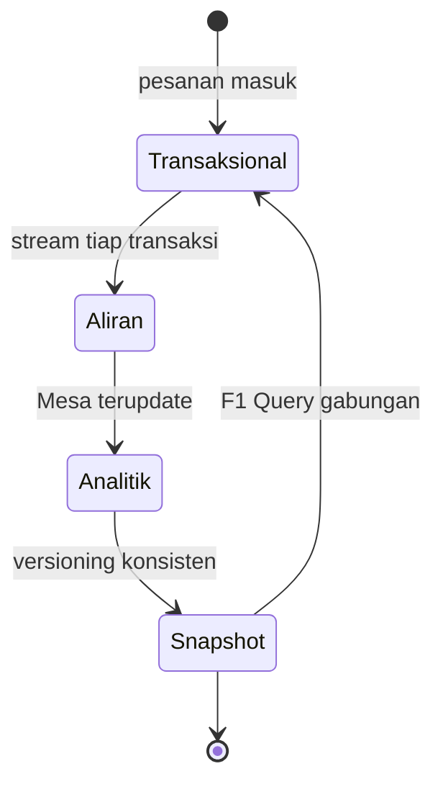

# Cloud Infrastructure | Sesi 12: Big Data, Data Streaming and Mobile Cloud

> **Mata Kuliah:** COSC6100001 - Cloud Infrastructure | **Sesi:** 12 | **Status:** Materi UAS

---

## 🔑 Cues
- 3V plus persistency
- Immutability dan HDFS append-only
- Mesa, Spanner, F1 Google
- Streaming versus batch
- Spark RDD dan mobile cloud

---

## 📖 Materi Utama

### 1. Watak Big Data
- Empat ciri: **volume** (ukuran raksasa), **velocity** (query dan analisis harus sangat cepat), **variety** (sumber dan format beragam), **persistency** (nilai tahan lama, bukan ephemeral). Isinya campuran user-generated dan machine-generated, kualitasnya hit or miss — ada yang structured, ada yang raw.
- Sifat operasionalnya: job seperti MapReduce **deterministic** sehingga fault tolerance cukup lewat **recomputation**; operasi sama di segmen beda membuat replikasi program lebih murah dari replikasi data; ada **working set** yang dieksploitasi Spark dan Tachyon dengan menyimpan di memori; **locality** dijaga via delay dan data-aware scheduling; data **immutable** sehingga HDFS hanya mengizinkan **append**.
- Tantangannya: infrastruktur scalable responsif, menampung diversity manajemen data, end-to-end processing plus knowledge extraction, dan interface ramah untuk layman pengumpul–analisis data.

### 2. Gudang data Google: tiga serangkai
- **Data warehouse** adalah repositori sentral enterprise untuk business intelligence — menampung upload sistem operasional demi predictive analysis dan hidden pattern, dimodelkan dengan Statistical Learning Theory.
- **Mesa** (data warehouse iklan Google): near-real-time, sangat available via **geo-replication**, skalabel; menangani **petabyte**, **miliaran query** atas **triliunan baris per hari**, update **jutaan baris per detik**. Tiap site menjalankan satu instance dua subsistem (update/maintenance dan query); controller mengawasi 4 worker (update, compaction, schema change, checksum); data di **Colossus**, metadata di **BigTable**; sisi query dibantu Global Location Service.
- **Spanner** (distributed database global): replika lintas site (3–5 data center searea atau lebih luas), di atas directory-bucketed key-value mapping; menjamin consistent backup, atomic schema update, consistent MapReduce, externally consistent read/write, dan globally consistent read pada satu timestamp. Terorganisasi per **zones** ala AWS; mendukung read-write, read-only, dan snapshot reads; latency mengikuti jarak user–data dan antar-replika.
- **F1-scaling**: database gaya tradisional — skema RDBMS logis plus hierarki tabel eksplisit dan kolom **Protocol Buffer**; child table disimpan clustered dan interleaved di baris parent dengan binary encoding open-source Google.
- Integrasi ala Google Ads: **F1 Query** menggabungkan nama customer (Spanner) dengan performa klik (Mesa) dalam satu SQL; transaksi F1/Spanner di-stream kontinyu ke Mesa; versioning Mesa memberi consistent snapshot selaras logika bisnis F1.

### 3. Mengalir versus menumpuk
- **Data streaming**: transfer steady rate tinggi dengan latency rendah terkontrol; keputusan real-time; contoh HDTV; layanan cloud-nya seperti AWS menampung Netflix dan Google Cloud menampung YouTube; platformnya Apache Kafka, Flume, Spark Streaming, Storm.
- Bedanya dengan batch: streaming mengunyah **record/microbatch** (bukan dataset raksasa), jendela **rolling time window** (bukan seluruh data), latency **milidetik** (bukan menit/jam), output **agregat sederhana** (bukan analitik kompleks); global state sulit di-reasoning (node memproses waktu beda) sementara batch well-defined untuk checkpoint–restart.
- **Spark Streaming** (model D-Streams: functional API, strong consistency, fault recovery efisien; prototype dengan upstream backup + downstream node) mengatasi latency lewat abstraksi **RDD (Resilient Distributed Dataset)** untuk rebuild tanpa replikasi. Operatornya: stateless transform (map, reduce, groupBy, join — independen per interval) versus stateful (share antar interval) versus output (misal simpan RDD ke HDFS); operasi stateful baru: windowing, incremental aggregation over window, time-skewed joins stream-vs-RDD.
- Cache router **CCN**: **LRU** (simpan yang baru dipakai), **LFU** (simpan yang sering diminta via history), **sLRFU** (weight per request yang decay eksponensial).

### 4. Cloud di saku: mobile
- **MCC (Mobile Cloud Computing)**: menghantar aplikasi mobile lewat teknologi cloud; perangkat menangkap gambar–video kaya konten (bukan scalar seperti suhu); kekuatan kerumunan (power in numbers) memperkuat sensing untuk security dan rapid service discovery.
- Bidang pakainya: healthcare (patient record, medical image sharing), learning (anatomy, computer science, engineering, arts), e-commerce, mobile gaming (potensi earning besar), location services, search.
- Masa depannya: sensor makin maju (kamera high-res, barometer, light sensor), AR dan gaming makin penting, peta traffic real-time kolektif, monitoring polusi dan smart city. PR-nya: offloading kode/komputasi (static partitioning + dynamic profiling menuju otomatis), layanan task-oriented (MDaaS/MCaaS/MMMaaS/location-based menuju human-centric), validasi elasticity–scheduling dengan traffic dan VM migration model valid, serta harga layanan (auction/bidding menuju optimasi empiris).

---

## Library Diagram & Arsitektur

*Putaran sinkronisasi: transaksi mengalir ke analitik, lalu dibaca kembali sebagai snapshot konsisten.*

---

## 🛠️ Use Case / Implementasi Nyata
- **Skenario:** Koperasi kampus ingin dashboard penjualan kantin yang update tiap ada transaksi kasir.
- **Masalah yang Diatasi:** Rekap batch malam hari selalu basi saat dipakai rapat pagi.
- **Keuntungan:** Tiap struk di-stream (Kafka) ke sisi analitik; dashboard membaca snapshot konsisten; data dingin tetap append-only di storage Big Data.

---

## 🗂️ Konsep Kunci

| Istilah | Definisi | Contoh / Catatan |
|---------|----------|-----------------|
| 3V + Persistency | Volume, Velocity, Variety, Persistency | Ciri dasar Big Data |
| HDFS append-only | Cerminan data immutable | Recompute ganti update |
| Mesa | Warehouse analitik Google | Petabyte, geo-replication |
| Spanner | DB terdistribusi global | Consistent lintas timestamp |
| F1 | RDBMS-style di atas KV | Kolom Protocol Buffer |
| RDD | Dataset terdistribusi resilient | Rebuild tanpa replikasi |
| MCC | Aplikasi mobile via cloud | Sensor + AR + gaming |

---

## 📊 Tabel Ringkasan

| Aspek | Streaming | Batch Processing |
|-------|-----------|-------------------|
| Unit data | Individual record/microbatch | Dataset besar |
| Latency | Milliseconds | Menit - jam |
| Analytics | Sederhana (aggregate, rolling) | Kompleks |
| Global state | Sulit di-reasoning | Well-defined |

| Sistem Google | Fungsi |
|----------------|--------|
| Mesa | Data warehouse analitik |
| Spanner | Distributed database global |
| F1 | RDBMS scaling tradisional |

---

## ⚠️ Catatan Penting
> **3V + Persistency**: Volume, Velocity, Variety, Persistency — paket definisi dasar.

> Spark Streaming rebuild lewat **RDD**, bukan replikasi generik — jangan tertukar dengan D-Streams.

> Angka replikasi hemat daya 31% milik Sesi 09 (resource management), bukan sesi ini — tulis di jawaban yang tepat.

---

## 📝 Materi Tambahan (Visual Insights)
- Seluruh materi sesi ini dari slide PPT "Big Data, Data Streaming and Mobile Cloud" (Sesi 12); tidak ada foto pendukung tambahan.
