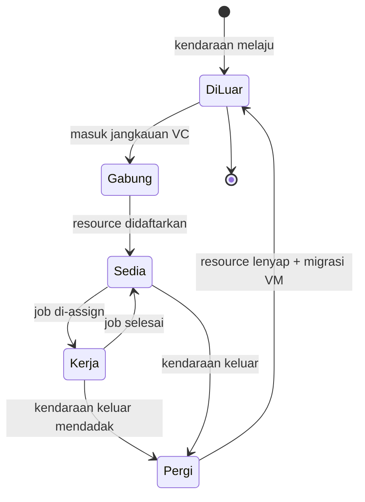

# Cloud Infrastructure | Sesi 13: Emerging Clouds

> **Mata Kuliah:** COSC6100001 - Cloud Infrastructure | **Sesi:** 13 | **Status:** Materi UAS

---

## 🔑 Cues
- Kontradiksi desain cloud
- Heterogenitas GPU dan TPU
- Layanan ML AWS
- Kriteria DiVincenzo dan E = hν
- Vehicular cloud dinamis

---

## 📖 Materi Utama

### 1. Ramalan jangka pendek: kontradiksi yang harus didamaikan
- Fisik terus diperbarui (solid-state, arsitektur prosesor), orkestrasi software lahir tiap bulan, stack makin dalam — aplikasi baru nyaris pasti bermunculan bila cloud ingin bertahan; **variability** dan **conflicting requirements** menuntut cara berpikir desain baru.
- Lima kontradiksi desain: sharing sebagai prinsip dasar vs isolasi performa–keamanan ketat; siklus murah via utilisasi maksimum vs cadangan untuk spike; tampil flawless–reliable vs hardware murah yang failure rate-nya tinggi; garansi performa vs mix workload dinamis di resource sama — semuanya wajib diseimbangkan.
- Jawaban provider: **heterogenitas** — ragam prosesor dan co-processor seperti **GPU dan TPU**, plus **solid-state disk** untuk aplikasi real-time — sehingga pemrosesan data raksasa terjangkau banyak institusi.

### 2. Machine learning di atas cloud
- **ML** memakai algoritma yang belajar mengerjakan task spesifik tanpa diprogram eksplisit.
- Empat layanan AWS: **SageMaker** (fully managed build–train–deploy), **SageMaker Ground Truth** (kualitas label via annotation consolidation dan audit workflow), **Kendra** (enterprise search ber-ML), **Forecast** (menemukan pengaruh time series dan variabel seperti fitur produk atau lokasi store secara otomatis).

### 3. Komputasi kuantum lewat cloud
- Sejarah singkat: **1900 Max Planck** (Friedrich-Wilhelms-Universität Berlin) mempostulatkan energi elektromagnetik teremisikan sebagai kuantum **E = h × ν**; **1905 Einstein** menjelaskan photoelectric effect yang mengukuhkannya (Nobel Fisika 1921); **1924 Louis de Broglie** mengembangkan teori electron wave; wave-particle duality melahirkan **quantum mechanics** tentang transformasi–evolusi quantum system.
- Akses quantum computer masih terbatas meski 3 dekade kemajuan information processing; simulasi fisika kuantum (misal many-body) kini dikerjakan classical computer powerful seperti di Amazon cloud.
- Cara kerja: simpan informasi sebagai initial state sistem fisik berhukum klasik, kendalikan transformasinya hingga hasil keluar tercepat dengan energi terkecil; versi digitalnya mentransformasikan state solid-state device operasi Boolean mengikuti program di memori.
- **Quantum parallelism**: dari ruang Hilbert berdimensi **2^n**, sistem quantum penghitung f(x) (x∈I, N=pq) menghasilkan superposition seluruh codomain f(x)∀x∈I — sekali jalan mencakup semua nilai domain, ideal untuk komputasi sekelas **FFT**, berbanding classical yang satu waktu satu nilai f(a).
- **Kriteria DiVincenzo** (5 + 2 transfer): (1) sistem scalable ber-qubit well-characterized, (2) inisialisasi ke |000...0⟩, (3) decoherence jauh lebih panjang dari gate time, (4) set universal quantum gate, (5) measurement qubit-specific, (6) interkonversi qubit stationary (memory) dan flying (komunikasi), (7) transmisi flying qubit antar lokasi secara faithful.
- Akses cloud: **Quantum Open Source Foundation** (github.com/qosf/awesome-quantum-software); **IBM Q Experience** (2016, tersofistikasi — 2 prosesor 5-qubit dan 1 prosesor 16-qubit publik, 20-qubit via IBM Q Network); **Microsoft Quantum Development Kit** (pengganti LIQUi|⟩ — bahasa **Q#** di Visual Studio, simulator lokal/Azure, library dan sample).

### 4. Cloud berjalan: kendaraan sebagai server
- **Vehicular Cloud (VC)**: sekumpulan kendaraan berbagi resource komputasi via paradigma cloud, bekerja sama dengan roadside unit untuk scheduling on-demand yang adaptif terhadap QoS — karenanya resource management krusial.
- Lima kerja pengelola: estimasi jumlah kendaraan, VM migration di VC, estimasi residency time, identifikasi VC feasible, assign job ke kendaraan. Dinamikanya unik: kendaraan masuk → resource lahir; keluar (sering mendadak) → resource lenyap.
- Tantangan riset: architectural, operational and policy, serta VC server consolidation.

---

## Library Diagram & Arsitektur

*Siklus resource VC: lahir saat gabung, lenyap saat pergi — migrasi VM menambal kepergian mendadak.*

---

## 🛠️ Use Case / Implementasi Nyata
- **Skenario:** Parkiran kampus 500 mobil menganggur 8 jam saat kuliah.
- **Masalah yang Diatasi:** Lab komputasi antre saat deadline tugas besar.
- **Keuntungan:** VC kampus meminjam CPU mobil terparkir untuk job batch ringan; saat pemilik pulang, VM dimigrasikan mulus ke kendaraan yang masih diam.

---

## 🗂️ Konsep Kunci

| Istilah | Definisi | Contoh / Catatan |
|---------|----------|-----------------|
| GPU/TPU | Co-processor heterogenitas cloud | Workload akselerasi |
| Qubit | Unit quantum, bisa superposition | Lawan bit klasik |
| Quantum parallelism | Satu jalan mencakup seluruh domain | Kuat untuk FFT |
| DiVincenzo Criteria | 5+2 syarat quantum computer useful | Scalability, decoherence, gate, measurement |
| Vehicular Cloud | Cloud dari resource kendaraan | Join/leave tak terduga |
| SageMaker | ML managed AWS | Build, train, deploy |

---

## 📊 Tabel Ringkasan

| Layanan AWS ML | Fungsi |
|------------------|--------|
| SageMaker | Build/train/deploy model ML |
| SageMaker Ground Truth | Annotation & label quality |
| Kendra | Enterprise search berbasis ML |
| Forecast | Time series prediction |

| Platform Quantum Cloud | Penyedia |
|--------------------------|----------|
| IBM Q Experience | IBM (2016, 5-qubit & 16-qubit, 20-qubit via IBM Q Network) |
| Quantum Development Kit (Q#) | Microsoft (Azure cloud) |

---

## ⚠️ Catatan Penting
> **5 kriteria DiVincenzo** (+2 transfer) — hafalkan yang utama untuk essay syarat quantum computer.

> **E = h × ν** (Planck) — rumus sejarah yang rajin muncul.

> VC unik karena resource **datang–pergi mendadak** — pembeda dari cloud konvensional yang stabil.

> GPU/TPU = jawaban **heterogenitas prosesor** tren cloud masa depan.

---

## 📝 Materi Tambahan (Visual Insights)
- Seluruh materi sesi ini dari slide PPT "Emerging Clouds" (Sesi 13); tidak ada foto pendukung tambahan.
