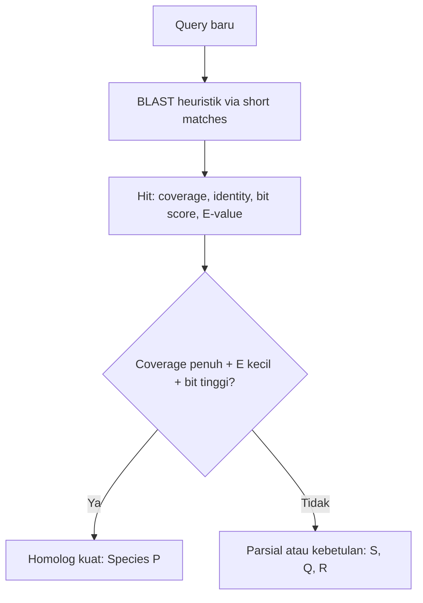
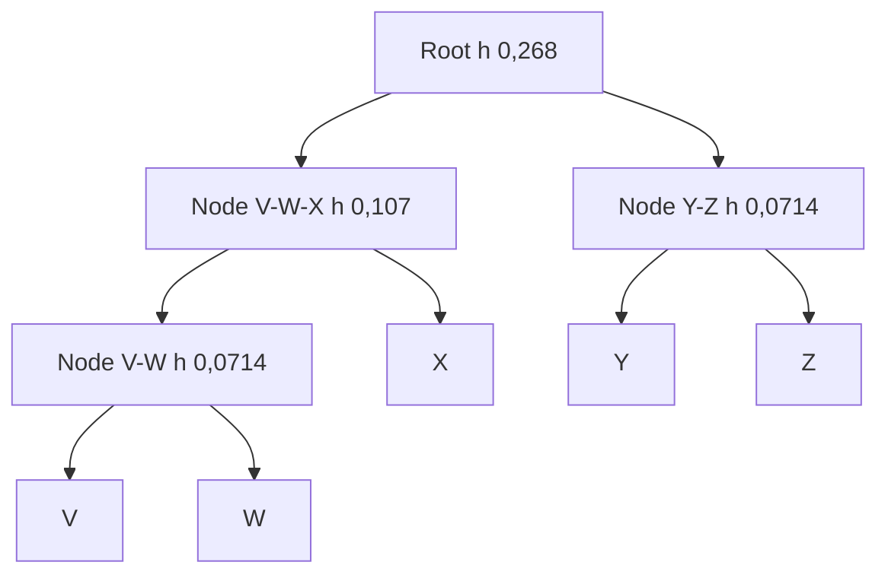

# Computational Biology | Sesi 0: Pembahasan Latihan Bioinformatika

> **Mata Kuliah:** Computational Biology | **Sesi:** 0 | **Status:** Latihan Soal (Pembahasan Lengkap)

---

## 🔑 Cues

- Membaca empat kolom BLAST
- Global lawan local alignment
- Matriks skor CGTGA dan CGAA
- Traceback dan tie-breaking
- Kolom conserved pada MSA
- Makna gap indel
- Rasio KA/KS 0,12 per 0,04

---

## 📖 Materi Utama

### 1. Menilai Hit BLAST dari Empat Angka

BLAST (Basic Local Alignment Search Tool) mencari kemiripan lokal query terhadap database lalu menilai signifikansi tiap hit. Ia menjadi skrining awal: mengidentifikasi asal spesies tanpa eksperimen penuh, menebak fungsi dari sekuens mirip yang sudah diketahui, dan memberi estimasi filogeni awal secara cepat lewat heuristik.

Tabel acuan:

| Organism | Query Coverage | Identity | E-value | Bit Score |
|----------|-----------------|----------|---------|-----------|
| Species P | 100% | 99% | 3 × 10⁻⁵⁵ | 260 |
| Species Q | 75% | 92% | 1 × 10⁻¹⁵ | 140 |
| Species R | 98% | 70% | 0.05 | 85 |
| Species S | 50% | 100% | 2 × 10⁻⁸ | 120 |

Jawaban hubungan terdekat: Species P. Ia menang di coverage penuh 100%, E-value terkecil 3×10⁻⁵⁵, dan bit score tertinggi 260, hanya kalah tipis identity (99% vs 100% milik S). S menipu: identity sempurna tetapi coverage hanya 50% — cocok sempurna di separuh query, kemungkinan sekadar satu domain pendek, diperkuat E-value 2×10⁻⁸ dan bit score 120 yang jauh di bawah P. R gugur karena E-value 0,05 berada di ambang meragukan meski coverage 98% — identity 70% plus skor 85 mengarah ke kebetulan statistik. Q baik merata tetapi tidak unggul di parameter mana pun.

E-value kecil berarti signifikan karena ia menaksir berapa hit sebaik itu yang muncul kebetulan saja pada database sebesar itu. E-value turun eksponensial seiring bit score naik, dan membesar mengikuti ukuran database serta panjang query. Nilai mendekati nol (misal 10⁻⁵⁵) nyaris mustahil kebetulan — sinyal homologi dari leluhur bersama; nilai dekat 1 patut dicurigai.



### 2. Dua Matriks dari Pasangan yang Sama

Data: Sequence 1 (baris) `CGTGA` panjang 5, Sequence 2 (kolom) `CGAA` panjang 4. Skor: match +2, mismatch −1, gap −2. Rekurens: maksimum dari diagonal (tambah s = +2 jika sama, −1 jika beda), atas minus 2, kiri minus 2; local menambah opsi 0 sehingga sel tak pernah negatif.

Global (Needleman-Wunsch): tepi diisi kelipatan gap (−2, −4, dst). Matriks penuh (baris "" C G A A vs kolom "" C G T G A) menghasilkan sel akhir 3. Contoh sel M[2][2] G-vs-G: diagonal 2+2=4, atas 0−2=−2, kiri 0−2=−2, menang 4. Traceback dari (5,4)=3 ke (0,0): (5,4)→(4,3) diagonal A-A match; (4,3)→(3,2) diagonal G-A mismatch (tie dengan jalur atas, prioritas diagonal-atas-kiri); (3,2)→(2,2) atas T-gap; (2,2)→(1,1) diagonal G-G match; (1,1)→(0,0) diagonal C-C match. Hasil:

```
Seq1:  C G T G A
Seq2:  C G - A A
```

Skor (+2)+(+2)+(−2)+(−1)+(+2) = 3. Skor optimal global = 3.

Local (Smith-Waterman): tepi nol semua. Negatif ditulis 0 sebagai titik mulai baru. Dua puncak tie skor 4: M[2][2] dan M[5][3]. Opsi 1 dari M[2][2]: (2,2)→(1,1) G-G match, (1,1)→(0,0) C-C match, STOP di 0 — alignment `CG/CG` skor 4. Opsi 2 dari M[5][3]: (5,3)→(4,2) A-A match, (4,2)→(3,1) G-G match, STOP di 0 — alignment `GA/GA` skor 4. Skor optimal local = 4, keduanya sah.

### 3. Membaca Alignment Empat Mamalia

Rekonstruksi 7 kolom (gap Dog dan Wolf di kolom 3, Fox dan Cat punya C tambahan di sana):

| Organisme | 1 | 2 | 3 | 4 | 5 | 6 | 7 |
|-----------|:---:|:---:|:---:|:---:|:---:|:---:|:---:|
| Dog | C | G | - | T | A | C | G |
| Wolf | C | G | - | T | A | C | A |
| Fox | C | G | C | T | A | C | G |
| Cat | C | A | C | T | G | C | G |

Sekuens tanpa gap: Dog CGTACG, Wolf CGTACA, Fox CGCTACG, Cat CACTGCG. Kolom conserved sempurna (tanpa gap, tanpa variasi): kolom 1 (semua C), kolom 4 (semua T), kolom 6 (semua C); kolom 2 gugur (Cat A), kolom 3 gugur (ada gap), kolom 5 gugur (Cat G), kolom 7 gugur (Wolf A). Gap kolom 3 adalah peristiwa indel: delesi C pada lineage Dog-Wolf, atau insersi C pada lineage Fox-Cat — bukti mutasi struktural divergensi, bukan substitusi biasa.

MSA wajib sebelum pohon karena pohon mengasumsikan sekuens homolog dan tiap kolom berevolusi independen; tanpa kolom yang sepadan, jarak evolusi salah. MSA menempatkan gap tepat, menandai blok conserved, dan kualitasnya menentukan reliabilitas topologi.

| Aspek | Pairwise | MSA |
|-------|----------|-----|
| Jumlah | Tepat 2 sekuens | 3 atau lebih |
| Tujuan | Similarity dua sekuens | Blok conserved dan hubungan banyak taksa |
| Output | Skor, identity, satu jalur | Matriks multi-baris, dasar pohon |
| Algoritma | Needleman-Wunsch, Smith-Waterman | ClustalW, MUSCLE, T-Coffee, MAFFT |

### 4. Teori Evolusi dan Hitungan Seleksi

Darwinian: mutasi mentah acak independen kebutuhan, seleksi alam kekuatan utama memfiksasi yang unggul via kompetisi. Netral (Kimura): mayoritas mutasi molekuler netral, drift fluktuasi acak adalah motor fiksasi utama; seleksi tetap menyingkirkan yang sangat merugikan. Keduanya kompatibel: Darwin kuat di fenotipe, netral menjelaskan akumulasi substitusi molekuler.

KA/KS: KA = 0,12, KS = 0,04, rasio 0,12/0,04 = 3,0 > 1 berarti positive (Darwinian) selection. Nonsynonymous terfiksasi 3 kali laju synonymous — anomali di bawah ekspektasi netral (yang seharusnya menekan perubahan asam amino), sehingga menandakan keuntungan adaptif yang disapu seleksi (selective sweep), bukan drift semata.

| Rasio KA/KS | Jenis seleksi |
|---|---|
| Kurang dari 1 | Purifying (negatif) |
| Sama dengan 1 | Netral |
| Lebih dari 1 (di sini 3,0) | Positif (Darwinian) |

### 5. Membangun Pohon UPGMA Lima Sekuens

Data 7 nukleotida: V `G G A T C T A`, W `G G A T C T G`, X `G G A T A T G`, Y `C G A T A C C`, Z `C G A T G C C`. Jarak = mismatch/7: V-W 1/7=0,143; V-X 2/7=0,286; V-Y 4/7=0,571; V-Z 4/7=0,571; W-X 1/7=0,143; W-Y 4/7=0,571; W-Z 4/7=0,571; X-Y 3/7=0,429; X-Z 4/7=0,571; Y-Z 1/7=0,143. Tiga tie minimum 0,143 (V-W, W-X, Y-Z); W dipakai sekali jadi V-W digabung dulu.

Iterasi 1: cluster (V,W), height 0,143/2=0,0714. Jarak baru rata-rata: ke X (0,286+0,143)/2=0,214; ke Y 0,571; ke Z 0,571. Iterasi 2: gabung (Y,Z), height 0,0714; ke (V,W) 0,571; ke X (0,429+0,571)/2=0,500. Iterasi 3: gabung (V,W,X), height 0,214/2=0,107; ke (Y,Z) (0,571+0,500)/2=0,5357. Root: gabung (V,W,X)+(Y,Z), height 0,5357/2=0,268.



Interpretasi: pasangan terdekat V-W (setara Y-Z, sama-sama 0,143); dataset terbagi dua klaster utama {V,W,X} vs {Y,Z} yang menyatu terakhir di 0,268 — keduanya paling jauh satu sama lain, tanpa outlier tunggal. Panjang cabang = divergensi substitusi; dengan asumsi molecular clock UPGMA juga proksi waktu relatif.

---

## 🛠️ Use Case / Implementasi Nyata

- **Skenario:** Sekuens baru di-BLAST, di-align, lalu dipetakan ke pohon lima taksa.
- **Masalah yang Diatasi:** Satu angka kemiripan tidak cukup menentukan homologi.
- **Keuntungan:** Rantai BLAST, alignment, MSA, KA/KS, dan UPGMA memberi verdict bertingkat.

---

## 🗂️ Konsep Kunci

| Istilah | Definisi | Contoh / Catatan |
|---------|----------|-----------------|
| E-value | Hit kebetulan yang diperkirakan | Kecil berarti signifikan |
| Bit score | Kualitas alignment | Makin tinggi makin baik |
| Traceback | Telusur balik jalur skor | Global ke 0,0; local ke 0 |
| Conserved | Kolom identik semua taksa | Kolom 1, 4, 6 |
| KA/KS | Nonsynonymous per synonymous | 3,0 berarti positif |
| UPGMA | Clustering jarak rata-rata | Height = jarak/2 |

---

## 📊 Tabel Ringkasan

| Pertanyaan | Kunci jawaban |
|------------|---------------|
| BLAST terdekat | Species P (coverage 100%, E 3×10⁻⁵⁵, bit 260) |
| Global CGTGA-CGAA | Skor 3, `CGTGA` vs `CG-AA` |
| Local CGTGA-CGAA | Skor 4, `CG/CG` atau `GA/GA` |
| MSA conserved | Kolom 1, 4, 6 |
| KA/KS 0,12/0,04 | 3,0, seleksi positif |
| UPGMA root | Height 0,268, dua klaster utama |

---

## ⚠️ Catatan Penting

> **Global boleh negatif, local tidak** — Traceback global ke (0,0); local berhenti di sel 0 pertama.

> **Dua rumus hitungan UAS** — E-value kecil berarti signifikan; KA/KS di atas 1 positif, tepat 1 netral, di bawah 1 purifying.

---

## 📝 Materi Tambahan (Visual Insights)

- Tie skor adalah hal biasa: dua jalur sama baik berarti dua jawaban sama sah.
- Gap pada MSA adalah fosil mutasi struktural, bukan spasi kosong.
- Pohon UPGMA dibaca dari daun ke akar: gabung dulu berarti paling mirip.
