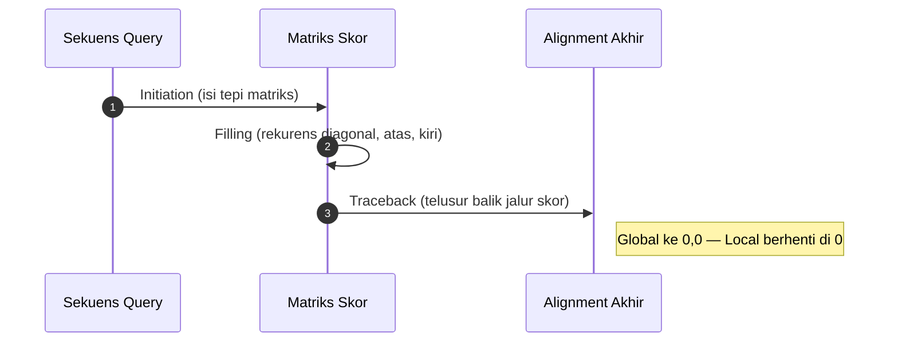

# Computational Biology | Sesi 6: Sequence Alignment

> **Mata Kuliah:** Computational Biology | **Sesi:** 6 | **Status:** Materi UAS

---

## 🔑 Cues

- Tujuan alignment sekuens
- Similarity versus identity
- Global dan local alignment
- Match, mismatch, gap
- Tiga tahap dynamic programming
- Needleman-Wunsch dan Smith-Waterman
- BLAST, E-value, bit score

---

## 📖 Materi Utama

### 1. Mengapa Dua Sekuens Disejajarkan

Ketika dua sekuens DNA dibandingkan, blok yang cocok menandakan konservasi genetik dan petunjuk fungsi. Alignment mencari blok cocok dan menandai mutasi yang menarik, lalu dipakai untuk menemukan region penting DNA, RNA, atau asam amino, memprediksi fungsi biologis, dan menilai evolusi genetik — termasuk hubungan kekerabatan spesies, gen unik, dan gen bersama untuk kesehatan, farmasi, dan rekayasa genetika.

### 2. Dua Ukuran Kemiripan yang Sering Tertukar

Similarity adalah penilaian statistik kecocokan query terhadap database yang mengindikasikan homologi, umum dipakai pada asam amino karena mempertimbangkan substitusi yang mirip sifat kimianya. Identity adalah hitungan karakter yang cocok persis, gap tidak dihitung, dan persentasenya relatif terhadap sekuens yang lebih pendek. Coverage BLAST sebaliknya relatif terhadap panjang query.

| Istilah | Definisi | Catatan |
|---------|----------|---------|
| Similarity | Skor statistik kemiripan, indikasi homologi | Level asam amino |
| Identity | Exact match persis | Gap dikecualikan, relatif ke sekuens pendek |

### 3. Sejajarkan Semua atau Sejajarkan Sebagian

Global alignment memaksa kedua ujung ikut sejajar penuh, cocok untuk sekuens yang panjang dan homologinya merata — algoritma acuannya Needleman-Wunsch. Local alignment hanya mengambil segmen terbaik di dalam sekuens panjang dan mengabaikan sisanya — acuannya Smith-Waterman. Secara visual: global menyambung seluruh panjang lengkap dengan gap, local hanya menyorot blok skor tertinggi.

### 4. Kosakata Kolom dan Empat Tantangan

Tiap kolom hasil sandingan manual hanya tiga kemungkinan: gap (`-`) untuk indel insersi-delesi, matched untuk nukleotida sama persis, mismatched untuk substitusi. Latihan menggeser satu sekuens untuk mencari susunan terbaik menunjukkan metode manual runtuh pada sekuens panjang. Empat isu yang harus diputuskan: align penuh atau sebagian, cara scoring yang adil untuk panjang dan substitusi berbeda, algoritma yang dipakai, dan signifikansi biologis hasil.

### 5. Mesin Skor Tiga Langkah

Dynamic programming menggantikan cara manual lewat matriks skor: initiation mengisi baris dan kolom pertama (kelipatan penalti gap untuk global, nol semua untuk local), filling mengisi tiap sel dari nilai maksimum diagonal, atas, dan kiri, traceback menelusuri balik dari sel akhir (global, ke 0,0) atau dari skor tertinggi ke sel nol pertama (local) untuk merekonstruksi alignment optimal. Pembeda ujian: sel local tidak boleh negatif — hasil negatif ditulis 0 — sedangkan global mengizinkan negatif.

### 6. BLAST sebagai Smith-Waterman yang Dipercepat

BLAST mencari kemiripan lokal query terhadap database dan menghitung signifikansi statistik tiap hit. Lima kegunaannya: identifikasi spesies dan homolog, lokasi domain protein, estimasi awal filogeni (kurang reliabel), pemetaan DNA, dan transfer anotasi antar spesies berkerabat. BLAST memakai heuristik lewat short matches sehingga jauh lebih cepat namun bisa melewatkan hit terbaik; Smith-Waterman eksak dan akurat tetapi lambat dan rakus memori — dipercepat memakai FPGA dan SIMD.

---

## 🛠️ Use Case / Implementasi Nyata

- **Skenario:** Sampel DNA organisme laut dalam yang belum dikenal di-BLAST ke database nukleotida.
- **Masalah yang Diatasi:** Identitas spesies dan kekerabatan tanpa sekuensing genom penuh dari nol.
- **Keuntungan:** Skor kuantitatif (E-value, bit score, identity, coverage) memberi dasar keputusan cepat.

---

## 🗂️ Konsep Kunci

| Istilah | Definisi | Contoh / Catatan |
|---------|----------|-----------------|
| Global alignment | Sejajar ujung-ke-ujung | Needleman-Wunsch |
| Local alignment | Segmen terbaik saja | Smith-Waterman |
| Gap | Penanda indel | Simbol `-` |
| Traceback | Telusur balik jalur skor | Penentu alignment akhir |
| BLAST | Pencarian heuristik ke database | Cepat, tidak selalu optimal |
| Bit score | Kualitas alignment, makin tinggi makin baik | Independen ukuran database |
| E-value | Hit kebetulan yang diperkirakan | Makin kecil makin signifikan |

---

## 📊 Tabel Ringkasan

| Aspek | Global Alignment | Local Alignment |
|-------|-------------------|------------------|
| Cakupan | Seluruh panjang sekuens | Sub-region terbaik |
| Algoritma | Needleman-Wunsch | Smith-Waterman |
| Cocok untuk | Panjang mirip, homolog merata | Panjang beda, mirip sebagian |
| Inisialisasi tepi | Kelipatan gap penalty | Nol semua |
| Traceback berhenti | Sel (0,0) | Sel nol pertama |

---

## ⚠️ Catatan Penting

> **Aturan nol local** — Sel matriks Smith-Waterman tidak boleh negatif; hitung negatif ditulis 0. Needleman-Wunsch mengizinkan negatif.

> **Penyebut persentase** — Identity relatif ke sekuens terpendek, query coverage relatif ke panjang query.

---

## 📝 Materi Tambahan (Visual Insights)

- Global seperti menyamakan dua kalimat penuh kata per kata; local seperti mencari frasa sama di dua buku berbeda.
- Traceback adalah membaca jejak panah mundur: dari puncak skor kembali ke titik mulai.
- E-value kecil berarti kabar baik: kecocokan hampir mustahil terjadi karena kebetulan.
