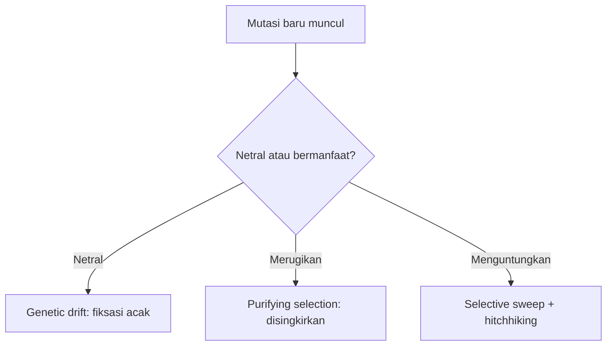

# Computational Biology | Sesi 7: Molecular Evolution

> **Mata Kuliah:** Computational Biology | **Sesi:** 7 | **Status:** Materi UAS

---

## 🔑 Cues

- Empat tahap asal-usul kehidupan
- Protocell dan RNA replikatif
- Skala eon dan era geologis
- Revolusi oksigen dan endosimbiosis
- Darwin versus teori netral
- Rasio KA/KS dan seleksi
- Pohon filogenetik dan UPGMA

---

## 📖 Materi Utama

### 1. Dari Kimia Tak Hidup ke Sel Pertama

Kehidupan mikroba ditaksir muncul 3,5 miliar tahun lalu lewat empat tahap: sintesis abiotik molekul organik kecil (asam amino, basa nitrogen — purin adenin-guanin spontan dilaporkan 2016, sitosin-urasil 2009), perangkaian menjadi makromolekul (protein, asam nukleat), pengemasan menjadi protocell yaitu droplet bermembran dengan kimia internal berbeda yang bisa bereproduksi dan bermetabolisme sederhana, lalu kemunculan molekul replikasi-diri sebagai awal pewarisan. Kandidat pertamanya RNA: menyimpan informasi sekaligus berkatalisis sebagai ribozim, dengan bentuk 3D ditentukan urutannya; RNA yang bereplikasi dalam protocell memungkinkan tumbuh, membelah, dan mewariskan salinan, sebelum DNA untai ganda yang lebih stabil mengambil alih arsip.

### 2. Membaca Waktu Geologis

Tiga eon awal — Hadean, Archaean, Proterozoic — mencakup sekitar 4 miliar tahun; eon Phanerozoic sekitar 500 juta tahun terakhir memuat hampir seluruh sejarah hewan, terbagi atas Paleozoic, Mesozoic, Cenozoic. Fosil stromatolit berlapis menjadi bukti prokariota 3,5 miliar tahun lalu yang menghuni Bumi sendirian sekitar 1,5 miliar tahun. Fotosintesis oksigenik ala cyanobacteria menjenuhkan air dengan O2 hingga terlepas ke atmosfer (oxygen revolution) — oksigen merusak ikatan dan menghambat enzim sehingga menyeleksi kehidupan. Sel eukariota yang kompleks (nukleus, mitokondria, retikulum endoplasma) dijelaskan lewat endosimbiosis: host anaerob diuntungkan simbion pengguna oksigen. Hewan muncul sekitar 700 juta tahun lalu, mungil lebih dari 100 juta tahun, lalu meledak diversitasnya pada Cambrian Explosion 535–525 juta tahun lalu.

### 3. Dua Cara Menjelaskan Perubahan

Evolusi biologis berarti descent with modification dari satu leluhur purba LUCA sekitar 3,6 miliar tahun lalu. Darwin berargumen: variasi ada, sumber daya terbatas, kompetisi terjadi, varian menguntungkan bertahan — dengan mutasi muncul acak tak tergantung kebutuhan lalu difiksasi seleksi. Kimura (1968) menjawab lewat teori netral: di level molekuler sebagian besar perubahan adalah fiksasi acak alel netral atau nyaris netral (genetic drift), bukan seleksi atas varian unggul. Lensa ukurnya rasio KA/KS: KA substitusi nonsynonymous pengubah asam amino, KS synonymous yang tidak mengubah (rata-rata historis 0,88 vs 4,7 per situs per miliar tahun). Jika semua netral, rasio antar-spesies mirip rasio dalam-spesies; penyimpangan menandakan seleksi positif — contoh protein sperma abalone 16 dan 18 kDa dengan KA/KS 1,36–5,15, serta studi McDonald-Kreitman pada gen Adh Drosophila melanogaster, simulans, yakuba. Mutasi fitness-naik yang tersapu cepat disebut selective sweep, gen tetangga yang ikut naik disebut hitchhiking.

### 4. Empat Sumber Variasi dan Lima Pengubah Frekuensi

Variasi berasal dari mutasi (point: missense, nonsense pembuat stop, silent; transition vs transversion; frameshift pengubah ORF; kromosomal: insersi, delesi, inversi, duplikasi, translokasi), rekombinasi (homolog via crossing over meiosis yang jarang; site-specific antar non-homolog dengan sedikit region identik; NAHR pendorong CNV — delesi di satu kromosom, duplikasi di lainnya), aliran gen (vertikal induk-anak satu spesies; horizontal antar spesies — menaikkan variasi dalam populasi, mengecilkan jarak antar populasi jauh), dan gen baru (dari gen lama: duplikasi, exon shuffling, fusi-fisi, HGT — nasib salinan: pseudogenization nonfungsional, neofunctionalization fungsi baru, subfunctionalization fungsi terbagi; de novo dari noncoding dengan syarat transcription-competent plus ORF, umumnya single exon). Frekuensi alel lalu digeser oleh mutasi, migrasi, seleksi alam, drift, dan kawin non-acak — akumulasinya menjadi mikroevolusi. Alel berarti versi alternatif suatu gen.

### 5. Merekonstruksi Silsilah dengan Pohon

Phylogenetics mempelajari hubungan evolusi dari leluhur bersama; versi molekuler memakai perubahan sekuens DNA atau protein untuk mengestimasi divergensi lalu menggambar phylogenetic tree berisi node dan branch (topologinya pola percabangan; tiap cabang hanya menghubungkan dua node; daun terminal adalah OTU nyata seperti spesies atau sekuens; node internal adalah HTU leluhur hipotetis). Asumsinya: sekuens homolog dan tiap kolom alignment berevolusi independen — maka kualitas MSA menentukan reliabilitas, dan untuk sekuens coding disarankan memakai protein. Lima tahapnya: pilih marker, susun MSA, pilih model evolusi, konstruksi pohon, uji reliabilitas. Protein dipilih karena 20 karakter vs 4 nukleotida mengurangi kemiripan kebetulan, matriks substitusinya lebih canggih, menghindari inflasi variasi akibat codon bias, serta gen lambat untuk kerabat jauh dan gen cepat untuk kerabat dekat. Alignment baik bergap sedikit dan pendek; gap menandakan indel evolusioner; ujung ambigu boleh dipangkas. Model nukleotida dari sederhana ke kompleks: Jukes-Cantor 1 parameter, Kimura 2-parameter, Felsenstein, HKY; model asam amino: Bishop-Friday, Dayhoff (PAM), JTT, WAG, LG. Metode distance-based: UPGMA dan Neighbor Joining; character-based: Maximum Parsimony dan Maximum Likelihood. UPGMA bekerja sequential clustering dari matriks jarak: gabungkan pasangan terdekat berulang hingga satu akar. MP memilih topologi dengan jumlah mutasi tersedikit. Reliabilitas diuji bootstrapping: resampling berulang dengan pengembalian menjadi banyak bootstrap tree lalu dibandingkan dengan pohon asli.

---

## 🛠️ Use Case / Implementasi Nyata

- **Skenario:** Peneliti menguji apakah gen pada dua spesies dekat sedang terseleksi.
- **Masalah yang Diatasi:** Membedakan sinyal seleksi nyata dari drift acak.
- **Keuntungan:** Rasio KA/KS memberi angka jenis tekanan tanpa eksperimen fenotipe.

---

## 🗂️ Konsep Kunci

| Istilah | Definisi | Contoh / Catatan |
|---------|----------|-----------------|
| LUCA | Leluhur universal terakhir | Sekitar 3,6 miliar tahun lalu |
| Ribozim | RNA berkatalisis | Hipotesis RNA world |
| Drift | Fiksasi acak alel netral | Inti teori Kimura |
| KA/KS | Laju nonsynonymous per synonymous | Ukur tekanan seleksi |
| Selective sweep | Sapuan cepat mutasi unggul | Plus hitchhiking tetangga |
| OTU / HTU | Daun nyata / leluhur hipotetis | Terminal vs internal |
| Bootstrapping | Resampling uji topologi | Nilai bootstrap persen |

---

## 📊 Tabel Ringkasan

| Rasio KA/KS | Interpretasi | Jenis seleksi |
|-------------|---------------|----------------|
| Kurang dari 1 | Nonsynonymous ditekan | Purifying (negatif) |
| Sama dengan 1 | Laju setara | Netral |
| Lebih dari 1 | Nonsynonymous dipertahankan | Positif (Darwinian) |

---

## ⚠️ Catatan Penting

> **Rasio KA/KS** — Alat hitung utama seleksi molekuler: di bawah 1 purifying, tepat 1 netral, di atas 1 positif. Detail hitungan ada di catatan latihan Pertanyaan 4B.

> **Drift bukan seleksi** — Teori netral tidak menolak seleksi alam; ia menegaskan fiksasi acak juga besar perannya di level molekuler.

---

## 📝 Materi Tambahan (Visual Insights)

- Referensi slide memakai Campbell Biology edisi 12 bab 4 dan Choudhuri (2014) Bioinformatics for Beginners bab 8, ISBN 978-0124104716.
- Diagram duplikasi gen di slide menunjukkan satu gen menjadi dua salinan dengan tiga nasib berbeda.
- Contoh matriks jarak UPGMA dan perbandingan topologi MP di slide adalah pola yang direplikasi pada soal latihan pohon.
