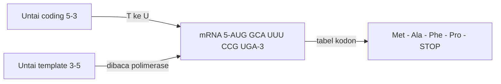

# Computational Biology | Sesi 0: Latihan Soal UTS

> **Mata Kuliah:** Computational Biology | **Sesi:** 0 | **Status:** Latihan Soal UTS

---

## 🔑 Cues

- Coding lawan template
- Aturan transkripsi T ke U
- Tabel kodon dan STOP
- Silent, missense, nonsense
- Spliceosome dan intron
- Promoter dan enhancer
- Database primer dan sekunder

---

## 📖 Materi Utama

### 1. Genomik dan Dogma Sentral (Bobot 40 persen)

Soal 1 memakai dupleks 5'-`ATG GCA TTT CCG TGA`-3' berpasangan 3'-`TAC CGT AAA GGC ACT`-5'. Untai 5'-3' adalah coding, untai 3'-5' adalah template. mRNA hasil transkripsi: 5'-`AUG GCA UUU CCG UGA`-3'. Translasi memakai tabel kodon standar: Met - Ala - Phe - Pro - STOP.

Soal 2 meminta kontras enzim: RNA polymerase menyintesis RNA tanpa primer, DNA polymerase menyintesis DNA dan membutuhkan primer. Arah baca template 3' ke 5', arah sintesis produk 5' ke 3'.

Soal 3 menguji mutasi pada dupleks yang sama: basa ke-6 A menjadi G bersifat silent (kodon GCA tetap Alanine, fungsi utuh); basa ke-7 T menjadi G bersifat missense (TTT/Phe menjadi TGT/Cys, satu asam amino berganti); basa ke-4 G menjadi A juga missense (GCA/Ala menjadi ACA/Thr, sifat kimia berubah). Nonsense paling merusak karena memunculkan STOP prematur — protein terpotong dan fungsi hilang total, berbanding terbalik dengan silent yang tak mengubah apa pun.

### 2. Struktur Gen dan Pemrosesan RNA (Bobot 30 persen)

Soal 4: spliceosome mengenali situs potong, membuang intron non-coding, dan menyambung exon coding menjadi mRNA matang. Gagal splicing membuat sampah genetik terbawa — protein misfolded. Pada Beta Thalassemia, mutasi situs splicing merusak produksi hemoglobin.

Soal 5: gen Exon 1-2-3-4 menghasilkan isoform A (1-2-4) dan B (1-3-4) karena sel memilih kombinasi exon berbeda saat menyambung mRNA matang. Keuntungannya efisiensi genom: satu gen melahirkan banyak isoform protein.

Soal 6: promoter adalah tempat menempel RNA polymerase untuk memulai transkripsi; enhancer menaikkan laju dan efisiensinya; transcription factor adalah protein pengatur yang menyalakan atau mematikan gen.

### 3. Bioinformatika dan Integrasi Multi-omics (Bobot 30 persen)

Soal 7: urutan hierarki dari kecil ke besar adalah Molecular, Cellular, Organismal, Populational, Ecosystem. Contoh molecular: DNA; cellular: sel neuron.

Soal 8: primary database menyimpan data mentah eksperimen seperti GenBank, secondary menyimpan hasil analisis atau kurasi ahli seperti UniProt. Dua format NCBI: FASTA untuk urutan basa sederhana, GenBank flat file untuk detail lokasi gen dan referensi. Langkah pencarian: buka ncbi.nlm.nih.gov, pilih database Gene, cari nama gen, ambil sekuens FASTA-nya.

Soal 9: PCR memperbanyak DNA dan sequencing membaca urutan basanya untuk disimpan ke database. Multi-omics integration berarti membaca bersama data DNA (genomics), RNA (transcriptomics), dan protein (proteomics) untuk memahami sistem biologis. Protein misfolded menggumpal dan merusak sel — contoh Alzheimer (Amyloid-beta) atau anemia sel sabit.

---

## 🛠️ Use Case / Implementasi Nyata

- **Skenario:** Peserta UTS menelusuri satu mutasi dari DNA sampai database.
- **Masalah yang Diatasi:** Soal memaksa lompat antar level organisasi kehidupan.
- **Keuntungan:** Alur coding-mRNA-protein-mutasi-database menjadi satu respons utuh.

---

## 🗂️ Konsep Kunci

| Istilah | Definisi | Contoh / Catatan |
|---------|----------|-----------------|
| Coding strand | Untai 5'-3' cermin mRNA | T menjadi U |
| Missense | Satu asam amino berganti | Phe ke Cys, Ala ke Thr |
| Nonsense | STOP prematur | Protein terpotong |
| Spliceosome | Mesin buang intron | Exon disambung |
| Promoter | Titik mulai transkripsi | Ditempeli polimerase |

---

## 📊 Tabel Ringkasan

| Bagian | Topik | Jawaban kunci |
|--------|-------|---------------|
| Bagian 1 | Coding, mRNA, protein | `AUG GCA UUU CCG UGA`, Met-Ala-Phe-Pro-STOP |
| Bagian 1 | Mutasi | Silent Ala, missense Cys dan Thr, nonsense terpotong |
| Bagian 2 | Splicing | Intron dibuang, gagal berarti misfolded dan Thalassemia |
| Bagian 2 | Regulasi | Promoter mulai, enhancer percepat, TF atur |
| Bagian 3 | Database | Primer GenBank, sekunder UniProt, FASTA vs flat file |

---

## ⚠️ Catatan Penting

> **Arah baca** — Template dibaca 3' ke 5', produk disintesis 5' ke 3'; tertukar arah berarti salah mRNA.

> **Nonsense versus silent** — Nonsense memenggal protein, silent tidak mengubah apa pun; pewawancara soal suka mengadu keduanya.

---

## 📝 Materi Tambahan (Visual Insights)

- Satu dupleks menjawab tiga soal: kenali coding dulu, sisanya mengalir.
- Alternative splicing adalah menu hemat: satu dapur gen, banyak hidangan protein.
- Database adalah ujung pipa: PCR dan sequencing mengisi, anotasi membuatnya berguna.
