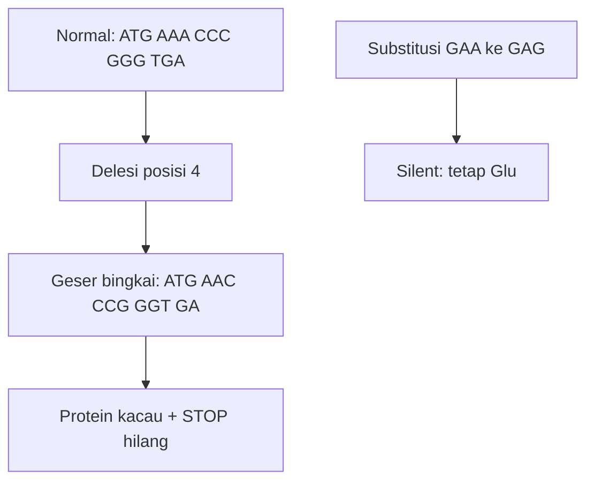

# Computational Biology | Sesi 0: Pembahasan Quiz 1

> **Mata Kuliah:** Computational Biology | **Sesi:** 0 | **Status:** Latihan Quiz 1

---

## 🔑 Cues

- Coding dan template quiz
- mRNA AUG UUU CGA GGA UAA
- Silent, missense, nonsense
- Mutasi GAA ke GAG
- Frameshift delesi posisi 4
- Alternative splicing antibodi
- Validasi BLAST ke RefSeq

---

## 📖 Materi Utama

### 1. Bedah Untai dan Kodon Dasar

Dupleks acuan: 5'-`ATG TTT CGA GGA TAA`-3' dan 3'-`TAC AAA GCT CCT ATT`-5'. Untai 5'-3' adalah coding (cermin mRNA, T menjadi U), untai 3'-5' adalah template yang dibaca RNA polimerase. mRNA: 5'-`AUG UUU CGA GGA UAA`-3'. Translasi: AUG Met, UUU Phe, CGA Arg, GGA Gly, UAA STOP — hasil Met - Phe - Arg - Gly. Satu basa salah dapat berujung silent (kode beda, asam amino sama, tanpa efek), missense (satu asam amino berganti, fungsi bisa rusak), atau nonsense (STOP terlalu awal, protein pendek tak berfungsi).

### 2. Substitusi yang Tenang dan STOP yang Hilang

Normal 5'-`ATG GAA TTT CCG TGA`-3' bermutasi di basa 6 A ke G menjadi `ATG GAG TTT CCG TGA`. Kodon GAA menjadi GAG, keduanya Glutamic Acid (Glu) — silent substitution tanpa dampak struktur-fungsi. Sebaliknya bila kodon STOP `TGA` yang bermutasi, ribosom kebablasan menambah asam amino sampai STOP berikutnya — protein abnormal terlalu panjang dan fungsinya rusak total.

### 3. Delesi Satu Basa yang Mengacak Semua

Normal `ATG AAA CCC GGG TGA` (Met - Lys - Pro - Gly - STOP) kehilangan A posisi 4 menjadi `ATG AAC CCG GGT GA...` — seluruh bingkai bergeser kiri. Protein mutan: Met - Asn - Pro - Gly tanpa STOP. Missense hanya menukar satu asam amino; frameshift dari delesi atau insersi menukar semua asam amino setelah titik mutasi plus sering menghilangkan STOP — kerusakan struktural total.

### 4. Dari Mutasi ke Penyakit lewat Splicing

Rantai patologi: mutasi DNA sebagai instruksi salah, mutasi di splice site membuat intron tertahan atau exon terbuang, mRNA salah menghasilkan asam amino salah, protein misfolded menumpuk atau gagal kerja — ujungnya penyakit seperti Alzheimer atau Thalassemia.

Alternative splicing pada Exon1-2-3-4: isoform A membuang Exon 3, isoform B membuang Exon 2 — satu gen, dua protein, variasi naik tanpa gen baru. Contoh konteks: pembentukan antibodi sistem imun yang memotong RNA berbeda untuk melawan virus dan bakteri berbeda.

Regulasi gen menjawab sinyal lingkungan seperti stres oksidatif: promoter sebagai saklar ON/OFF di awal gen, enhancer sebagai booster volume produksi, transcription factor sebagai operator penempel DNA pemicu transkripsi. Pendekatan komputasi: motif searching pada promoter atau RNA-Seq untuk melihat gen menyala saat stres.

### 5. Menghubungkan Dogma ke Database

Alur dogma ke organisme: DNA ke RNA ke Protein (instruksi, kurir, mesin), protein menjalankan metabolisme dan struktur sel, sel membangun organ — mutasi protein kontraksi jantung merambat menjadi gagal jantung. Langkah database gen penyakit metabolik: buka NCBI, pilih Gene, ketik misal "Diabetes Type 2", pilih gen misal INS atau SLC2A2; kumpulkan ID gen (accession), lokasi kromosom, FASTA DNA/protein, dan SNP diketahui; validasi dengan BLAST pasien lawan referensi RefSeq.

Kasus khusus gen bermutasi tetapi RNA tampak tetap lalu protein berubah dijelaskan sebagai modifikasi pasca-transkripsi atau RNA editing: penyalinan tetap jalan, pengubahan terjadi di level protein. Pendekatan komputasi: protein docking atau molecular dynamics simulation untuk melihat perubahan struktur.

---

## 🛠️ Use Case / Implementasi Nyata

- **Skenario:** Varian pasien tampak normal di RNA tetapi abnormal di protein.
- **Masalah yang Diatasi:** Sekuens RNA saja menyembunyikan efek akhir.
- **Keuntungan:** Simulasi docking dan dinamika molekul menyingkap kerusakan struktur.

---

## 🗂️ Konsep Kunci

| Istilah | Definisi | Contoh / Catatan |
|---------|----------|-----------------|
| Silent | Asam amino tetap | GAA ke GAG tetap Glu |
| Frameshift | Bingkai bergeser | Delesi posisi 4 |
| Splicing | Buang intron, sambung exon | Gagal berarti misfolded |
| Enhancer | Peningkat laju transkripsi | Booster promoter |
| RNA editing | Ubahan pasca-transkripsi | Protein berubah, RNA tampak tetap |

---

## 📊 Tabel Ringkasan

| Kasus | Perubahan | Hasil |
|-------|-----------|-------|
| Untai quiz | Coding 5'-3', template 3'-5' | mRNA `AUG UUU CGA GGA UAA` |
| GAA ke GAG | Substitusi silent | Tetap Glu, tanpa efek |
| STOP bermutasi | Readthrough | Protein terlalu panjang |
| Delesi posisi 4 | Frameshift | Met-Asn-Pro-Gly, STOP hilang |
| Gen ke database | Gene, INS/SLC2A2 | Validasi BLAST ke RefSeq |

---

## ⚠️ Catatan Penting

> **Frameshift lawan missense** — Missense menukar satu bata, frameshift merobohkan seluruh susunan bata sesudahnya.

> **STOP bukan akhir opsional** — Menghapus STOP memanjangkan protein; memunculkan STOP awal memenggalnya; keduanya merusak.

---

## 📝 Materi Tambahan (Visual Insights)

- Kodon ketiga sering pemaaf: perubahan di sana kerap silent (wobble).
- Antibodi adalah etalase splicing: satu arsitektur gen, banyak ujung penangkap.
- Database tanpa validasi hanya arsip: BLAST ke RefSeq mengubah arsip menjadi bukti.
