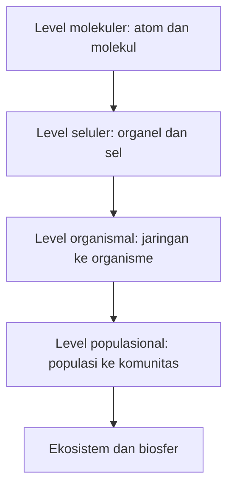

# Computational Biology | Sesi 1: Basic Principles of Biology

> **Mata Kuliah:** Computational Biology | **Sesi:** 1 | **Status:** Materi UTS (Soal 3)

---

## 🔑 Cues

- 7 ciri makhluk hidup
- Tangga organisasi biologis
- Cell theory dan pewarisan DNA
- Ikatan hidrogen pada air
- Kohesi, adhesi, kalor spesifik
- Buffer dan skala pH
- Empat makromolekul utama

---

## 📖 Materi Utama

### 1. Apa yang Membuat Sesuatu Disebut Hidup

Tujuh sifat yang dipakai untuk mengenali sistem hidup: tersusun dari sel, memiliki keteraturan kompleks, peka terhadap rangsang, tumbuh-berkembang-bereproduksi dengan mewariskan DNA, memakai energi untuk kerja, menjaga kestabilan internal (homeostasis), dan mengakumulasi adaptasi evolusioner lewat interaksi dengan lingkungan.

### 2. Membaca Tangga Kehidupan dari Kecil ke Besar

Alih-alih menghafal daftar, bayangkan zoom-out bertahap: level molekuler membentuk sel sebagai unit dasar (atom, molekul, organel, sel), sel berkelompok menjadi organisme (jaringan, organ, sistem organ, organisme), organisme berkumpul menjadi level populasi (populasi, spesies, komunitas), lalu komunitas plus habitat fisiknya (tanah, air, atmosfer) membentuk ekosistem, dan seluruh ekosistem planet membentuk biosfer.

### 3. Benang Merah yang Menyatukan Biologi

Empat gagasan pemersatu: sel sebagai fondasi tumbuh dan bereproduksi, DNA sebagai media pewarisan informasi, hubungan erat antara bentuk makromolekul dan fungsinya, serta konservasi evolusioner — kesamaan biokimia antar organisme sebagai jejak asal-usul yang sama.

### 4. Air sebagai Penyangga Kehidupan

Air istimewa karena ikatan hidrogennya yang lemah namun kolektif kuat (H parsial positif tertarik ke O parsial negatif). Dari situ muncul kohesi (air-air, tegangan permukaan), adhesi (air-permukaan lain, aksi kapiler), dan kalor spesifik tinggi yang menstabilkan suhu. Skala pH membaca konsentrasi H+, dan sistem buffer seperti asam karbonat darah menahannya tetap stabil dengan menyerap atau melepas H+.

### 5. Empat Keluarga Molekul Besar

Karbohidrat untuk energi cepat (glukosa, pati) dan konstruksi (selulosa, kitin); asam nukleat DNA dan RNA untuk arsip informasi; protein sebagai polimer asam amino dengan empat jenjang struktur (primer, sekunder, tersier, kuartener); lipid yang hidrofobik — trigliserida sebagai cadangan dan fosfolipid sebagai bahan membran.

---

## 🛠️ Use Case / Implementasi Nyata

- **Skenario:** Tim komputasi memodelkan mengapa mutasi satu asam amino merusak fungsi enzim.
- **Masalah yang Diatasi:** Menghubungkan perubahan level molekuler ke dampak level organisme.
- **Keuntungan:** Kerangka hierarki membuat jelas bahwa gangguan ikatan kecil dapat merambat menjadi fenotipe penyakit.

---

## 🗂️ Konsep Kunci

| Istilah | Definisi | Contoh / Catatan |
|---------|----------|-----------------|
| Homeostasis | Regulasi kondisi internal agar stabil | Suhu tubuh, pH darah |
| Kohesi | Tarikan antar molekul air | Tegangan permukaan |
| Adhesi | Tarikan air ke permukaan lain | Kenaikan kapiler |
| Buffer | Sistem penstabil pH | Asam karbonat darah |
| Makromolekul | Polimer biologis besar | Karbohidrat, protein, lipid, asam nukleat |

---

## 📊 Tabel Ringkasan

| Keluarga | Peran utama | Contoh |
|----------|-------------|--------|
| Karbohidrat | Energi dan struktur | Glukosa, pati, selulosa, kitin |
| Asam nukleat | Penyimpanan informasi | DNA, RNA |
| Protein | Kerja dan struktur sel | Enzim, 4 jenjang struktur |
| Lipid | Cadangan dan membran | Trigliserida, fosfolipid |
| Air | Pelarut dan penstabil suhu | Kohesi, adhesi, buffer pH |

---

## ⚠️ Catatan Penting

> **Hierarki organisasi** — Pahami alur dari level molekuler (atom, molekul) sampai ekosistem. Soal UTS meminta penalaran bagaimana interaksi molekuler berdampak ke level yang lebih besar.

---

## 📝 Materi Tambahan (Visual Insights)

- Struktur menentukan fungsi: lipatan protein yang berubah sedikit saja dapat menghilangkan aktivitas enzim.
- Air bukan latar pasif: sifat termal dan kapilernya menciptakan lingkungan tempat reaksi biokimia bisa berjalan stabil.
- DNA sebagai benang pewarisan: reproduksi berarti menyalin arsip molekuler ini ke generasi berikut.
