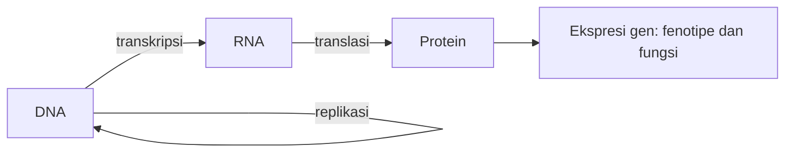

# Computational Biology | Sesi 2: Advances in Computational Biology

> **Mata Kuliah:** Computational Biology | **Sesi:** 2 | **Status:** Materi UTS (Soal 1 & 3)

---

## 🔑 Cues

- Definisi bioinformatika
- Segitiga biologi, komputer, informasi
- Tonggak 1953 sampai 2003
- Aliran informasi DNA ke protein
- PCR, sequencing, RFLP
- Genomics dan proteomics
- Metabolomics dan systems biology

---

## 📖 Materi Utama

### 1. Bioinformatika sebagai Jembatan Tiga Bidang

Bioinformatika memakai perangkat matematika, statistika, dan komputasi untuk menjawab persoalan biologi berbasis data DNA dan asam amino. Ia lahir di pertemuan tiga dunia: biologi sebagai sumber pertanyaan, ilmu komputer sebagai mesin metode, dan teknologi informasi sebagai infrastruktur data.

### 2. Enam Tonggak yang Perlu Dihafal

Jejak sejarahnya: 1953 struktur double helix DNA (Watson dan Crick), 1977 metode sequencing Sanger, 1983 penemuan PCR oleh Kary Mullis, 1988 berdirinya NCBI, 1990 rilis BLAST, dan 2003 selesainya Human Genome Project.

### 3. Peta Aliran Informasi Genetik

Dogma sentral diringkas sebagai DNA menjadi RNA menjadi protein. Replikasi menyalin DNA ke DNA, transkripsi menyalin DNA ke RNA, translasi membaca RNA menjadi protein, dan keseluruhan alirannya disebut ekspresi gen.

### 4. Perkakas Membaca Molekul

DNA sequencing menentukan urutan basa; PCR melipatgandakan fragmen DNA kecil memakai primer dan enzim Taq polymerase; RFLP memakai Southern blotting untuk menyingkap perbedaan DNA antar individu; yeast two-hybrid dipakai menelusuri interaksi antar protein.

### 5. Dari Satu Omics ke Systems Biology

Genomics membaca susunan genetik organisme, proteomics membaca struktur dan fungsi seluruh set protein, metabolomics membaca metabolit pada level sistemik. Systems biology mengintegrasikan ketiganya untuk memahami perilaku dinamis sistem hidup. Dalam bioteknologi dasar, sequencing menjadi pintu masuk data genom, genomics-proteomics menjadi analisis skala besar untuk riset medis, dan integrasi data ke database seperti NCBI menjadi fondasi diagnosis penyakit.

---

## 🛠️ Use Case / Implementasi Nyata

- **Skenario:** Laboratorium klinik mengurutkan sampel pasien lalu membandingkannya ke database publik.
- **Masalah yang Diatasi:** Data mentah sequencing belum bermakna tanpa konteks pembanding.
- **Keuntungan:** Integrasi genomics, proteomics, dan database mempercepat arah diagnosis.

---

## 🗂️ Konsep Kunci

| Istilah | Definisi | Contoh / Catatan |
|---------|----------|-----------------|
| Bioinformatika | Komputasi untuk masalah biologi berbasis sekuens | DNA, asam amino |
| Replikasi | Penyalinan DNA menjadi DNA | Pewarisan genom |
| Transkripsi | Penyalinan DNA menjadi RNA | Langkah awal ekspresi |
| Translasi | Penerjemahan RNA menjadi protein | Kodon ke asam amino |
| Systems biology | Integrasi multi-omics | Genomics plus proteomics plus metabolomics |

---

## 📊 Tabel Ringkasan

| Tonggak | Tahun | Peristiwa |
|---------|-------|-----------|
| Double helix | 1953 | Watson dan Crick |
| Sequencing | 1977 | Metode Sanger |
| PCR | 1983 | Kary Mullis |
| NCBI | 1988 | Pusat data bioteknologi |
| BLAST | 1990 | Pencarian kemiripan sekuens |
| Human Genome Project | 2003 | Genom manusia selesai |

---

## ⚠️ Catatan Penting

> **Dogma sentral** — Hafalkan arah DNA ke RNA ke protein beserta tiga prosesnya; ini kisi-kisi Soal 1.

> **Integrasi bioteknologi** — Sequencing, genomics, proteomics, dan database NCBI dibaca sebagai satu pipeline, bukan topik terpisah; ini kisi-kisi Soal 3.

---

## 📝 Materi Tambahan (Visual Insights)

- PCR adalah mesin fotokopi molekuler: dari sedikit DNA menjadi cukup banyak untuk dianalisis.
- BLAST adalah mesin pencari kemiripan: query baru dibandingkan ke arsip lama dalam hitungan detik.
- Multi-omics adalah sudut pandang berlapis: gen, protein, dan metabolit dibaca bersama agar gambaran sistem utuh.
