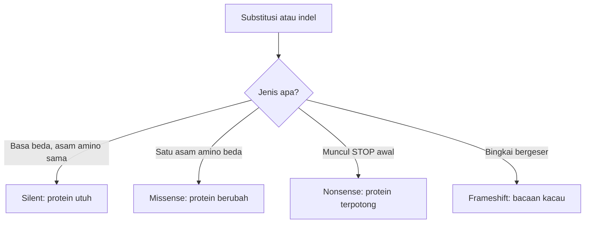

# Computational Biology | Sesi 3: Genomics

> **Mata Kuliah:** Computational Biology | **Sesi:** 3 | **Status:** Materi UTS (Soal 1 & 2)

---

## 🔑 Cues

- Pasangan basa dan arah untai
- Untai coding versus template
- Contoh translasi lima kodon
- Mutasi silent, missense, nonsense
- Frameshift dan exon-intron
- Alternative splicing
- Replikasi semikonservatif

---

## 📖 Materi Utama

### 1. Alfabet dan Arsitektur DNA

Basa purin adalah A dan G, pirimidin adalah C serta T pada DNA (U menggantikan T pada RNA). Untai ganda tersusun antiparalel 5' ke 3' berpasangan dengan 3' ke 5', nukleotida dirangkai ikatan fosfodiester, dan pasangan basa diikat hidrogen dengan aturan A=T dan G≡C.

### 2. Dua Wajah Untai Ganda Saat Ditranskripsi

Untai template berarah 3'-5' dibaca sebagai cetakan sehingga komplemen-terbalik terhadap mRNA, sedangkan untai coding berarah 5'-3' urutannya sama dengan mRNA kecuali T ditulis U. Contoh acuan dari kuis: coding 5'-`ATG TTT CGA GGA TAA`-3', template 3'-`TAC AAA GCT CCT ATT`-5', mRNA 5'-`AUG UUU CGA GGA UAA`-3', protein `Met - Phe - Arg - Gly - Stop`.

### 3. Spektrum Akibat Mutasi

Silent tidak mengganti asam amino, missense mengganti satu asam amino, nonsense memunculkan kodon STOP prematur sehingga protein terpotong, dan frameshift dari insersi atau delesi menggeser seluruh bingkai baca kodon.

### 4. Penyuntingan RNA sebelum Dibaca

Exon adalah blok pengkode yang dipertahankan, intron adalah blok non-coding yang dibuang lewat splicing dari pre-mRNA. Alternative splicing menyertakan atau melewatkan exon tertentu sehingga satu gen dengan exon 1, 2, 3, 4 dapat menghasilkan isoform 1-2-4 dan isoform 1-3-4 — keragaman protein naik tanpa menambah jumlah gen.

### 5. Menyalin Genom secara Semikonservatif

Eksperimen Meselson-Stahl membuktikan tiap molekul hasil replikasi membawa satu untai lama dan satu untai baru. Enzimnya: helicase membuka heliks, DNA polymerase III mensintesis untai baru, polymerase I menyingkirkan primer RNA, ligase menyambung fragmen Okazaki. Untai leading disintesis kontinu sedangkan lagging terputus-putus.

---

## 🛠️ Use Case / Implementasi Nyata

- **Skenario:** Kurator varian menilai apakah substitusi pasien berbahaya.
- **Masalah yang Diatasi:** Membedakan perubahan netral dari yang memotong protein.
- **Keuntungan:** Klasifikasi silent, missense, dan nonsense mempercepat keputusan klinis.

---

## 🗂️ Konsep Kunci

| Istilah | Definisi | Contoh / Catatan |
|---------|----------|-----------------|
| Template strand | Cetakan transkripsi 3'-5' | Komplemen mRNA |
| Coding strand | Untai 5'-3' yang sama dengan mRNA | T menjadi U |
| Silent | Mutasi tanpa ganti asam amino | Efek minimal |
| Nonsense | Mutasi memunculkan STOP prematur | Protein pendek |
| Splicing | Pembuangan intron, penyambungan exon | Pre-mRNA ke mRNA matang |

---

## 📊 Tabel Ringkasan

| Jenis mutasi | Perubahan | Dampak protein |
|--------------|-----------|----------------|
| Silent | Basa beda, asam amino sama | Tidak berubah |
| Missense | Satu asam amino beda | Fungsi bisa berubah |
| Nonsense | STOP prematur | Terpotong, misfolded |
| Frameshift | Bingkai baca bergeser | Kacau total |
| Splicing gagal | Intron tertahan | STOP prematur, penyakit seperti anemia |

---

## ⚠️ Catatan Penting

> **Trio mutasi favorit UTS** — Kuasai beda silent, missense, dan nonsense beserta contoh kodonnya.

> **Splicing dan penyakit** — Intron yang gagal dibuang dapat memunculkan STOP prematur dan protein misfolded.

---

## 📝 Materi Tambahan (Visual Insights)

- Coding strand adalah cermin mRNA: baca satu, langsung tahu yang lain dengan aturan T ke U.
- Satu gen banyak protein: alternative splicing seperti memilih bab berbeda dari naskah yang sama.
- Replikasi semikonservatif: tiap generasi menyimpan separuh memori generasi sebelumnya.
