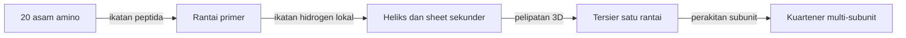

# Computational Biology | Sesi 4: Proteomics

> **Mata Kuliah:** Computational Biology | **Sesi:** 4 | **Status:** Materi UTS (Soal 3)

---

## 🔑 Cues

- Translasi kodon ke polipeptida
- Proteome dan proteomics
- Anatomi 20 asam amino
- R-group hidrofobik dan hidrofilik
- Ikatan peptida dan sudut phi-psi
- Ramachandran plot
- Empat jenjang struktur protein

---

## 📖 Materi Utama

### 1. Dari Kode menjadi Mesin Kerja

Translasi menerjemahkan kodon mRNA menjadi urutan asam amino pada polipeptida. Proteome adalah seluruh protein yang diekspresikan sel atau jaringan pada satu waktu, dan proteomics mempelajari set protein itu: sifat, fungsi, dan interaksinya.

### 2. Bata Penyusun yang Hanya 20 Macam

Setiap asam amino dibangun di sekitar karbon-alfa yang mengikat gugus amina (NH2), gugus karboksil (COOH), satu hidrogen, dan satu R-group variabel. R-group inilah penentu watak: hidrofobik yang menolak air atau hidrofilik yang menyukai air.

### 3. Cara Merangkai dan Cara Melipat

Ikatan peptida menghubungkan gugus amina dan karboksil antar asam amino sambil melepas H2O (sintesis dehidrasi). Fleksibilitas rantai diukur dari sudut torsi phi dan psi pada ikatan N-Cα dan Cα-C, dan Ramachandran plot memetakan kombinasi sudut mana yang diizinkan secara termodinamika.

### 4. Empat Lantai Struktur

Struktur primer adalah urutan asam amino yang ditentukan gen; sekunder adalah lipatan lokal seperti α-helix dan β-sheet akibat ikatan hidrogen; tersier adalah bentuk 3D final satu rantai; kuartener adalah gabungan beberapa subunit polipeptida.

### 5. Membaca Arsip Struktur

Protein Data Bank (PDB) mengarsipkan struktur 3D dari X-ray, NMR, atau Cryo-EM dengan ID empat karakter seperti 1ABC. Analisisnya mencakup identifikasi peptida, anotasi biologis, dan kuantifikasi protein. Alur patologi yang penting: mutasi DNA mengubah asam amino, lipatan 3D rusak (misfolding), fungsi hilang, penyakit muncul. Aplikasi proteomics meliputi diagnosis ginjal, neurologi, riset kanker urologis, dan profil antibodi.

---

## 🛠️ Use Case / Implementasi Nyata

- **Skenario:** Peneliti kanker membandingkan profil protein jaringan sehat dan tumor.
- **Masalah yang Diatasi:** Data genom saja tidak menjelaskan protein mana yang aktif.
- **Keuntungan:** Kuantifikasi proteomics menunjuk kandidat biomarker yang terukur.

---

## 🗂️ Konsep Kunci

| Istilah | Definisi | Contoh / Catatan |
|---------|----------|-----------------|
| Proteome | Seluruh protein yang terekspresi pada satu waktu | Konteks sel dan waktu |
| Ikatan peptida | Sambungan amina-karboksil pelepas H2O | Rantai polipeptida |
| Ramachandran plot | Peta sudut phi-psi yang diizinkan | Validasi lipatan |
| Struktur tersier | Bentuk 3D satu rantai | Penentu fungsi |
| PDB | Arsip struktur 3D protein | ID seperti 1ABC |

---

## 📊 Tabel Ringkasan

| Jenjang | Isi | Penentu |
|---------|-----|---------|
| Primer | Urutan asam amino | Gen |
| Sekunder | Heliks dan sheet lokal | Ikatan hidrogen |
| Tersier | Bentuk 3D satu rantai | Interaksi R-group |
| Kuartener | Gabungan subunit | Perakitan multi-rantai |

---

## ⚠️ Catatan Penting

> **Dogma ke penyakit** — Mutasi, perubahan asam amino, misfolding, dan hilangnya fungsi adalah satu rantai sebab-akibat yang sering ditanyakan.

---

## 📝 Materi Tambahan (Visual Insights)

- R-group adalah sidik kepribadian asam amino: suka atau benci air menentukan posisi akhirnya di lipatan.
- Ramachandran plot adalah peta larangan: tidak semua putaran rantai diizinkan fisika.
- PDB adalah perpustakaan bentuk: tiap entri menyimpan satu solusi lipatan yang terukur eksperimen.
