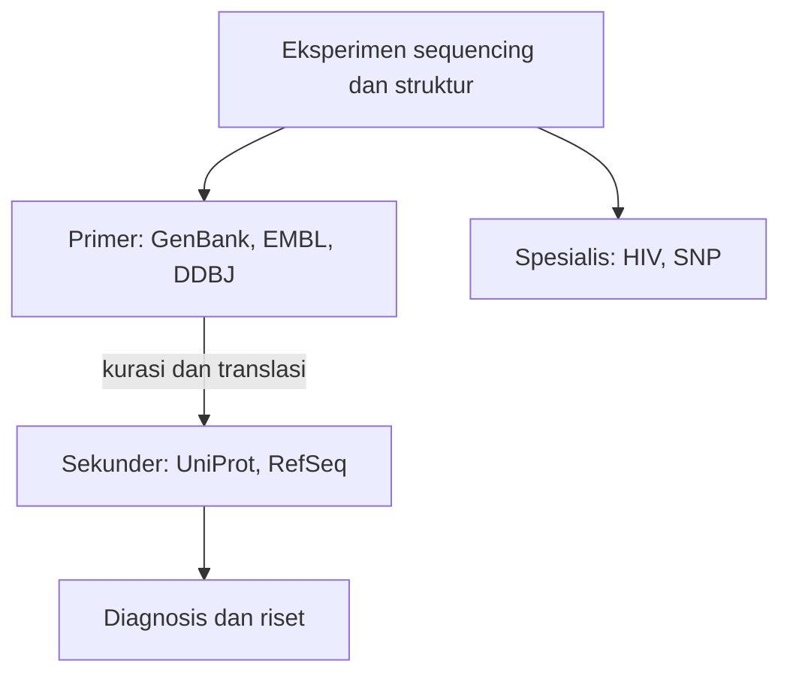

# Computational Biology | Sesi 5: Bioinformatics Database

> **Mata Kuliah:** Computational Biology | **Sesi:** 5 | **Status:** Materi UTS (Soal 3)

---

## 🔑 Cues

- Definisi database biologis
- Alasan ledakan data
- Database primer dan sekunder
- Database terspesialisasi
- NCBI, GenBank, INSDC
- Format FASTA dan flat file
- Validasi dengan BLAST

---

## 📖 Materi Utama

### 1. Mengapa Biologi Butuh Database

Database biologis adalah koleksi informasi terstruktur yang bisa dicari dan diperbarui berkala, dilengkapi perangkat akses. Ia dibutuhkan karena data biologis tumbuh eksponensial, publikasi digital butuh wadah, dan penemuan baru terbantu oleh data lama yang tersimpan rapi.

### 2. Tiga Kasta Database

Database primer menyimpan data langsung eksperimen seperti sequencing dan X-ray — contohnya GenBank milik NCBI, EMBL-EBI, dan DDBJ yang tergabung dalam INSDC. Database sekunder menyimpan turunan hasil analisis data primer seperti translasi protein — contohnya UniProt dan RefSeq. Database terspesialisasi fokus pada satu domain, misalnya HIV atau SNP.

### 3. Wajah-wajah NCBI

GenBank adalah koleksi publik sekuens DNA teranotasi, INSDC adalah kolaborasi NCBI, EMBL, dan DDBJ untuk berbagi data nukleotida dunia, dan NDB adalah portal struktur 3D asam nukleat.

### 4. Dua Format yang Wajib Dibedakan

Format FASTA adalah teks sederhana: baris header diawali `>` berisi identifier dan deskripsi, sekuens ditulis mulai baris kedua. GenBank flat file adalah format lengkap berisi judul, header, sekuens, plus feature table yang merinci lokasi exon, intron, dan CDS.

### 5. Cara Mengambil dan Memercayai Data

Alur pencarian gen di NCBI: buka NCBI, pilih database Gene, masukkan kata kunci seperti "Metabolic Disease", lalu kumpulkan sekuens DNA, mRNA, protein, struktur gen, dan lokasi mutasi. Validasi dilakukan dengan membandingkan antar database, menjalankan BLAST untuk komparasi sekuens, dan merujuk literatur ilmiah sebelum menarik kesimpulan biologis.

---

## 🛠️ Use Case / Implementasi Nyata

- **Skenario:** Mahasiswa mencari gen penyakit metabolik untuk tugas anotasi.
- **Masalah yang Diatasi:** Sekuens mentah tanpa konteks lokasi dan fungsi menyesatkan.
- **Keuntungan:** Feature table plus validasi silang memberi anotasi yang bisa dipertanggungjawabkan.

---

## 🗂️ Konsep Kunci

| Istilah | Definisi | Contoh / Catatan |
|---------|----------|-----------------|
| INSDC | Kolaborasi nukleotida dunia | NCBI, EMBL, DDBJ |
| GenBank | Arsip DNA publik teranotasi | Database primer |
| FASTA | Format teks header plus sekuens | Diawali `>` |
| Feature table | Rincian lokasi fitur gen | Exon, intron, CDS |
| Validasi | Uji silang keandalan data | BLAST dan literatur |

---

## 📊 Tabel Ringkasan

| Jenis | Isi | Contoh |
|-------|-----|--------|
| Primer | Data mentah eksperimen | GenBank, PDB, EMBL-EBI, DDBJ |
| Sekunder | Turunan hasil kurasi | UniProt, RefSeq |
| Spesialis | Satu domain fokus | HIV, SNP |
| Format sederhana | Sekuens saja | FASTA |
| Format lengkap | Sekuens plus anotasi | GenBank flat file |

---

## ⚠️ Catatan Penting

> **GenBank sebagai primer** — Contoh database primer paling krusial untuk Soal 3; jangan tertukar dengan UniProt atau RefSeq yang sekunder.

> **Validasi sebelum simpulan** — Hasil komputasi wajib diuji silang; komputasi tanpa validasi bukan bukti biologis.

---

## 📝 Materi Tambahan (Visual Insights)

- Primer versus sekunder: data mentah versus data yang sudah diberi tafsir ahli.
- FASTA adalah amplopnya, flat file adalah surat beserta lampirannya.
- BLAST sebagai pemeriksa silang: klaim kemiripan harus lolos uji statistik.
