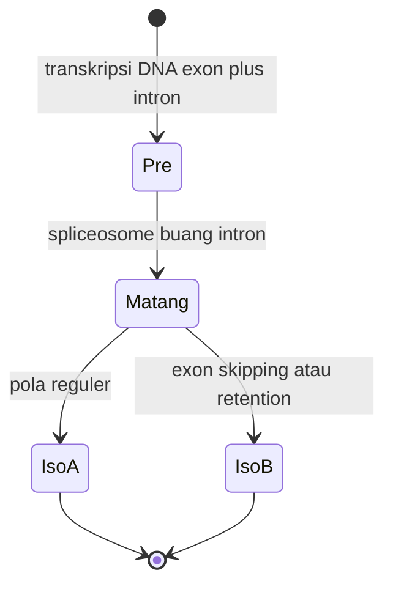

# Computational Biology | Sesi GSLC: Genomics dan Replication

> **Mata Kuliah:** Computational Biology | **Sesi:** GSLC | **Status:** Tugas GSLC

---

## 🔑 Cues

- Translasi AUG dan kodon stop
- Sense lawan antisense
- Mutasi spontan dan terinduksi
- Ekson, intron, spliceosome
- Alternative splicing HSP yeast
- Replikasi sirkular dan linier
- Telomere TTAGGG dan telomerase

---

## 📖 Materi Utama

### 1. Membaca Kode dan Dua Untai DNA

Translasi dibaca ribosom dari kodon mRNA berarah 5' ke 3', dimulai dari AUG (Met) dan diakhiri UAA, UAG, atau UGA. Untai sense (coding) 5' ke 3' identik dengan mRNA kecuali T menjadi U; untai antisense (template) 3' ke 5' komplemen terhadap mRNA dan dipakai RNA polimerase sebagai cetakan.

### 2. Katalog Mutasi dan Pemicunya

Mutasi adalah perubahan permanen nukleotida. Pemicu spontan: kesalahan replikasi, depurinasi, deaminasi. Pemicu terinduksi: radiasi UV pembentuk thymine dimer, zat kimia intercalating agent, virus. Substitusi point: silent tanpa ganti asam amino, missense mengganti satu asam amino (contoh His menjadi Asn), nonsense memunculkan STOP prematur. Frameshift dari insersi atau delesi bukan kelipatan 3 mengacak seluruh kodon sesudahnya.

### 3. Arsitektur Gen Eukariotik

Ekson adalah sekuens coding yang dipertahankan di mRNA matang; intron adalah sekuens pengintervensi non-coding yang dibuang. Spliceosome (snRNP U1, U2, dan seterusnya) memotong intron dan menyambung exon; U1 mengenali batas 5' exon-intron, U2 mengenali branch point untuk membentuk lariat — loop intron yang lalu didegradasi. Alternative splicing memotong satu pre-mRNA dengan pola berbeda (misal exon skipping atau intron retention) menjadi banyak isoform. Perubahan posisi pertama atau kedua kodon umumnya missense, posisi ketiga sering silent (wobble hypothesis).

### 4. Dua Mesin Replikasi

Prokariota sirkular: satu origin ori, replikasi dua arah cepat, memakai DNA Pol I, II, III, laju sekitar 1000 bp per detik, tanpa telomerase. Eukariota linier: ribuan origin ARS, berlangsung di nukleus fase S, memakai Pol α, δ, ε plus PCNA sliding clamp penstabil, laju sekitar 50 bp per detik. Masalah ujung (end replication problem): DNA polimerase butuh primer sehingga untai lagging tak selesai sampai ujung — kromosom memendek tiap siklus. Ujung dilindungi telomere berulang TTAGGG dan dipulihkan telomerase pada sel tertentu. Replisom prokariota memakai loop pada lagging strand agar Pol III menyintesis dua untai searah gerakan garpu.

---

## 🛠️ Use Case / Implementasi Nyata

- **Skenario:** Analisis gen HSP (Heat Shock Protein) pada Saccharomyces cerevisiae.
- **Masalah yang Diatasi:** Satu gen harus merespons beragam stres suhu dan nutrisi.
- **Keuntungan:** Alternative splicing menaikkan diversitas proteom tanpa menambah gen, memungkinkan adaptasi kompleks.

---

## 🗂️ Konsep Kunci

| Istilah | Definisi | Contoh / Catatan |
|---------|----------|-----------------|
| Lariat | Loop intron saat splicing | Dibuang dan didegradasi |
| PCNA | Klem geser eukariotik | Menstabilkan polimerase |
| Telomere | Pelindung ujung kromosom | Ulangan TTAGGG |
| Missense | Mutasi ganti asam amino | Anemia sel sabit |
| Spliceosome | Kompleks snRNP pemotong RNA | U1, U2, dan seterusnya |

---

## 📊 Tabel Ringkasan

| Fitur | Prokariota | Eukariota |
|-------|------------|-----------|
| Bentuk DNA | Sirkular | Linier |
| Origin | Tunggal (oriC) | Banyak (ARS) |
| Polimerase | Pol I, II, III | Pol α, δ, ε |
| Laju | Sekitar 1000 bp/detik | Sekitar 50 bp/detik |
| Telomerase | Tidak ada | Ada |

---

## ⚠️ Catatan Penting

> **End replication problem** — Primer yang wajib ada membuat ujung lagging kromosom linier selalu kurang salinan; tanpa telomerase, kromosom memendek.

> **Arah mRNA** — mRNA selalu 5' ke 3', sejajar untai sense (coding).

---

## 📝 Materi Tambahan (Visual Insights)

- Splice site yang bermutasi merusak splicing walau exonnya sendiri normal — penyakit genetik bisa berasal dari sana.
- Jumlah protein manusia jauh melampaui jumlah gennya berkat alternative splicing.
- Splicing dan mutasi adalah satu cerita: instruksi salah atau pemotongan salah, ujungnya protein salah.
