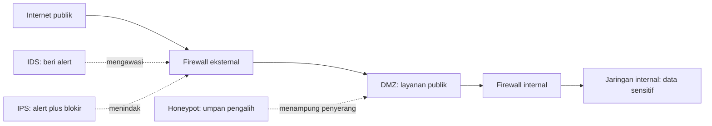

# Computer Security Principles | Sesi 8: IDS, IPS, Firewall dan Honeypot

> **Mata Kuliah:** Computer Security Principles (COMP6824001) | **Sesi:** 8 | **Status:** Materi UTS

---

## 🔑 Cues
- Firewall penyaring paket di perimeter
- Host versus network firewall
- Stateful versus stateless inspection
- VLAN dan routing statis serta dinamis
- IDS pasif versus IPS aktif
- Honeypot, DMZ, NAT, dan VPN

---

## 📖 Materi Utama

### 1. Penjaga Gerbang: Firewall dan Cara Memeriksa Paket
Firewall adalah sistem yang melindungi komputer atau jaringan dari serangan berbasis jaringan dengan menyaring paket data yang melintas. Firewall perimeter umumnya punya minimal dua sambungan: ke jaringan yang dilindungi dan ke jaringan eksternal. Empat tipe berdasar penyaringan: packet filtering, circuit-level, application-level, dan stateful multilevel. Dari sisi wujudnya, software firewall terbagi menjadi host firewall yang dipasang di host untuk melindungi dirinya sendiri (disebut juga personal firewall) dan network firewall yang dipasang di server untuk melindungi satu segmen dari segmen lain, dengan vendor populer Cisco. Dari sisi kecerdasan, stateful inspection memeriksa apakah paket bagian dari sesi yang sudah ada dengan mempertimbangkan info header plus konteks lain, sedangkan stateless inspection hanya melihat info header tanpa konteks dan memutuskan berdasar aturan statis.

### 2. Penataan Jalan: VLAN, Routing, dan Isolasi Server
VLAN mengelompokkan perangkat secara logis dengan empat basis keanggotaan: port, MAC address, subnet IP, dan protokol. Routing menghubungkan antar jaringan lewat static routing yang tabelnya dikonfigurasi manual per destination network, atau dynamic routing yang memakai protokol routing dinamis namun lebih kompleks. Kelemahan protokol dinamis antara lain overhead tinggi, boros bandwidth, convergence lama, routing loop, tidak scalable, serta persoalan split horizon, split horizon with poison reverse, dan count-to-infinity. Di lingkungan Windows, server and domain isolation memadukan IPsec dengan Microsoft Active Directory agar admin bisa mensegmentasi lingkungan menjadi jaringan logis yang terisolasi secara dinamis, walau bisnis meminta akses resource yang lebih longgar.

### 3. Mata, Tangan, dan Umpan: IDS, IPS, Honeypot, DMZ, NAT, VPN
IDS (Intrusion Detection System) mendeteksi aktivitas tak terotorisasi, serangan, dan kompromi jaringan; IPS (Intrusion Prevention System) serupa tetapi bisa mengambil tindakan mencegah breach terjadi. Tipenya network-based dan host-based, dengan metodologi deployment unfiltered dan screened. Honeypot adalah jebakan bagi hacker — istilah yang diadaptasi dari dunia spionase — dengan jenis production dan research, plus varian anti-spam berupa email address honeypot dan email open relay honeypot. DMZ (Demilitarized Zone) adalah jaringan perimeter sebagai lapisan tambahan antara internet publik dan LAN internal, umumnya berupa subnetwork di antara keduanya, dengan konfigurasi sandwich DMZ dan single firewall DMZ. NAT (Network Address Translation) memodifikasi info alamat host saat traffic lewat router atau firewall, dalam tipe static NAT dan dynamic NAT. VPN (Virtual Private Network) membangun tunnel terenkripsi lewat jaringan publik dengan standar awal berbasis IPsec; protokol terkait lain adalah SSL/TLS — SSL yang diusulkan Netscape kini diformalkan IETF menjadi TLS untuk komunikasi client-server anti eavesdropping dan tampering plus endpoint authentication — serta SSH (Secure Shell).

#### **Visualisasi Konsep: Dari Internet ke Aset Internal**

---

## 🛠️ Use Case / Implementasi Nyata
- **Skenario:** Koperasi daring ingin portal anggotanya bisa dibuka publik tanpa mempertaruhkan database simpanan.
- **Masalah yang Diatasi:** Portal yang dibobol tidak otomatis memberi jalan ke database karena ada dua lapis firewall dan zona penyangga.
- **Keuntungan:** Web server di DMZ boleh dikorbankan dan diperbaiki, sementara data inti tetap di balik lapis kedua.

---

## 🗂️ Konsep Kunci

| Istilah | Definisi | Contoh / Catatan |
|---------|----------|-----------------|
| Stateful inspection | Firewall menilai konteks sesi | Lebih canggih dari stateless |
| IDS | Deteksi dan alert tanpa penindakan | Pasif, memantau |
| IPS | Deteksi, alert, plus blokir otomatis | Aktif, inline |
| Honeypot | Sistem jebakan untuk perisetasan | Production dan research |
| DMZ | Zona penyangga publik versus internal | Sandwich atau single firewall |
| NAT | Modifikasi alamat saat lewat router | Static dan dynamic |
| VPN | Tunnel terenkripsi lewat publik | Awalnya berbasis IPsec |

---

## 📊 Tabel Ringkasan

| Aspek | IDS | IPS |
|-------|-----|-----|
| Deteksi | Ya | Ya |
| Alert ke admin | Ya | Ya |
| Blokir otomatis | Tidak | Ya |
| Watak tipikal | Pasif memantau | Aktif inline |

---

## ⚠️ Catatan Penting
> **Pembeda ujian** — IDS hanya detect dan alert sedangkan IPS bisa take action mencegah breach; DMZ selalu terkait expose layanan publik seperti web dan mail server dengan posisi di antara internet dan private network.

---

## 📝 Materi Tambahan (Visual Insights)
- Ilustrasi isolasi server dan domain menampilkan beberapa segmen jaringan logis terpisah seperti awan-awan "Contoso Network", contoh segmentasi Windows via IPsec dan Active Directory.
- Diagram implementasi firewall menggambarkan Internet, firewall berisi aturan filter, lalu corporate network, dengan tanda silang untuk traffic terblokir dan centang untuk yang diizinkan.
