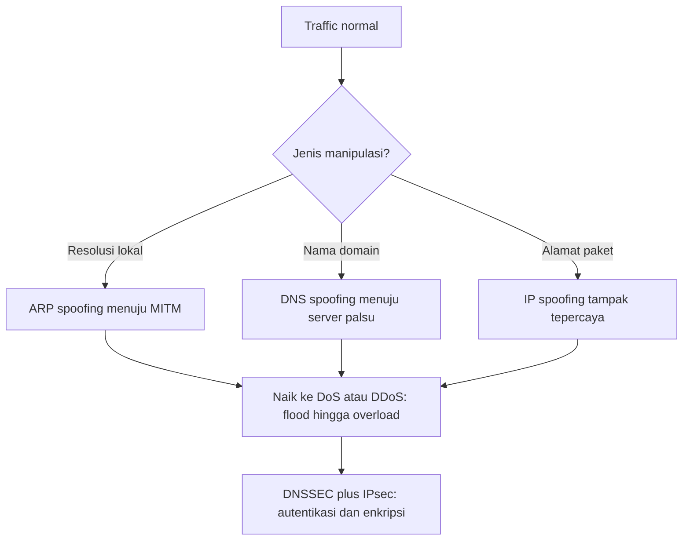

# Computer Security Principles | Sesi 9: Protocol Network Security

> **Mata Kuliah:** Computer Security Principles (COMP6824001) | **Sesi:** 9 | **Status:** Materi UTS

---

## 🔑 Cues
- DNS sebagai buku telepon dan DNSSEC
- Spoofing ARP, DNS, dan IP
- Sniffing dengan Wireshark
- DoS versus DDoS dan tiga tipenya
- IPv4 versus IPv6 dan IPsec

---

## 📖 Materi Utama

### 1. Nama Menjadi Angka: DNS dan Pengamannya
DNS adalah buku telepon internet yang me-resolve nama domain (FQDN) menjadi IP address lewat jaringan name server terdistribusi. DNS standar tidak memeriksa apakah jawabannya valid atau sudah dipalsukan, sehingga lahir DNSSEC (DNS Security Extensions) yang menambahkan authentication dan integrity checking memakai public key encryption agar komputer benar-benar diarahkan ke server yang benar. Praktik IPsec yang sejalan: perusahaan menjalankan jaringan TCP/IP privat yang aman dengan memblokir link ke site tak tepercaya, mengenkripsi paket keluar, dan mengotentikasi paket masuk.

### 2. Pemalsuan dan Penyadapan: Spoofing serta Sniffing
Protocol spoofing adalah misuse protokol jaringan untuk mengecoh host atau device, dalam tiga bentuk: ARP spoofing yang memalsukan Address Resolution Protocol di local network sebagai pijakan man-in-the-middle; DNS spoofing yang memanipulasi hasil DNS agar pengguna diarahkan ke server palsu; dan IP address spoofing yang memalsukan source IP paket agar tampak dari sumber tepercaya. Network sniffing adalah teknik analisis untuk melihat traffic lewat, dipakai admin untuk troubleshooting seperti latency dan error dengan tools seperti Wireshark yang menampilkan detail paket. Pisau bermata dua: informasi yang sama berguna bagi admin juga berguna bagi penyerang.

### 3. Pelumpuhan dan Alamat: DoS, IP, dan IPsec
DoS attack membuat machine atau network resource tidak bisa diakses dengan mem-flood target memakai superfluous requests hingga overload, bertanda jaringan melambat drastis, situs tidak bisa diakses, dan lonjakan email spam. Versi distributed-nya (DDoS) terbagi menjadi volume-based attacks, protocol attacks, dan application-layer attacks, dengan varian populer UDP flood, ICMP (ping) flood, SYN flood, ping of death, HTTP flood, email bomb, dan zero-day attacks. IP adalah alamat sekaligus identifier tiap device. IPv4 yang umum dipakai dideploy 1981, 32-bit, sekitar 4,3 miliar alamat, notasi numeric dot-decimal seperti 192.168.5.18, konfigurasi DHCP atau manual. IPv6 penerusnya dideploy 1998, 128-bit, 340 undecillion alamat, notasi alphanumeric hexadecimal yang disederhanakan seperti 50fe:2400:0000, dan mendukung autoconfiguration. IPsec sebagai grup protokol koneksi terenkripsi antar device mencakup tiga area fungsional — authentication, confidentiality, key management — dengan aplikasi secure branch office connectivity over Internet, secure remote access over Internet, extranet dan intranet connectivity dengan partner (autentikasi plus confidentiality plus key exchange), serta enhancing e-commerce security.

#### **Visualisasi Konsep: Dari Pemalsuan ke Pelumpuhan**

---

## 🛠️ Use Case / Implementasi Nyata
- **Skenario:** Waralaba dengan cabang di banyak kota butuh bertukar data tanpa menyewa private line mahal.
- **Masalah yang Diatasi:** Internet publik murah tetapi rawan sadap dan pemalsuan tujuan.
- **Keuntungan:** VPN IPsec antar cabang memberi autentikasi dan enkripsi sehingga hemat biaya namun tetap privat.

---

## 🗂️ Konsep Kunci

| Istilah | Definisi | Contoh / Catatan |
|---------|----------|-----------------|
| DNSSEC | Ekstensi aman DNS via public key | Mencegah DNS spoofing |
| ARP spoofing | Manipulasi tabel ARP lokal | Awal umum MITM |
| DoS | Pelumpuhan via banjir request | Satu sumber; DDoS banyak sumber via botnet |
| IPsec | Grup protokol enkripsi antar device | Basis VPN |
| Wireshark | Tools analisis dan sniffing | Dipakai admin maupun penyerang |
| IPv4 | Alamat 32-bit generasi lama | Deployed 1981 |
| IPv6 | Alamat 128-bit penerus | Deployed 1998, autoconfiguration |

---

## 📊 Tabel Ringkasan

| Kategori | Contoh Serangan |
|----------|-----------------|
| Denial of service | Serangan DoS dan DDoS |
| Spoofing | IP spoofing menembus proteksi jaringan |
| Interception | Serangan man-in-the-middle, replay attack |
| Persistence | Back door attack |
| Resolusi nama | DNS poisoning |
| Kunci dan enkripsi | Weak encryption keys |
| Sosial | Social engineering |
| Password | Password cracking, dictionary attack, brute force attack |
| Software | Software vulnerability attack, buffer overflow attack, remote code execution attack |
| Aplikasi web | SQL injection attack, cross-site scripting attack |

---

## ⚠️ Catatan Penting
> **Tiga level spoofing** — ARP bermain di jaringan lokal, DNS di resolusi nama, IP di header paket; DoS satu sumber sedangkan DDoS banyak sumber dengan tiga kategori volume-based, protocol, dan application-layer.

---

## 📝 Materi Tambahan (Visual Insights)
- Slide perbandingan menekankan keunggulan jumlah alamat IPv6 128-bit atas IPv4 32-bit serta dukungan autoconfiguration versus DHCP atau manual.
- Daftar spoofing bertingkat ARP, DNS, dan IP address tampil sebagai satu sub-topik mandiri sehingga rawan keluar sebagai soal pembeda.
