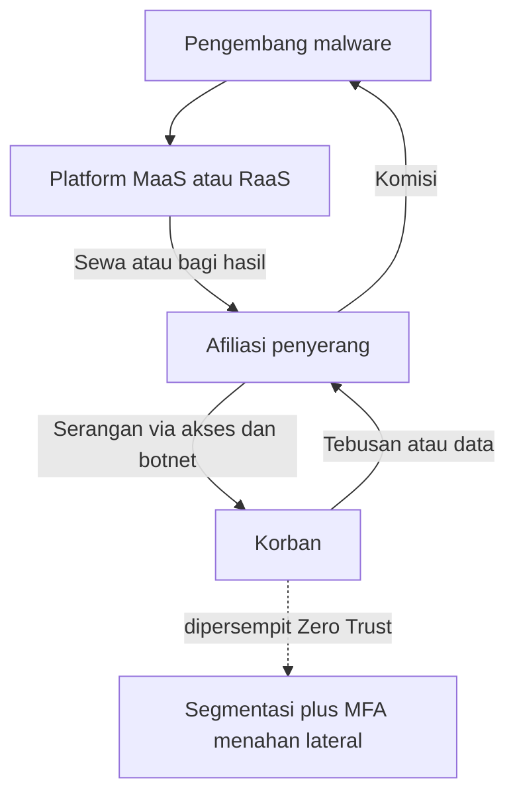

# Computer Security | Sesi UTS: Jawaban Kisi-kisi UTS

> **Mata Kuliah:** COMP6584001 – Computer Security | **Sesi:** UTS | **Tanggal:** 16/04/2026

---

## 🔑 Cues
- Analisis insiden via CIA triad
- Direct attack versus supply chain
- Malware, phishing, dan credential services
- Akses, exploit, dan infrastruktur serangan
- Zero Trust dan micro-segmentation

---

## 📖 Materi Utama

### 1. Membedah Insiden dengan CIA Triad
Setiap kasus dinilai dari pilar mana yang terluka. Confidentiality terluka saat data dibaca pihak tak sah, contohnya kebocoran Ashley Madison yang mengumbar data sensitif jutaan pengguna ke publik. Integrity terluka saat data dimanipulasi diam-diam, contohnya Stuxnet yang mengubah putaran turbin nuklir tetapi melaporkan status normal ke monitor. Availability terluka saat layanan tak bisa diakses, contohnya serangan DDoS Dyn tahun 2016 yang melumpuhkan Twitter, Netflix, dan Reddit bagi jutaan orang.

### 2. Menyerang Langsung versus Menitipkan Vendor
Direct attack menghantam server target secara frontal, ibarat mendobrak pintu depan bank. Supply chain attack menghantam pihak ketiga seperti vendor atau supplier demi mencapai target utama, ibarat menyuap kurir atau memanipulasi update software vendor yang dipakai target. Jalur kedua lebih work karena faktor trust: perusahaan memberi vendor akses istimewa seperti update otomatis atau VPN tanpa audit ketat, sehingga satu vendor jebol menular ke ribuan klien sekaligus sebagai force multiplier.

### 3. Pasar Kejahatan: Malware, Akses, Infrastruktur, dan Scam
Model bisnis cybercrime-as-a-service (CaaS) nyata dan masif, memungkinkan script kiddies melancarkan serangan canggih bermodal langganan. Perbandingan intinya: Malware-as-a-Service (MaaS) menyediakan infrastruktur malware umum seperti trojan, stealer, dan botnet untuk spionase, curi login, atau DDoS dengan model sewa botnet atau jual-beli logs bulanan dan volume, contohnya Emotet dan RedLine Stealer; sedangkan Ransomware-as-a-Service (RaaS) spesialis pemerasan via enkripsi atau penguncian dengan model revenue share antara pengembang dan afiliasi, contohnya LockBit, Conti, dan REvil. Kelompok layanan malware dan phishing: MaaS menyewakan infrastruktur trojan dan stealer seperti Emotet yang menyewakan akses infeksi; Phishing-as-a-Service (PhaaS) menjual phishing kits berupa halaman login palsu siap pakai plus pengiriman massal seperti BulletProftLink dengan ribuan template Microsoft dan Google plus bypass MFA; credential-as-a-service menjual database username dan password curian seperti logs RedLine Stealer di forum dark web. Kelompok akses dan eksploitasi: Initial Access Broker (IAB) menjual pintu masuk jaringan jebol ke grup ransomware seperti Genesis Market yang menjual bot berisi akses komputer terinfeksi plus sidik digital cookies; Exploit-as-a-Service (EaaS) menyewakan kode exploit zero-day atau N-day seperti grup NSO Group dengan Pegasus; vulnerability-as-a-service mencari celah spesifik berdasar pesanan. Kelompok infrastruktur dan serangan: DDoS-as-a-service atau booter dan stresser menyewakan pelumpuhan situs seperti vDOS; botnet-as-a-service menyewakan jaringan komputer terinfeksi seperti Mirai Botnet via IoT; proxy-as-a-service memakai komputer korban sebagai jalur seperti 911.re yang memakai jutaan PC terinfeksi. Kelompok scam: spam-as-a-service mengirim sampah massal seperti Cutwail bermiliaran email harian; scam-as-a-service menjual paket penipuan situs plus gateway palsu seperti Classiscam otomatis via Telegram; AI-powered CaaS memakai deepfake suara dan video atau phishing otomatis, contohnya kasus Hong Kong 2024 di mana staf keuangan mentransfer $25 juta setelah video call dengan CFO palsu.

### 4. Tidak Percaya Siapa Pun: Zero Trust
Zero Trust membuang pembedaan internal versus eksternal dengan prinsip never trust, always verify. Relevan di era 2020-an karena WFH dan cloud membuat tembok kantor tak lagi relevan dan perangkat tersebar di mana saja. Dua pasangannya: strict access control atau least privilege yang memberi akses seminimal mungkin, dan micro-segmentation yang memecah jaringan menjadi pulau kecil agar serangan tak bergerak lateral. Contoh nyata Google BeyondCorp yang memvalidasi identitas dan kesehatan perangkat bukan lokasi jaringan. Dampaknya: pencurian satu password tertahan MFA biometrik dan segmentasi, sehingga blast radius terbatas pada satu titik.

#### **Visualisasi Konsep: Dari Langganan Jahat ke Korban**

---

## 🛠️ Use Case / Implementasi Nyata
- **Skenario:** Startup cloud menerapkan verifikasi identitas plus segmentasi antar layanan.
- **Masalah yang Diatasi:** Satu kredensial bocor tidak berarti seluruh arsip ikut terbuka.
- **Keuntungan:** Kerusakan terkotak sehingga blast radius kecil dan pemulihan lebih cepat.

---

## 🗂️ Konsep Kunci

| Istilah | Definisi | Contoh / Catatan |
|---------|----------|-----------------|
| Force multiplier | Satu jebolan menular ke banyak korban | Efek trust pada vendor |
| MaaS | Sewa infrastruktur malware umum | Emotet, RedLine Stealer |
| RaaS | Sewa malware khusus pemerasan | LockBit, Conti, REvil |
| IAB | Penjual pintu masuk jaringan jebol | Genesis Market |
| Zero-day | Celah belum diketahui vendor | Diperdagangkan via EaaS |
| Deepfake | Media AI peniru orang asli | Senjata CaaS modern |
| Blast radius | Jangkauan kerusakan serangan | Diperkecil Zero Trust |

---

## 📊 Tabel Ringkasan

| Fitur | Malware-as-a-Service | Ransomware-as-a-Service |
|-------|----------------------|-------------------------|
| Fokus utama | Infrastruktur malware umum | Malware khusus pemerasan |
| Model bisnis | Sewa botnet atau jual logs | Bagi hasil pengembang dan afiliasi |
| Tujuan akhir | Spionase, curi login, DDoS | Memaksa bayar tebusan |
| Contoh | Emotet, RedLine Stealer | LockBit, Conti, REvil |

---

## ⚠️ Catatan Penting
> **Pintu masuk direndahkan** — CaaS membuat orang awam cukup bermodal kartu kredit dan forum dark web untuk melancarkan serangan canggih tanpa jago coding.

---

## 📝 Materi Tambahan (Visual Insights)
- MaaS adalah infrastruktur umumnya sedangkan RaaS adalah spesialisasi pemerasan data.
- AI kini dua sisi: alat pertahanan sekaligus senjata utama kriminal lewat deepfake dan phishing otomatis.
