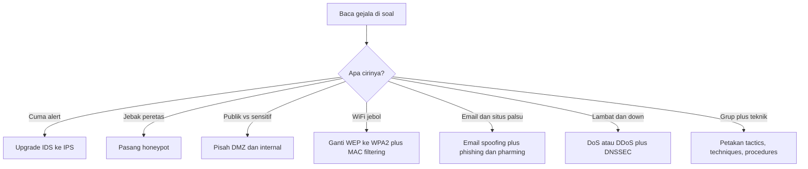

# Computer Security Principles | Sesi UAS: Latihan Soal dan Pembahasan

> **Mata Kuliah:** Computer Security Principles (COMP6824001) | **Sesi:** UAS | **Status:** Materi UAS

---

## 🔑 Cues
- IDS pasif versus IPS aktif
- DMZ dan flat network
- WEP ke WPA2 plus MAC filtering
- Email spoofing, phishing, pharming
- DoS dan DDoS plus DNSSEC
- TTP, T1060, T1053, pyramid of pain

---

## 📖 Materi Utama

### 1. Enam Kasus Pendek: Soal dan Jawaban
Soal dan jawaban dipisah tegas agar tidak tertukar saat dibaca.

**Kasus 1 — e-commerce diserang dan butuh tiga teknologi.** Skenario: pemindaian jaringan hanya memicu alert tanpa penghentian otomatis; perusahaan ingin memancing peretas ke server palsu untuk meriset tactics; sekaligus menyembunyikan IP internal saat lewat router publik. Jawaban: upgrade IDS menjadi IPS karena IPS bisa take action memblokir sedangkan IDS hanya detect dan alert; pasang honeypot sebagai trap yang memancing serangan agar teknik diteliti tanpa membahayakan produksi; terapkan NAT yang memodifikasi info alamat internal saat traffic melintasi router atau firewall.

**Kasus 2 — PT Finansial Nusantara dan flat network.** Skenario: web server internet banking, email server, database server saldo dan data pribadi, serta PC karyawan semua berada di satu jaringan internal di belakang satu router biasa; web server jebol lalu penyerang lateral bebas ke database. Jawaban: akar masalahnya arsitektur flat network tanpa pembatas antar server sehingga titik terekspos sama dengan kunci seluruh rumah. Solusinya sandwich DMZ dua firewall: firewall eksternal antara internet dan DMZ, firewall internal antara DMZ dan jaringan internal. Pembagian: DMZ menampung web server yang wajib publik dan email server yang berkomunikasi dengan luar; jaringan internal menampung database server yang tidak boleh di DMZ dan PC karyawan yang tak perlu diakses luar. Prinsip defense in depth: firewall kedua beraturan ketat hanya mengizinkan koneksi spesifik web ke database via port dan protokol tertentu.

**Kasus 3 — jaringan lambat plus DNS dibelokkan.** Skenario: akses lambat, situs perusahaan tak bisa dibuka, lonjakan spam, dan analisis Wireshark menunjukkan DNS diarahkan paksa ke server salah. Jawaban: gejalanya serangan DoS atau DDoS yang meng-overload mesin dengan superfluous requests; solusinya DNSSEC yang menambahkan authentication dan integrity checking via public key encryption sehingga pengguna selalu diarahkan ke server benar.

**Kasus 4 — WiFi kedai kopi 5 laptop.** Skenario: WiFi karyawan memakai WEP yang masih bisa ditembus; pemilik ingin standar terbaik plus penolakan ketat perangkat lain. Jawaban: WEP adalah standar paling awal dengan flaw skema enkripsi sehingga mudah di-crack; ganti ke WPA2 yang mengimplementasikan seluruh standar IEEE 802.11i penuh; aktifkan MAC filters dengan mendaftarkan hardware address unik kelima laptop ke tabel access point, efektif untuk lingkungan di bawah 10–20 device.

**Kasus 5 — email bank palsu.** Skenario: staf keuangan menerima `From: "Customer Service" <email@bank-bca-resmi.com>` berisi tautan ke situs tiruan bank yang meminta nomor rekening dan PIN. Jawaban: manipulasi pengirimnya email spoofing berupa header From atau Reply-to palsu agar tampak tepercaya; serangan situsnya kombinasi phishing yaitu social engineering peminta data pribadi dan pharming yaitu pengarah ke bogus website.

**Kasus 6 — APT1337 dan registry run keys.** Skenario: grup APT1337 mengejar persistence lewat Registry Run Keys Windows; analis CTI perlu berbagi ke defender dan cabang. Jawaban: persistence adalah tactics yaitu technical goal; registry run keys kode T1060 adalah techniques yaitu metode spesifik; pemblokiran TTPs berada di puncak pyramid David Bianco dengan efek Tough karena lawan harus merancang ulang dari awal.

### 2. Dua Kasus Besar Terkoordinasi
**Serangan beruntun PT Nusantara E-Commerce.** Kronologi: lounge VIP memakai WEP untuk 5 laptop direksi sehingga peretas tamu membobol dari lobi; email spoofing berkedok IT Support internal mengarahkan staf admin database ke portal login tiruan hingga kredensial diserahkan; grup APT1337 menanam registry run keys; IDS sekadar alert saat scanning sehingga peretas leluasa; server dibanjiri paket hingga down dan DNS `www.nusantara-ecommerce.com` dibelokkan ke situs judi. Jawaban per modul: nirkabel ganti WEP ke WPA2 penuh 802.11i plus MAC filters lima laptop; manipulasi klien adalah email spoofing plus phishing dan pharming, lawan dengan edukasi tautan dan MFA; perilaku peretas adalah taktik persistence dan teknik T1060 dengan efek tough di puncak piramida; pertahanan internal upgrade ke IPS penindak otomatis plus NAT penyembunyi IP plus honeypot jebakan; mitigasi protokol mengenali down sebagai DoS atau DDoS overload superfluous requests dan memasang DNSSEC autentikasi plus integritas public key.

**Ransomware multi-fase RS Medika Sentosa.** Kronologi: WiFi ruang tunggu ber-WEP karena router usang; email spoofing `"IT_Support@rsmedika-internal.com"` mengarahkan perawat ke situs tiruan peminta username dan password; skrip tools mengejar credential access dan persistence; lompatan ke database rekam medis karena tanpa DMZ dan IDS hanya mencatat log; distraksi berupa banjir superfluous requests hingga overload. Lima soal dan kunci: soal 1 — WEP berbahaya karena flaw skema enkripsi mudah di-crack dan hanya menahan orang awam, ganti WPA2 penuh IEEE 802.11i; soal 2 — email spoofing via From dan Reply-to palsu plus phishing dan pharming via bogus website; soal 3 — credential access dan persistence adalah tactics, blokir tools berasa challenging sedangkan blokir TTPs berasa tough di puncak; soal 4 — IDS gagal karena hanya detect dan alert tanpa cegah, ganti IPS yang take action otomatis; soal 5 — banjirnya DoS atau DDoS dengan tiga gejala jaringan lambat tak wajar, situs lumpuh, dan lonjakan spam drastis.

### 3. Latihan Mandiri: Tujuh Pola dan Enam Soal Baru
Hampir semua kasus di atas hanyalah tujuh pola berganti baju cerita rumah sakit, e-commerce, bank, dan kedai: sistem cuma alert berarti upgrade IDS ke IPS; ingin menjebak berarti honeypot; server publik versus database berarti DMZ plus firewall berlapis; WiFi jebol atau batasi device berarti WEP ke WPA2 plus MAC filtering; email dan situs tampak asli berarti spoofing plus phishing plus pharming; jaringan lambat dan down berarti DoS atau DDoS plus DNSSEC bila DNS dimanipulasi; grup plus teknik spesifik berarti hirarki tactics sebagai tujuan, techniques sebagai cara berkode T-nomor, dan procedures sebagai langkah super spesifik. Enam soal variasi: universitas yang deteksi scanning lalu otomatis memutus koneksi; toko daring yang menumpuk web, database, dan file-sharing tanpa pemisahan; warnet yang membatasi WiFi ke 8 komputer sendiri; HRD yang menerima email direktur berisi link portal HRIS tiruan; grup ShadowFox memakai scheduled task atau job T1053 demi persistence; server yang menerima ribuan request HTTP per detik dari ribuan IP hingga down. Kunci: soal 1 IPS aktif bukan IDS pasif; soal 2 risiko flat network dan solusi DMZ web di luar database di dalam; soal 3 WPA2 anti crack plus MAC filtering anti device asing yang saling melengkapi karena WPA2 tak membatasi identitas dan MAC filtering tanpa enkripsi mudah dipalsukan; soal 4 email spoofing pengirim direktur plus phishing dan pharming berurgency; soal 5 persistence adalah tactic dan T1053 adalah technique, blokir satu teknik hanya annoying hingga challenging sedangkan blokir seluruh TTP adalah tough; soal 6 namanya DDoS bukan DoS biasa karena distributed dari banyak IP via botnet sehingga tak cukup blokir satu IP.

#### **Visualisasi Konsep: Peta Pola Jawaban Kasus**

---

## 🛠️ Use Case / Implementasi Nyata
- **Skenario:** Kelompok belajar menutup kunci jawaban lalu menjawab enam soal variasi dengan kata sendiri sebelum mencocokkan.
- **Masalah yang Diatasi:** Baca ulang kunci memberi ilusi paham padahal belum bisa active recall.
- **Keuntungan:** Pola tujuh jawaban standar menempel sehingga soal berkostum baru tinggal ditempel ke pola.

---

## 🗂️ Konsep Kunci

| Istilah | Definisi | Contoh / Catatan |
|---------|----------|-----------------|
| IPS | Pencegah intrusi penindak otomatis | Upgrade dari IDS |
| Honeypot | Server jebakan periset taktik | Aman karena bukan produksi |
| Flat network | Jaringan tanpa segmentasi | Satu jebol semua terancam |
| WPA2 | Standar WLAN penuh 802.11i | Pengganti WEP |
| Phishing | Rekayasa sosial peminta data | Via email dan situs tiruan |
| DDoS | Pelumpuhan dari banyak sumber | Via botnet; DoS satu sumber |
| T1060 | Teknik registry run keys | Contoh technique persistence |
| T1053 | Teknik scheduled task atau job | Satu teknik di bawah TTP |

---

## 📊 Tabel Ringkasan

| Pola | Ciri Soal | Jawaban Standar |
|------|-----------|-----------------|
| 1 | Sistem cuma alert tak bisa block | Upgrade IDS ke IPS |
| 2 | Jebak dan pelajari peretas | Honeypot |
| 3 | Server publik versus database sensitif | DMZ plus firewall berlapis |
| 4 | WiFi jebol atau batasi device | WEP ke WPA2 plus MAC filtering |
| 5 | Email dan situs tampak asli | Email spoofing plus phishing plus pharming |
| 6 | Lambat, banjir request, situs down | DoS atau DDoS; tambah DNSSEC bila DNS dimanipulasi |
| 7 | Grup plus teknik spesifik | Tactics tujuan, techniques cara, procedures langkah spesifik |

---

## ⚠️ Catatan Penting
> **Bedakan dua level** — blokir satu technique hanya annoying hingga challenging karena lawan punya teknik cadangan, sedangkan blokir seluruh TTP adalah tough karena lawan merancang ulang dari nol.

---

## 📝 Materi Tambahan (Visual Insights)
- Port DMZ yang dirujuk kasus review: SSH TCP 22, NNTP TCP 119, SNMP UDP 161 agent dan UDP 162 trap, NetBIOS Session Service TCP 139, NTP UDP 123.
- Port umum cadangan untuk varian soal: HTTP 80, HTTPS 443, FTP 20 dan 21, DNS 53, Telnet 23, SMTP 25.
