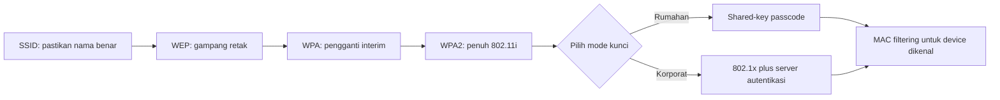

# Computer Security Principles | Sesi 10: Securing Wireless Network

> **Mata Kuliah:** Computer Security Principles (COMP6824001) | **Sesi:** 10 | **Status:** Materi UTS

---

## 🔑 Cues
- SSID hanya nama, bukan pengaman
- WEP lawas dan mudah retak
- WPA interim dan WPA2 penuh 802.11i
- Mode shared-key versus 802.1x
- MAC filtering dan batas skalanya
- Empat faktor risiko nirkabel

---

## 📖 Materi Utama

### 1. Nama dan Kunci: SSID, WEP, WPA, WPA2
SSID adalah nama WLAN menurut standar IEEE 802.11: string case-sensitive maksimal 32 karakter kombinasi huruf dan angka. SSID tidak punya kemampuan security inheren, tetapi pemilihan SSID yang benar memastikan konek ke WLAN yang tepat bukan jebakan. Keamanan WLAN terbaik memadukan authentication dan encryption lewat tiga mekanisme berbasis kunci: WEP (Wired Equivalent Privacy), WPA (Wi-Fi Protected Access), dan WPA2 versi keduanya. WEP adalah kapabilitas pertama dari standar 802.11 orisinal yang bertujuan memberi privacy, namun flaw enkripsinya relatif mudah di-crack; ia hanya dipakai bila tidak ada solusi lain (better than nothing) atau untuk device lama seperti PDA dan handheld game yang hanya mendukung WEP. WPA dirancang sebagai interim successor WEP dengan mengimplementasikan sebagian besar standar IEEE 802.11i, sedangkan WPA2 mengimplementasikan seluruh standar tersebut. Keduanya berjalan dalam mode Shared-Key WPA berbasis pre-shared key atau passcode, dan mode IEEE 802.1x enterprise yang butuh authentication server.

### 2. Daftar Tamu: MAC Filtering
MAC address adalah alamat hardware unik network adapter berformat `00:00:00:00:00:00` atau `00-00-00-00-00-00`. MAC filtering mengontrol device mana boleh konek berdasar tabel alamat yang disimpan dan dimaintain access point. Kelebihannya pas untuk home dan small office, tetapi sulit dimaintain manual begitu device melebihi 10–20 unit apalagi di lingkungan dinamis yang sering ganti perangkat.

### 3. Kenapa Udara Lebih Berisiko: Faktor, Mobile, dan 802.11i
Jaringan nirkabel lebih berisiko daripada kabel karena empat faktor: channel yang lebih vulnerable terhadap active attack atas kelemahan protokol; mobility karena device portabel dibawa ke lokasi tak aman; resources karena smartphone dan tablet ber-OS canggih namun memori dan daya terbatas melawan DoS dan malware; serta accessibility karena sensor atau robot bisa ditinggal unattended di lokasi remote dan hostile. Perangkat mobile butuh proteksi spesifik merujuk NIST SP 800-124 tahun 2013 dengan tujuh ancaman: lack of physical control, use of untrusted mobile devices, use of untrusted networks, use of untrusted applications, interactions with other systems, use of untrusted content, dan use of location services. Standar IEEE 802.11i menjawab lewat RSN (Robust Security Network) dengan dua servis: authentication berupa pertukaran protokol antara user dan AS (Authentication Server) untuk mutual authentication dan pembentukan temporary key antara client dan AP, serta access control yang menegakkan authentication, merutekan pesan, dan memfasilitasi key exchange dengan beragam protokol. Dua karakteristik wired LAN yang tidak dimiliki wireless: transmisi kabel butuh koneksi fisik (otentikasi alami yang observable) sedangkan semua station dalam radio range bisa transmit; dan penerimaan kabel terbatas pada yang attached (privacy alami) sedangkan semua station dalam radio range bisa menerima.

#### **Visualisasi Konsep: Naik Kelas Pengaman WiFi**

---

## 🛠️ Use Case / Implementasi Nyata
- **Skenario:** Biro arsitek kecil memasang WiFi untuk belasan laptop staf tanpa anggaran enterprise.
- **Masalah yang Diatasi:** Tetangga atau pejalan kaki tidak bisa menumpang bandwidth atau menyusup ke file internal.
- **Keuntungan:** WPA2 shared-key plus MAC filtering cukup menutup skala kecil, walau tak praktis bila perangkat membeludak.

---

## 🗂️ Konsep Kunci

| Istilah | Definisi | Contoh / Catatan |
|---------|----------|-----------------|
| SSID | Nama WLAN standar 802.11 | Bukan pengaman, hanya identifikasi |
| WEP | Generasi pertama keamanan WLAN | Mudah dibobol, opsi terakhir |
| WPA2 | Standar penuh 802.11i | Rekomendasi home dan korporat |
| MAC filtering | Kontrol akses berdasar alamat hardware | Tak scalable di atas belasan device |
| RSN | Robust Security Network dari 802.11i | Menyatukan authentication dan access control |
| 802.1x | Mode enterprise dengan server autentikasi | Lawan dari shared-key rumahan |

---

## 📊 Tabel Ringkasan

| Tipe | Kelebihan | Kekurangan |
|------|-----------|------------|
| WEP | Lebih baik dari tanpa pengaman | Skema rentan, hanya menahan tetangga iseng |
| WPA dan WPA2 | Terbaik untuk home dan korporat | Butuh device dan access point kompatibel |
| MAC filtering | Bagus untuk home dan small office | Berat dimaintain manual di lingkungan dinamis |

---

## ⚠️ Catatan Penting
> **Urutan evolusi** — WEP ke WPA ke WPA2 beserta alasan WEP mudah dibobol dan WPA2 superior karena penuh 802.11i; empat faktor risiko channel, mobility, resources, accessibility rawan jadi soal sebutkan dan jelaskan.

---

## 📝 Materi Tambahan (Visual Insights)
- Contoh tampilan SSID pada pengaturan WiFi device memperlihatkan nama network tampil apa adanya seperti teks biasa.
- Mekanisme berbasis kunci divisualkan sebagai progres bertingkat dengan WPA2 sebagai endpoint paling aman evolusi WLAN.
