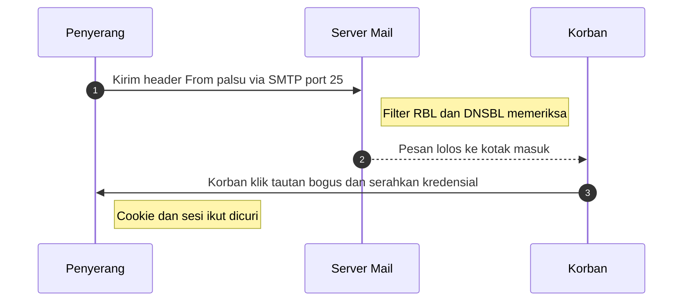

# Computer Security Principles | Sesi 11: Protecting the Clients

> **Mata Kuliah:** Computer Security Principles (COMP6824001) | **Sesi:** 11 | **Status:** Materi UTS

---

## 🔑 Cues
- Sembilan jenis malware
- UAC sejak Vista
- Model cloud NIST 5-3-4
- Tanggung jawab IaaS, PaaS, SaaS
- Ancaman cloud CSA dan IoT berlapis
- Spoofing, cookie, zona konten, phishing

---

## 📖 Materi Utama

### 1. Musuh di Endpoint: Malware dan UAC
Makin sering komputer tersambung internet, makin besar peluang malware; serangan via internet jumlahnya staggering. Sembilan jenis yang dicatat: virus, worm, trojan horse, spyware dan dishonest adware, rootkit, backdoor, polymorphic virus, zero-day attack, dan ransomware. Delapan kebiasaan common sense: tolak software tak jelas asalnya, abaikan attachment email aneh, jauhi hyperlink orang asing termasuk dari layanan seperti Yahoo, AOL, dan MSN, matikan auto-launch attachment, hindari situs mencurigakan seperti piracy dan porn site, patuhi warning browser soal situs host malware, waspadai pop-up peminta update driver atau scan virus, dan rutin backup data. User Account Control (UAC) sejak Windows Vista hingga Windows 10 mencegah perubahan tak diotorisasi: login administrator memicu prompt izin, login standard user memicu permintaan password administrator sebelum aksi berdampak sistem dijalankan.

### 2. Langit dan Perangkat Kecil: Cloud serta IoT
Definisi cloud merujuk NIST SP 800-145: model akses jaringan ubiquitous, convenient, dan on-demand ke shared pool resource (network, server, storage, application, service) yang cepat diprovision dan dirilis dengan minimal management effort. Modelnya punya 5 essential characteristics, 3 service models, dan 4 deployment models. Pembagian tanggung jawab customer versus provider: IaaS membuat customer mengelola application, OS, dan virtual machine sementara provider memegang hypervisor atau OS atau network plus facilities; PaaS membuat customer hanya mengelola application sementara provider memegang middleware hingga facilities; SaaS membuat hampir semua dipegang provider. Polanya: makin ke SaaS makin sedikit dikelola customer sekaligus makin kecil kontrolnya. Keamanan cloud merujuk NIST SP 800-144 tahun 2011 dengan tujuh top cloud-specific threats versi CSA13: abuse and nefarious use of cloud computing, insecure interfaces and APIs, malicious insiders, shared technology issues, data loss or leakage, account or service hijacking, dan unknown risk profile. IoT device beranggotakan sensor, actuator, microcontroller, transceiver, dan RFID, tersambung berjenjang dari edge network (jutaan device via Bluetooth, WiFi, sensor) ke fog network (puluhan ribu device) ke core network (ribuan device) hingga cloud atau data center (ratusan device aplikasi). IoT security framework mencakup authentication, role-based security, anti-tamper dan detection, data protection dan confidentiality, serta IP protocols dari smart object sampai data center.

### 3. Surat dan Peramban: Email, Cookie, Zona, Phishing
Spam filter tak bisa menangkap semua sehingga perlu rutin di-update dan di-tweak memakai RBL (Real-time Blackhole List) atau DNSBL (DNS-based Blackhole List). Email spoofing membuat header palsu seperti `From: "Legitimate Sender" <email@legitimatecompany.com>` dan `Reply-to: email@legitimatecompany.com` agar tampak dari sumber tepercaya. Relaying memakai SMTP untuk transfer antar server dan outgoing mail pada TCP port 25. Cookie adalah piece of text simpanan browser untuk identification, authentication, site preference, dan shopping cart; ia bisa disalahgunakan spyware atau situs pelacak meski sebagian situs tak jalan tanpanya. Internet Explorer membagi koneksi menjadi 4 content zone: Internet Zone, Local Intranet Zone, Trusted Sites Zone, dan Restricted Sites Zone. Phishing adalah teknik social engineering berbasis email atau situs yang meminta username, password, nomor akun, PIN, atau SSN/NIK lewat pesan dan halaman convincing; pharming satu paket dengannya mengarahkan pengguna ke bogus website untuk menyebar malware atau mencuri info personal.

#### **Visualisasi Konsep: Perjalanan Email Palsu ke Korban**

---

## 🛠️ Use Case / Implementasi Nyata
- **Skenario:** Studio gim indie memindahkan build server ke cloud tanpa tim keamanan khusus.
- **Masalah yang Diatasi:** Ancaman data loss, API tak aman, dan kebingungan siapa mengamankan apa.
- **Keuntungan:** Shared responsibility model memperjelas batas customer versus provider per pilihan IaaS, PaaS, atau SaaS.

---

## 🗂️ Konsep Kunci

| Istilah | Definisi | Contoh / Catatan |
|---------|----------|-----------------|
| UAC | Prompt izin sebelum perubahan sistem | Ada sejak Windows Vista |
| IaaS, PaaS, SaaS | Tiga service model cloud | Beda batas kelola customer dan provider |
| RBL dan DNSBL | Daftar hitam untuk filter spam | Wajib rutin diperbarui |
| Email spoofing | Header pengirim dipalsukan | Kolom From dan Reply-to |
| SMTP | Protokol transfer email antar server | TCP port 25 |
| Cookie | Teks simpanan browser | Identifikasi hingga keranjang belanja |
| Phishing | Rekayasa sosial peminta data | Via email dan situs palsu |
| Pharming | Pengalihan ke situs bogus | Sering sepaket dengan phishing |

---

## 📊 Tabel Ringkasan

| Model Cloud | Dikelola Customer | Dikelola Provider |
|-------------|-------------------|-------------------|
| IaaS | Application, OS, virtual machine | Hypervisor atau OS atau network, facilities |
| PaaS | Application | Middleware hingga facilities |
| SaaS | Hampir tidak ada | Application hingga facilities |

---

## ⚠️ Catatan Penting
> **Dua pasangan ujian** — phishing aktif meminta info sedangkan pharming mengalihkan otomatis; urutan tanggung jawab IaaS, PaaS, SaaS wajib hafal karena menentukan siapa mengamankan apa.

---

## 📝 Materi Tambahan (Visual Insights)
- Elemen cloud tersusun berlapis dari deployment models di bawah ke service models SaaS, PaaS, IaaS hingga essential characteristics seperti resource pooling.
- Gateway IoT mengatur komunikasi smart object menuju fog dan cloud dengan lapisan security serta privacy of data at rest di tengah jalur.
