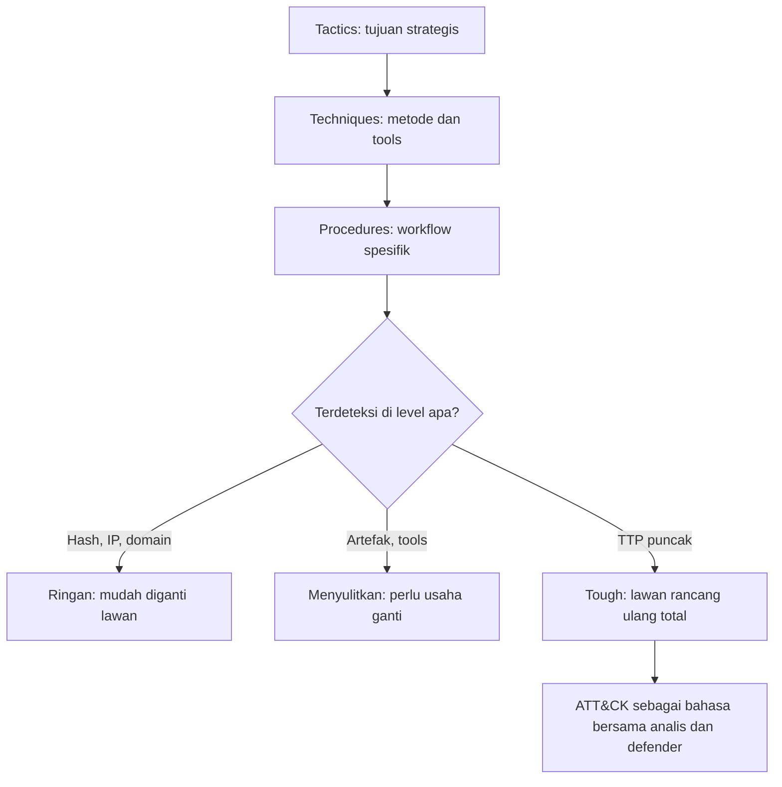

# Computer Security Principles | Sesi 12: Server-side Protection, TTP dan MITRE ATT&CK

> **Mata Kuliah:** Computer Security Principles (COMP6824001) | **Sesi:** 12 | **Status:** Materi UTS

---

## 🔑 Cues
- Tactics sebagai tujuan dan techniques sebagai cara
- Procedures sebagai langkah spesifik
- Lima kegunaan memahami TTP
- ATT&CK untuk Enterprise, Mobile, ICS
- Pyramid of Pain enam level
- Rekomendasi defense enam langkah

---

## 📖 Materi Utama

### 1. Bahasa Perilaku: Tactics, Techniques, Procedures
Deck berjudul server-side protection ini berisi perilaku penyerang, dengan learning outcome LO 1: define basic principal of computer security. Tactics adalah high-level strategic goals atau overarching objectives penyerang, contohnya data exfiltration, denial of service, phishing, privilege escalation, dan persistence. Techniques adalah metode dan tools spesifik mencapai tactics, lebih detail dan taktis, contohnya social engineering, watering hole, spear phishing, ransomware, IoT exploitation, zero-day exploits, brute force, dan malware. Procedures adalah step-by-step workflow eksekusi, sangat granular pada teknik dan tools, contoh rantai malware delivery, credential harvesting, lateral movement, data exfiltration process, evasion techniques, develop defense strategies, dan regular update step. Lima kegunaan memahami TTP: detect attacks lewat pola dikenal, develop defense strategies yang menyasar teknik spesifik, enhance incident response berbasis cara operasi lawan, share threat intelligence antar organisasi, dan improve threat hunting proaktif berbasis TTP.

### 2. Kamus Bersama: MITRE ATT&CK
ATT&CK adalah knowledge base adversary behavior berdasar real-world observation yang free, open, globally accessible, community-driven, dan berfungsi sebagai common language threat intelligence. Cakupannya tiga elemen: Enterprise, Mobile, dan ICS. Urainya: tactics sebagai technical goal adversary seperti initial access, privilege escalation, dan defense evasion; techniques sebagai cara mencapai goal seperti access token manipulation, account discovery, dan active scanning; procedures sebagai implementasi spesifik seperti malware Stuxnet yang impersonate anonymous token untuk enumerate bindings di service control manager. Contoh matriks: tactics reconnaissance menaungi 10 teknik dan persistence menaungi 20 teknik; di bawah persistence ada account manipulation, BITS jobs, boot or logon autostart execution, browser extensions; teknik browser extension T1176 dipakai malware Bundlore, Grandoreiro, Kimsuky, dan OSX/Shlayer untuk hijack search, steal cookies, atau infeksi via fake Flash Player; teknik gather victim host information T1592 dipakai Andariel lewat malicious script pengumpul browser type, system language, dan Flash Player version, Magic Hound lewat user-agent string pengunjung situs phishing, dan Sandworm Team lewat riset supply-chain terkait NotPetya.

### 3. Seberapa Sakit: Pyramid of Pain dan Rekomendasi
Pyramid of Pain ala David Bianco mengurutkan indikator dari bawah ke atas berdasar sulitnya diganti penyerang: hash values berlabel trivial, IP addresses easy, domain names simple, network atau host artifacts annoying, tools challenging, dan TTPs tough di puncak. Logikanya: deteksi di level TTP paling menyakitkan karena lawan harus mengubah seluruh cara kerja, bukan sekadar ganti IP atau domain. Dua manfaat ATT&CK: analis CTI dan defender berbicara dengan ID sama seperti T1060 registry run keys atau startup folder sehingga tak ambigu, dan antar organisasi bisa menyamakan temuan walau nama grup beda seperti APT1337 dengan autorun versus FUZZYDUCK dengan run key. Enam langkah rekomendasi berbasis ATT&CK: determine priority techniques, research how techniques are being used, research defensive options related to technique, research organizational capability atau constraints, determine tradeoffs for org on specific options, dan make recommendations.

#### **Visualisasi Konsep: Dari Tujuan ke Rasa Sakit**

---

## 🛠️ Use Case / Implementasi Nyata
- **Skenario:** Relawan keamanan kampus menemukan pola autorun mencurigakan di lab komputer.
- **Masalah yang Diatasi:** Tiap asisten memakai istilah berbeda untuk temuan yang sama sehingga respons lambat.
- **Keuntungan:** Menyebut ID teknik T1060 membuat semua pihak langsung merujuk perilaku yang sama tanpa debat istilah.

---

## 🗂️ Konsep Kunci

| Istilah | Definisi | Contoh / Catatan |
|---------|----------|-----------------|
| Tactics | Sasaran strategis penyerang | Initial access, persistence |
| Techniques | Metode mencapai sasaran | Access token manipulation |
| Procedures | Implementasi spesifik teknik | Cara Stuxnet mengeksekusi teknik |
| Pyramid of Pain | Hirarki sulitnya indikator diganti | TTP di puncak berlabel tough |
| MITRE ATT&CK | Basis pengetahuan perilaku lawan | Mencakup Enterprise, Mobile, ICS |
| T1060 | ID teknik registry run keys | Contoh bahasa bersama analis dan defender |

---

## 📊 Tabel Ringkasan

| Level | Indikator | Sulit Diganti |
|-------|-----------|---------------|
| 1 terbawah | Hash values | Trivial |
| 2 | IP addresses | Easy |
| 3 | Domain names | Simple |
| 4 | Network atau host artifacts | Annoying |
| 5 | Tools | Challenging |
| 6 teratas | TTPs | Tough |

---

## ⚠️ Catatan Penting
> **Hafalan dua urutan** — tactics menjawab apa, techniques menjawab bagaimana, procedures memerinci langkah; piramida dibaca dari hash values di bawah hingga TTPs di puncak karena makin atas makin sakit bagi penyerang.

---

## 📝 Materi Tambahan (Visual Insights)
- Matriks ATT&CK menampilkan tactics sebagai kolom seperti reconnaissance, resource development, initial access, execution, persistence, privilege escalation, defense evasion, credential access, discovery, lateral movement, dan collection; makin banyak teknik dalam satu kolom makin banyak jalan mencapai goal itu.
- Ilustrasi manfaat menampilkan analis dan defender serta company A dan company B yang awalnya beda istilah lalu tersambung lewat ID teknik yang sama.
