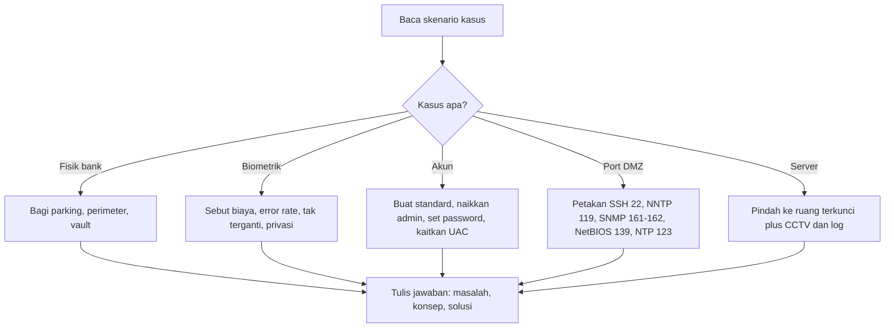

# Computer Security Principles | Sesi 13: Review Studi Kasus

> **Mata Kuliah:** Computer Security Principles (COMP6824001) | **Sesi:** 13 | **Status:** Materi UAS

---

## 🔑 Cues
- Review lesson 1 sampai 5 tanpa teori baru
- Bank tiga zona dan biometrik
- Akun John Adams dan UAC
- Port SSH, NNTP, SNMP, NetBIOS, NTP
- Server room versus meja terbuka

---

## 📖 Materi Utama

### 1. Cara Membaca Deck Review Ini
Slide sesi ini berisi lima case study dari lesson 1–5 buku Security Fundamental (Panek, 2019) tanpa teori baru, sehingga fungsinya sebagai simulasi soal ujian. Pola jawab yang dilatih: identifikasi masalah, kaitkan konsep relevan, lalu tawarkan solusi konkret. Referensi pendampingnya adalah Stallings dan Brown, Computer Security: Principles and Practice, edisi keempat tahun 2018.

### 2. Lima Kasus: Bank, Biometrik, Akun, Port, Server
Kasus lesson 1 menempatkan pembaca sebagai security manager bank menengah yang menahan perampok selepas jam operasional pada tiga area: parking lot dijaga CCTV, lampu sensor gerak, dan gerbang barrier; building perimeter dijaga alarm, pagar perimeter, sensor pintu dan jendela, serta patroli satpam; vault dijaga multi-factor authentication biometrik plus PIN, mekanisme time-lock, sensor deteksi intrusi, dan kontrol akses berlapis. Kasus lesson 2 menempatkan pembaca sebagai IT admin Contoso Corporation yang diminta CIO menjelaskan disadvantage biometrics: biaya hardware dan sensor tinggi, false positive dan false negative, data bocor tak bisa diganti seperti password, privacy concern atas data sangat personal, dan kendala teknis seperti sidik jari tak terbaca saat tangan basah atau luka. Kasus lesson 3 menugaskan admin Contoso mengelola akun John Adams di Windows 10: buat standard account via Settings, Accounts, Family and other users, Add account; naikkan JAdams ke administrator via pilih akun, Change account type, Administrator; lalu set password `Pa$$w0rd` via User Accounts, Manage another account, Change password; kaitannya dengan UAC adalah akun administrator tetap diprompt izin sedangkan standard account diminta password admin dulu. Kasus lesson 4 meminta definisi port atas protokol yang mengakses server di DMZ: SSH pada TCP 22 untuk remote login aman; NNTP pada TCP 119 untuk distribusi newsgroup Usenet; SNMP pada UDP 161 untuk agent dan UDP 162 untuk trap dalam monitoring device; NetBIOS Session Service pada TCP 139 sebagai bagian NetBIOS over TCP/IP; NTP pada UDP 123 untuk sinkronisasi waktu. Kasus lesson 5 menempatkan admin baru ABC Company yang melihat tujuh physical server di meja terbuka seberang meja kerja dan disuruh supervisor membiarkannya demi kemudahan monitor: solusinya pindahkan ke server room atau rak terkunci, pasang access control elektronik atau biometrik, pasang CCTV terekam, lengkapi environmental control suhu, kelembaban, dan fire suppression, serta catat log siapa masuk kapan; argumennya adalah terlihat mudah diawasi tidak sama dengan aman karena server terbuka rentan dicabut kabel, dicuri hardware, atau dicolok rogue device.

#### **Visualisasi Konsep: Kerangka Jawab Semua Kasus**

---

## 🛠️ Use Case / Implementasi Nyata
- **Skenario:** Peserta bimbingan belajar menjawab ulang kelima kasus dengan nama perusahaan diganti.
- **Masalah yang Diatasi:** Hafalan definisi tidak cukup karena soal berbentuk skenario essay.
- **Keuntungan:** Kerangka masalah, konsep, dan solusi membuat jawaban tetap runtut walau konteks diganti.

---

## 🗂️ Konsep Kunci

| Istilah | Definisi | Contoh / Catatan |
|---------|----------|-----------------|
| Physical security | Pengamanan bendawi atas aset | Kasus bank dan server |
| Biometrics | Otentikasi ciri tubuh | Bocor berarti permanen |
| Standard versus administrator | Tingkatan privilege akun Windows | Berkaitan dengan UAC |
| DMZ port | Port layanan yang diekspos di DMZ | SSH 22, NTP 123, dan lainnya |
| Server room | Ruang server terkunci dan terkendali | Lawan dari meja terbuka |

---

## 📊 Tabel Ringkasan

| Protokol | Port | Catatan |
|----------|------|---------|
| SSH (Secure Shell) | TCP 22 | Remote login aman; protokol VPN lain sesi 8 |
| NNTP (Network News Transfer Protocol) | TCP 119 | Distribusi artikel Usenet |
| SNMP (Simple Network Management Protocol) | UDP 161 agent, UDP 162 trap | Monitoring device jaringan |
| NetBIOS Session Service | TCP 139 | NetBIOS over TCP/IP |
| NTP (Network Time Protocol) | UDP 123 | Sinkronisasi waktu device |

---

## ⚠️ Catatan Penting
> **Format UAS** — soal kemungkinan besar berbentuk case study seperti kelima kasus ini; hafalkan port wajib plus port umum HTTP 80, HTTPS 443, FTP 20 dan 21, DNS 53, Telnet 23, dan SMTP 25 untuk varian soal.

---

## 📝 Materi Tambahan (Visual Insights)
- Deck review full teks soal per slide dengan judul konsisten "Case Study Lesson N" tanpa elemen visual atau diagram.
- Soal DMZ berkaitan langsung dengan konsep buffer zone antara internet publik dan internal network dari sesi 8.
