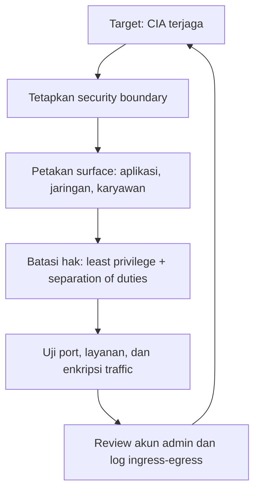

# Computer Security | Sesi 1: Computer Security Principles

> **Mata Kuliah:** Computer Security | **Sesi:** 1 | **Status:** Materi UTS

---

## 🔑 Cues
- CIA triad sebagai tujuan keamanan
- Least privilege dan separation of duties
- Attack surface tiga ranah
- Security boundary dan traffic review

---

## 📖 Materi Utama

### 1. Tujuan Keamanan: Kerahasiaan, Keutuhan, Ketersediaan
Tiga sasaran yang dipakai menilai setiap insiden: informasi tidak dibaca pihak tak berwenang (confidentiality), informasi tidak diubah sembarangan (integrity), dan layanan tetap bisa diakses saat dibutuhkan (availability). Gangguan availability datang dari dua arah: tidak disengaja (bencana alam, kerusakan hardware) maupun disengaja (serangan DoS yang membanjiri server dengan trafik palsu). Mekanisme pendukung типик meliputi enkripsi dan kontrol akses untuk kerahasiaan, hashing dan tanda tangan digital untuk keutuhan, serta backup dan redundansi untuk ketersediaan.

### 2. Membatasi Hak: Least Privilege dan Pemisahan Tugas
Dua disiplin yang mengubah tujuan di atas menjadi aturan operasional. Least privilege berarti setiap pengguna, sistem, atau aplikasi hanya memegang hak tidak lebih dari yang diperlukan fungsinya. Praktiknya: izin dikelola per grup bukan per individu, administrator memegang dua akun terpisah (harian biasa dan administratif khusus), jenis akun distandarisasi, dan siklus hidup akun diaudit memakai aplikasi pihak ketiga. Separation of duties melarang satu orang menyelesaikan sendiri seluruh alur proses kritis, sehingga penipuan, pencurian, dan kesalahan tunggal bisa dicegah.

### 3. Dari Mana Serangan Masuk: Attack Surface
Attack surface adalah seluruh jalur yang bisa dipakai penyerang masuk ke sistem; makin luas, makin besar peluang keberhasilan serangan. Tiga ranah yang dinilai: aplikasi (input data, layanan berjalan, port terbuka), jaringan (desain topologi, penempatan sistem kritis, aturan firewall), dan karyawan (rekayasa sosial, kesalahan manusia, ancaman orang dalam). Aktivitas analisisnya meliputi penetapan security boundaries (titik temu zona aman dan zona luar, misalnya firewall kantor), inventarisasi koneksi di batas tersebut, pembedaan traffic yang diizinkan versus diblokir pada log, pengujian port dan layanan terbuka, pengecekan mana traffic yang terenkripsi, serta review berkala akun administratif berhak tinggi.

#### **Visualisasi Konsep: Menutup Celah dari Tujuan ke Lapisan**

---

## 🛠️ Use Case / Implementasi Nyata
- **Skenario:** Bengkel otomotif memisahkan tugas kasir dan montir kepala dalam proses klaim garansi.
- **Masalah yang Diatasi:** Satu orang tidak bisa membuat klaim fiktif lalu mencairkannya sendiri, karena validasi dan pembayaran dipegang orang berbeda plus auditor memeriksa log.
- **Keuntungan:** Upaya penggelapan butuh kolusi beberapa pihak sehingga integritas catatan keuangan lebih terjaga.

---

## 🗂️ Konsep Kunci

| Istilah | Definisi | Contoh / Catatan |
|---------|----------|-----------------|
| Confidentiality | Informasi tidak diakses pihak tak berwenang | Enkripsi, autentikasi, kontrol akses |
| Integrity | Data konsisten, akurat, dan valid | Hashing, tanda tangan digital |
| Availability | Sumber daya dapat diakses saat dibutuhkan | Backup, redundansi; lawan dari DoS |
| Least privilege | Hak akses seminimal mungkin sesuai fungsi | Izin per grup, akun admin ganda |
| Separation of duties | Alur kritis dibagi ke beberapa pihak | Validasi, pembayaran, dan audit terpisah |
| Attack surface | Kumpulan jalur masuk potensial penyerang | Ranah aplikasi, jaringan, karyawan |
| Security boundary | Titik temu zona aman dan zona luar | Firewall sebagai pembatas |
| Egress traffic | Data yang keluar dari jaringan internal | Perlu dicek sumber, target, dan portnya |

---

## 📊 Tabel Ringkasan

| Ranah Surface | Yang Diperiksa | Ancaman Tipikal |
|---------------|----------------|-----------------|
| Aplikasi | Input, port, layanan berjalan | Injeksi, buffer overflow |
| Jaringan | Topologi, firewall, router | Penyadapan, pemindaian |
| Karyawan | Pelatihan, kesadaran, etika | Phishing, ancaman orang dalam |

---

## ⚠️ Catatan Penting
> **Target versus cara** — CIA triad adalah sasaran yang dilindungi, sedangkan least privilege dan separation of duties adalah cara mencapainya; analisis attack surface mengukur seberapa jauh sasaran itu terancam.

---

## 📝 Materi Tambahan (Visual Insights)
- Traffic ingress dan egress dinilai dari alamat sumber, alamat target, dan port; traffic tak terenkripsi di jalur komunikasi berisiko disadap.
- Akun administratif perlu ditinjau berkala karena haknya yang tinggi mampu melompati banyak batasan sekaligus.
