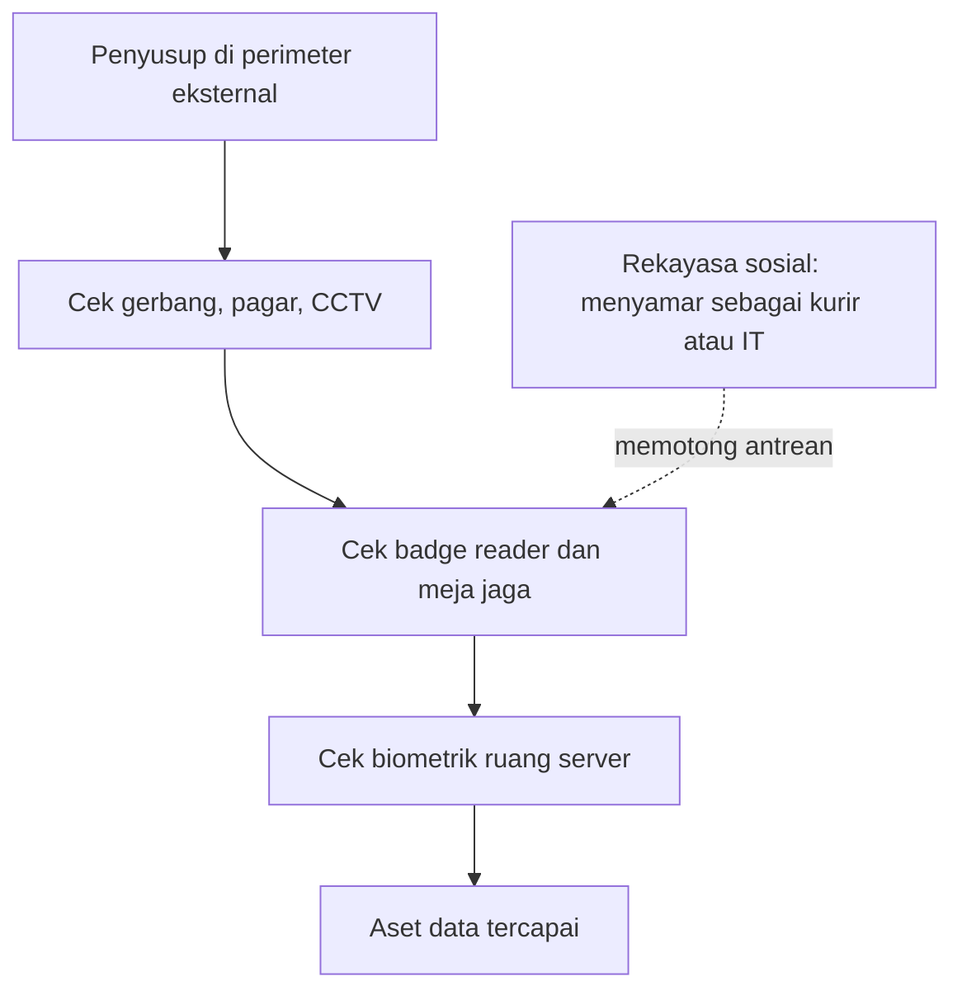

# Computer Security | Sesi 2: Security Layers

> **Mata Kuliah:** Computer Security | **Sesi:** 2 | **Status:** Materi UTS

---

## 🔑 Cues
- Rekayasa sosial dan sifat mudah percaya korban
- Defense in depth berlapis
- Perimeter eksternal, internal, area aman
- Threat modeling iteratif
- Standar ISO dan perlindungan karya

---

## 📖 Materi Utama

### 1. Lapisan Terluar: Fisik Sebelum Digital
Keamanan fisik adalah garis pertahanan pertama: proses, prosedur, kebijakan, dan teknologi yang melindungi perangkat secara bendawi. Idenya adalah defense in depth — pertahanan disusun berlapis sehingga kegagalan satu lapis masih ditutup lapis berikutnya. Tiga fungsi lapis fisik: authentication (memastikan siapa yang boleh masuk area), access control (membatasi hanya pihak berizin), dan auditing (merekam aktivitas lewat kamera atau log badge reader). Pembagian zonanya bertingkat: perimeter eksternal seperti parkir dan jalan masuk dijaga pagar, CCTV, gerbang berpenjaga, dan patroli; perimeter internal yaitu dinding dan pintu gedung dijaga kunci, keypad, CCTV, badge reader, dan meja penjaga; secure area seperti data center, ruang server, dan lab R&D dijaga biometrik, detektor logam, dan pintu khusus.

### 2. Lapisan Manusia: Rekayasa Sosial
Social engineering memperoleh akses ke data, sistem, atau jaringan lewat manipulasi psikologis dan penyamaran, mengeksploitasi sifat mudah percaya korban. Pelaku tampil tidak berbahaya atau sopan, beraksi tatap muka, via email, maupun telepon, misalnya menyamar sebagai tim IT atau karyawan baru dengan kredensial palsu. Pelajaran biayanya: keamanan butuh investasi, tetapi harus dibuat seamless — proteksi yang terlalu membebani pengguna justru mendorong mereka memutarinya.

### 3. Lapisan Perencanaan: Threat Modeling dan Aturan Main
Threat modeling mengoptimalkan keamanan dengan mengidentifikasi kerentanan dan risiko lalu menentukan countermeasure, dijalankan iteratif sepanjang siklus hidup sistem. Alurnya: menilai nilai aset, memotret arsitektur, mengurai komponen, mengidentifikasi ancaman, mendokumentasikan, lalu memberi rating ancaman. Dua kerangka acuan eksternal: standar seri ISO 27000 (27001, 27002, 27005, 27032) untuk manajemen keamanan informasi, dan rezim hukum seperti IPR, Copyright Act, serta Patent Law yang melindungi aspek moral dan material karya.

#### **Visualisasi Konsep: Penyusup Menembus Lapis demi Lapis**

---

## 🛠️ Use Case / Implementasi Nyata
- **Skenario:** Klinik menaruh rekam medis di ruang arsip terkunci dalam gedung berpagar.
- **Masalah yang Diatasi:** Orang asing tidak bisa sekadar masuk dan memotret dokumen, walau ia lolos dari pos satpam depan.
- **Keuntungan:** Pencurian bendawi terhambat berlapis, dan jejak siapa masuk kapan tetap terekam.

---

## 🗂️ Konsep Kunci

| Istilah | Definisi | Contoh / Catatan |
|---------|----------|-----------------|
| Defense in depth | Pertahanan berlapis-lapis | Gagal di pagar masih ada kunci dan biometrik |
| Social engineering | Akses via manipulasi psikologis | Menyamar sebagai help desk |
| External perimeter | Pertahanan fisik terluar | Pagar, pos satpam, patroli |
| Internal perimeter | Pertahanan di badan gedung | Kunci pintu, badge reader lobi |
| Secure area | Zona sensitif berproteksi ekstra | Ruang server, lab R&D |
| Threat modeling | Identifikasi risiko sistem terstruktur | Iteratif sepanjang siklus hidup |
| Authentication fisik | Verifikasi orang yang masuk area | Badge, biometrik |
| Auditing fisik | Pelacakan aktivitas di area | Rekaman kamera, log reader |

---

## 📊 Tabel Ringkasan

| Perangkat | Sifat Risiko | Pengaman Tipikal |
|-----------|--------------|-----------------|
| Server | Terpusat dan kritikal | Raket atau kabinet terkunci, kabel pengaman |
| Desktop | Stasioner di satu tempat | Kabel pengaman |
| Mobile | Portabel dan mudah hilang | Enkripsi, hapus jarak jauh, pelacakan |

---

## ⚠️ Catatan Penting
> **Manusia adalah sambungan** — teknologi lapis fisik tidak menolong bila karyawan menyerahkan akses karena tertipu penyamaran; kesadaran pengguna adalah kunci.

---

## 📝 Materi Tambahan (Visual Insights)
- Contoh latihan threat modeling memakai studi karakter fiksi: asetnya berupa kesehatan dan identitas, ancamannya digambarkan sebagai penjahat, dan penangkalnya berupa gawai serta taktik.
- Perangkat bergerak seperti ponsel atau tablet ber-OS canggih namun daya komputasi dan memorinya terbatas untuk melawan ancaman seperti DoS dan malware.
