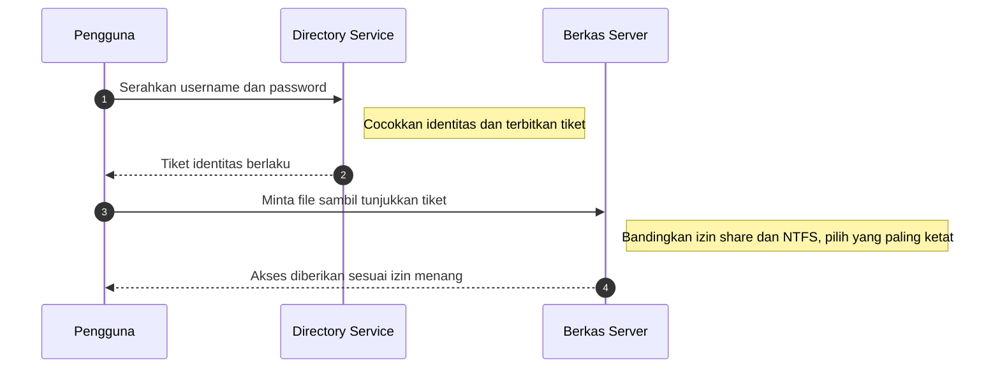

# Computer Security | Sesi 3: Authentication, Authorization and Accounting

> **Mata Kuliah:** Computer Security | **Sesi:** 3 | **Status:** Materi UTS

---

## 🔑 Cues
- Authentication menjawab siapa, authorization menjawab boleh apa
- Tiga faktor: tahu, miliki, ciri tubuh
- Active Directory, LDAP, Kerberos
- Rights versus permissions
- NTFS enam level dan share tiga level
- Aturan most restrictive dan registry

---

## 📖 Materi Utama

### 1. Gerbang Masuk: Siapa Anda, Lalu Boleh Apa
Authentication mengidentifikasi individu, umumnya lewat username dan password, untuk menjawab "siapa Anda". Authorization menyusul sesudahnya: memberi individu akses ke objek sistem sesuai identitasnya, untuk menjawab "apa yang boleh Anda lakukan". Verifikasi identitas memakai tiga faktor: what a user knows (password, PIN), what a user owns (paspor, smart card, ID card), dan who a user is yaitu biometrik (sidik jari, retinal scan, suara).

### 2. Direktori Terpusat: AD dan Protokolnya
Directory services mencari, mengelola, dan mengadministrasi sumber daya jaringan umum, dengan Active Directory (AD) sebagai implementasi Microsoft. Tiga layanan kuncinya: LDAP (Lightweight Directory Access Protocol), protokol aplikasi untuk query dan modifikasi data direktori via TCP/IP; Kerberos, protokol autentikasi default yang membuktikan identitas host di jaringan tak aman; serta penamaan berbasis DNS untuk menata users, groups, printers, dan computers. AD juga menjadi titik pusat delegasi wewenang ke admin lokal.

### 3. Hak versus Izin: NTFS, Share, dan Registry
Rights mengotorisasi tindakan pada komputer (misalnya log on interaktif, backup file) dan dikelola via local policies atau group policies AD, sedangkan permissions menetapkan tipe akses ke objek file atau folder. Enam level standar NTFS: Full Control (baca, tulis, ubah, eksekusi, ganti atribut dan permission, ambil kepemilikan); Modify (baca, tulis, ubah, eksekusi, ubah atribut); Read and Execute (lihat isi folder, baca data dan atribut, jalankan file); List Folder Contents (lihat isi dan atribut tanpa eksekusi); Read (lihat data, atribut, pemilik, permission); dan Write (tulis dan tambah isi, ubah atribut). Tiga level share untuk akses jaringan: Full Control (mencakup Read dan Change), Change (Read plus buat, hapus, dan modifikasi folder serta atribut), dan Read (lihat nama file, akses subfolder, baca data, jalankan program). Registry adalah database konfigurasi Windows berisi keys, subkeys, dan values perangkat keras dan lunak, disunting manual lewat `Regedit.exe`; setiap objek keamanan dikenali lewat SID (Security Identifier) yang unik.

#### **Visualisasi Konsep: Dari Login ke Akses File**

---

## 🛠️ Use Case / Implementasi Nyata
- **Skenario:** Koperasi menaruh slip gaji hanya di folder HR pada file server Windows.
- **Masalah yang Diatasi:** Anggota tim penjualan yang login valid tetap tidak bisa membuka folder gaji karena grupnya tidak diberi izin.
- **Keuntungan:** Least privilege berjalan otomatis lewat grup AD tanpa aturan manual per orang.

---

## 🗂️ Konsep Kunci

| Istilah | Definisi | Contoh / Catatan |
|---------|----------|-----------------|
| Authentication | Verifikasi identitas pengguna | Username plus password |
| Authorization | Pemberian akses pasca identitas valid | Cek permission file |
| LDAP | Protokol query data direktori | Pencarian user atau printer via AD |
| Kerberos | Autentikasi jaringan berbasis tiket | Default domain Windows |
| Rights | Hak melakukan tindakan pada komputer | Log on, backup; via policy |
| Permissions | Tipe akses ke objek file atau folder | NTFS dan share |
| SID | Pengenal unik objek keamanan | Satu ID satu objek |
| Registry | Basis data konfigurasi Windows | Kunci berisi subkeys dan values |

---

## 📊 Tabel Ringkasan

| Izin NTFS | Baca Data | Tulis Data | Ubah Permission | Ambil Kepemilikan |
|-----------|-----------|------------|-----------------|-------------------|
| Read | Ya | Tidak | Tidak | Tidak |
| Write | Ya | Ya | Tidak | Tidak |
| Modify | Ya | Ya | Tidak | Tidak |
| Full Control | Ya | Ya | Ya | Ya |

---

## ⚠️ Catatan Penting
> **Aturan akses jaringan** — pengguna yang membuka file lewat jaringan tunduk pada izin yang paling membatasi antara share dan NTFS, bukan yang paling longgar.

---

## 📝 Materi Tambahan (Visual Insights)
- Struktur registry menyerupai folder: tiap kunci dapat menampung subkeys atau nilai konfigurasi.
- Faktor biometrik masuk kategori "who a user is" dan lebih sulit dipalsukan dibanding password.
- Kesalahan sunting registry berisiko merusak sistem operasi sehingga perlu kehati-hatian ekstra.
