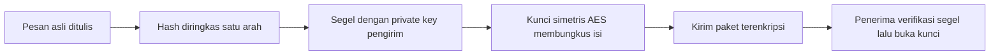

# Computer Security | Sesi 4: Encryption and Message Signature

> **Mata Kuliah:** Computer Security | **Sesi:** 4 | **Status:** Materi UTS

---

## 🔑 Cues
- Enkripsi simetris satu kunci versus asimetris sepasang kunci
- DES, Triple-DES, AES dan ukuran blok serta kunci
- Block cipher, IV, dan stream cipher
- Hash satu arah dan tahan kolisi
- Kerberos, CA, dan X.509
- Angka acak dan enkripsi data tersimpan

---

## 📖 Materi Utama

### 1. Dua Keluarga Kunci: Simetris dan Asimetris
Perangkat kriptografi mencakup symmetric encryption, public-key encryption, digital signatures, dan secure hash functions, dipakai untuk data transit maupun data tersimpan. Enkripsi simetris memakai kunci yang sama untuk mengenkripsi dan mendekripsi; musuhnya adalah cryptanalysis (mengeksploitasi sifat algoritma dan plaintext) dan brute-force attack (mencoba semua kunci). Tiga algoritma acuan: DES (Data Encryption Standard) berblok 64-bit dengan kunci 56-bit dan kini dianggap tidak aman; Triple-DES mengulang DES tiga kali dengan 2 atau 3 kunci unik sehingga lebih aman namun lambat; AES (Advanced Encryption Standard) pengganti DES berblok 128-bit dengan kunci 128, 192, atau 256-bit yang efisien dan aman. Enkripsi asimetris memakai pasangan public key dan private key: pembuatan pasangan, enkripsi dengan public key, dan dekripsi dengan private key harus mudah, tetapi menurunkan private key dari public key harus mustahil secara komputasi.

### 2. Membungkus Pesan: Cipher, Hash, dan Otentikasi
Block cipher mengenkripsi blok berukuran tetap dengan kunci simetris dan memakai Initialization Vector (IV) dari pembangkit angka acak untuk memperluas keyspace. Stream cipher menahan serangan aktif dengan memverifikasi keaslian pesan — isinya tidak diubah, sumbernya autentik, waktunya tepat — lewat authentication tag pada cleartext. Syarat hash function: menerima data berukuran apa pun, menghasilkan output panjang tetap, bersifat one-way (mustahil menurunkan input x dari hash h), dan collision resistant (mustahil menemukan dua input berbeda berhash sama). Message authentication memastikan pesan berasal dari sumber asli dan tidak diubah di jalan.

### 3. Kepercayaan Pihak Ketiga: Kerberos dan Sertifikat
Kerberos mempertemukan client, application server, dan Kerberos server sebagai standar de facto remote authentication. Certificate Authority (CA) adalah pihak ketiga tepercaya penerbit sertifikat digital, misalnya Let's Encrypt, untuk memverifikasi identitas para pihak. X.509 adalah standar ITU-T untuk format sertifikat public key yang dipakai HTTPS, S/MIME, dan VPN. Kualitas seluruh bangunan ini bergantung pada angka acak yang memenuhi randomness (distribusi seragam), unpredictability (tidak bisa ditebak dari nilai sebelumnya), dan kecepatan pembangkitan real-time; bila angka acak bisa diprediksi, kunci ikut bisa ditebak. Enkripsi data tersimpan (at rest) dikerjakan lewat back-end appliance, library-based tape encryption, atau background encryption pada PC dan laptop.

#### **Visualisasi Konsep: Surat Bersegel Dua Lapis**

---

## 🛠️ Use Case / Implementasi Nyata
- **Skenario:** Toko daring memproses pembayaran kartu lewat peramban pelanggan.
- **Masalah yang Diatasi:** Penyadap di jalur transit tidak bisa membaca nomor kartu atau memalsukan halaman bank.
- **Keuntungan:** Sertifikat X.509 membuktikan server itu asli, lalu AES menjaga kerahasiaan selama transit.

---

## 🗂️ Konsep Kunci

| Istilah | Definisi | Contoh / Catatan |
|---------|----------|-----------------|
| Brute-force | Mencoba semua kemungkinan kunci | Tak efektif lawan AES-256 |
| IV | Nilai awal pengacak block cipher | Mencegah pola berulang antar blok |
| One-way | Fungsi yang tak bisa dibalik | Sifat pokok hash |
| Collision resistance | Dua input tak boleh berhash sama | Syarat hash aman |
| CA | Penerbit sertifikat digital tepercaya | Memverifikasi identitas pihak |
| X.509 | Format standar sertifikat public key | Dipakai HTTPS dan VPN |
| Kerberos | Protokol autentikasi jarak jauh | Melibatkan client dan dua server |
| Randomness | Keacakan distribusi pembangkit | Salah satu syarat angka acak |

---

## 📊 Tabel Ringkasan

| Algoritma | Keluarga | Panjang Kunci | Status Keamanan |
|-----------|----------|---------------|-----------------|
| DES | Simetris | 56-bit | Rendah, bisa brute-force |
| Triple-DES | Simetris | 112 atau 168-bit | Sedang, lambat |
| AES | Simetris | 128, 192, atau 256-bit | Sangat tinggi |
| RSA | Asimetris | 2048-bit ke atas | Tinggi, tergantung panjang kunci |

---

## ⚠️ Catatan Penting
> **Data diam ikut dienkripsi** — kebocoran disk fisik atau pita backup sama berbahayanya dengan penyadapan transit, sehingga enkripsi at rest tidak boleh diabaikan.

---

## 📝 Materi Tambahan (Visual Insights)
- Tanda tangan digital memakai enkripsi public key untuk membuktikan identitas pengirim sekaligus keutuhan data.
- Digital signature umumnya menandatangani hash pesan, bukan seluruh pesan, demi efisiensi tanpa mengorbankan integritas.
