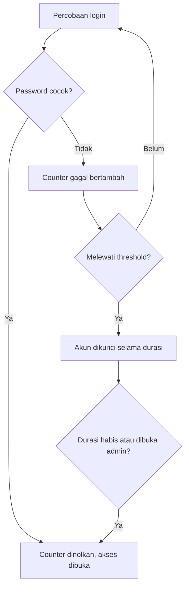

# Computer Security | Sesi 5: Understanding Security Policies

> **Mata Kuliah:** Computer Security | **Sesi:** 5 | **Status:** Materi UTS

---

## 🔑 Cues
- Kompleksitas 3 dari 4 kategori karakter
- Threshold, durasi, dan reset lockout
- Panjang versus usability
- History dan umur password
- Penegakan via Group Policy

---

## 📖 Materi Utama

### 1. Susunan Password: Kompleksitas dan Panjang
Fondasi program keamanan informasi adalah karyawan memakai password kuat. Aturan complexity menuntut minimal 3 dari 4 kategori: huruf besar (A–Z), huruf kecil (a–z), angka (0–9), dan non-alphanumeric seperti !, @, #, $, %. Password 14 karakter sangat aman tetapi sulit diingat, sehingga panjang password adalah tarik-menarik antara keamanan dan usability. Teknik penguatan yang disarankan: hindari detail personal (nama pasangan, tanggal lahir, SSN), lokasi, akronim umum, dan slang; gunakan pergeseran karakter (contoh "AArdvark!!" digeser 3 huruf menjadi "DDvgzdvn!!"); atau singkatan dari kalimat dan lagu (contoh "Anwycdfyc?" dari "Ask not what you can do for your country?"); serta racikan fakta personal plus simbol seperti "##Yell0w419".

### 2. Rem Tangan: Account Lockout
Account lockout membatasi percobaan login salah sebelum akun dikunci, dengan tiga kenop: Account Lockout Threshold (jumlah gagal sebelum dikunci), Account Lockout Duration (lama terkunci 0–99.999 menit, nilai 0 berarti hanya admin yang bisa membuka manual), dan reset account lockout counter after (jeda hingga penghitung gagal kembali nol). Nilai 0 pada durasi memaksa pengguna menghubungi helpdesk untuk verifikasi identitas.

### 3. Siklus Hidup: History dan Age
Password History menetapkan jumlah password unik yang wajib dipakai sebelum password lama boleh dipakai lagi, mencegah daur ulang password yang sama. Minimum Password Age mengatur jeda hari sebelum pengguna boleh mereset lagi (umumnya 10 hari atau lebih) agar history tidak diakali dengan mengganti password berkali-kali seketika. Maximum Password Age menetapkan batas wajib ganti (umumnya 90 hari untuk pengguna biasa, lebih singkat untuk admin). Penegakan terpusat di domain Windows dilakukan lewat Group Policy, dan edukasi soal serangan umum seperti social engineering sama pentingnya dengan kenop teknis.

#### **Visualisasi Konsep: Nasib Sekali Login Salah**

---

## 🛠️ Use Case / Implementasi Nyata
- **Skenario:** Koperasi simpan pinjam mengatur kebijakan login anjungan kasir via Active Directory.
- **Masalah yang Diatasi:** Bot penebak password yang mencoba ribuan kombinasi umum serta pegawai yang mendaur ulang password bocor lama.
- **Keuntungan:** Serangan otomatis tersendat oleh lockout dan history, tanpa admin mengatur tiap mesin manual.

---

## 🗂️ Konsep Kunci

| Istilah | Definisi | Contoh / Catatan |
|---------|----------|-----------------|
| Complexity | Syarat variasi karakter | Wajib 3 dari 4 kategori |
| Threshold | Batas gagal sebelum dikunci | Umumnya 3–5 kali |
| Duration | Lama akun terkunci | 15–30 menit; 0 berarti manual |
| History | Daftar password lama yang dilarang dipakai | Mencegah reuse |
| Min age | Jeda minimal antar penggantian | Menutup celah bypass history |
| Max age | Batas maksimal sebelum wajib ganti | Umumnya 90 hari |
| Group Policy | Penegakan kebijakan terpusat | Satu aturan untuk sedomain |

---

## 📊 Tabel Ringkasan

| Fitur | Fungsi | Nilai Acuan Umum |
|-------|--------|------------------|
| Complexity | Kekuatan karakter | Enabled |
| Length | Panjang minimal | 8–14 karakter |
| Threshold | Batas gagal login | 3–5 kali |
| Duration | Waktu penguncian | 15–30 menit |
| History | Cegah pemakaian ulang | 10–24 password |

---

## ⚠️ Catatan Penting
> **Aturan versus perilaku** — kebijakan yang terlalu rumit membuat pengguna menempel password di sticky note pada monitor, sehingga keamanan teknis runtuh oleh perilaku.

---

## 📝 Materi Tambahan (Visual Insights)
- Minimum age dan history adalah pasangan: tanpa jeda waktu, pengguna bisa memutar password berkali-kali dalam sekejap demi kembali ke favorit lama.
- Lockout adalah pertahanan utama melawan brute force dan dictionary attack.
