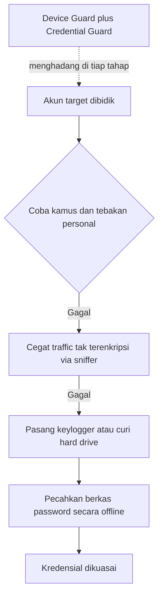

# Computer Security | Sesi 6: Understanding Common Attack Methods

> **Mata Kuliah:** Computer Security | **Sesi:** 6 | **Status:** Materi UTS

---

## 🔑 Cues
- Password sebagai mata rantai terlemah
- Dictionary attack dan password pendek
- Serangan fisik dan keylogger
- Sniffer jaringan nirkabel
- Device Guard dan Credential Guard

---

## 📖 Materi Utama

### 1. Titik Paling Rapuh: Password Pengguna
Password disebut weak link karena dua alasan: pengguna memilihnya sendiri sehingga kerap mudah ditebak, dan password kuat sekalipun tetap rentan terhadap beragam mekanisme serangan. Tebakan berbasis info personal (nama anak, tanggal lahir, foto di meja) disebut guessed passwords, sedangkan password bocor atau dibagi ke rekan kerja dilawan terutama lewat edukasi dan user awareness.

### 2. Dari Kamus sampai Kabel: Ragam Serangan Umum
Dictionary attack memakai kamus berisi daftar panjang password potensial dan sangat efektif pada password 7 karakter atau kurang; kamus semacam ini mudah diunduh dari internet. Cracked password terjadi saat penyerang mengantongi berkas password terenkripsi lalu memecahkannya offline dengan cracking tools. Network atau wireless sniffer menangkap paket yang lewat memakai perangkat lunak atau keras khusus — Wireshark adalah contoh populer — untuk mencuri kredensial dari traffic tak terenkripsi. Serangan fisik mem-bypass hampir semua proteksi digital: keylogger hardware atau software, kamera tersembunyi perekam ketikan, dan pencurian hard drive yang lalu dipasang di sistem lain sehingga data dibaca langsung tanpa lewat autentikasi OS target. Pola umum pengguna seperti huruf kapital di awal dan angka di akhir kata sudah masuk ke algoritma kamus modern.

### 3. Perisai Kredensial: Isolasi di Windows
Perlindungan akun domain memakai Device Guard yang mengeraskan sistem dengan hanya menjalankan aplikasi tepercaya, dan Credential Guard yang melindungi kredensial lewat isolasi berbasis virtualisasi sehingga malware di memori sulit mencurinya. Implementasi pada Windows 10 mencakup instalasi Hyper-V, Isolated User Mode, dan pengaktifan kedua fitur tersebut.

#### **Visualisasi Konsep: Jalan Penyerang Menuju Password**

---

## 🛠️ Use Case / Implementasi Nyata
- **Skenario:** Warnetographique warnet membiarkan pengunjung mencolok flashdisk sendiri ke PC billing.
- **Masalah yang Diatasi:** Keylogger titipan dan pencurian kredensial admin billing lewat akses fisik maupun sadapan WiFi terbuka.
- **Keuntungan:** Enkripsi disk penuh (BitLocker), traffic terenkripsi (TLS), dan isolasi kredensial menutup tiga jalan sekaligus.

---

## 🗂️ Konsep Kunci

| Istilah | Definisi | Contoh / Catatan |
|---------|----------|-----------------|
| Dictionary attack | Tebakan memakai daftar kata kamus | Mematikan untuk password pendek |
| Guessed password | Tebakan dari info personal korban | Tanggal lahir, nama anak |
| Keylogger | Pencatat ketikan keyboard | Dongle USB kecil atau software |
| Sniffer | Penangkap paket jaringan | Ganda: sah untuk admin, jahat di tangan penyerang |
| Offline attack | Peretasan dari berkas curian | Cracking tanpa koneksi ke server |
| Device Guard | Hanya menjalankan aplikasi tepercaya | Pengerasan anti-malware |
| Credential Guard | Isolasi kredensial via virtualisasi | Kredensial tak nangkring di memori biasa |
| Brute force | Mencoba semua kombinasi | Lambat dan haus komputasi |

---

## 📊 Tabel Ringkasan

| Metode | Sasaran | Penangkal Utama |
|--------|---------|-----------------|
| Dictionary attack | Password lemah | Complexity dan lockout |
| Serangan fisik | Hardware dan disk | Enkripsi disk penuh |
| Sniffer | Jaringan tak terenkripsi | Enkripsi end-to-end |
| Password dibagi | Kelalaian manusia | Pelatihan kesadaran pengguna |

---

## ⚠️ Catatan Penting
> **Akses fisik sama dengan kepemilikan** — bila penyerang memegang perangkatnya, seluruh password OS tidak berarti kecuali disk dienkripsi total.

---

## 📝 Materi Tambahan (Visual Insights)
- Malware modern mampu mencuri kredensial dari memori sistem, sehingga isolasi kredensial menjadi krusial.
- Sniffer adalah alat uji jaringan yang sah, tetapi disalahgunakan sebagai jalan pintas mencuri kredensial login.
