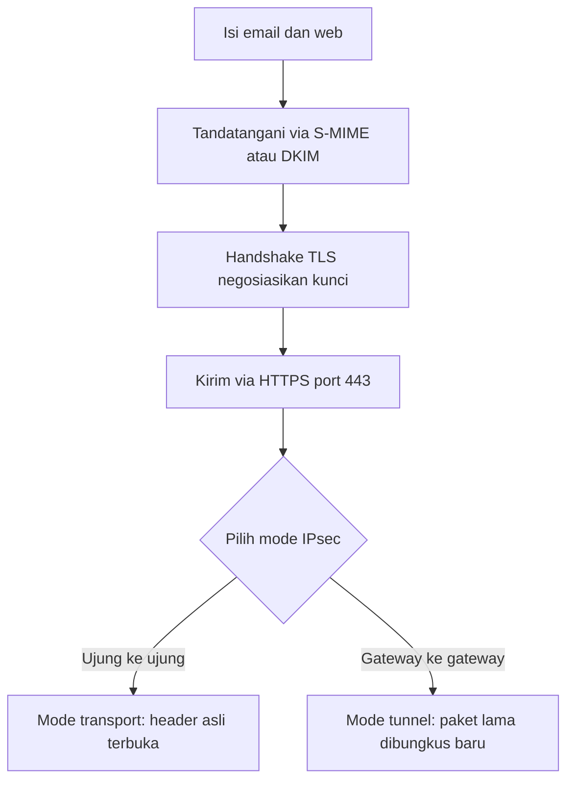

# Computer Security | Sesi 7: Internet Security Protocols

> **Mata Kuliah:** Computer Security | **Sesi:** 7 | **Status:** Materi UTS

---

## 🔑 Cues
- Model OSI tujuh lapis
- MIME dan S/MIME untuk email
- DKIM melawan spoofing
- Arsitektur TLS dan HTTPS port 443
- IPsec dan mode transport versus tunnel

---

## 📖 Materi Utama

### 1. Peta Lapisan: OSI dan Keamanan Email
Model OSI dari ISO memberi tujuh lapis konseptual agar sistem komunikasi heterogen bisa berinteraksi lewat protokol standar. Di atas peta itu, MIME memperluas format email RFC 822 agar mendukung multimedia (teks, gambar, audio, video), sedangkan S/MIME menambahkan tanda tangan digital dan enkripsi pesan, dirujuk pada RFC 5751 untuk spesifikasi pesan dan RFC 5652 untuk Cryptographic Message Syntax (CMS). DKIM menandatangani email secara kriptografis agar domain pengirim bisa diklaim bertanggung jawab; penerima mengambil public key dari DNS domain pengirim untuk verifikasi, sehingga email spoofing terhambat.

### 2. Jalur Web: TLS dan HTTPS
SSL adalah pendahulu yang kini digantikan TLS (Transport Layer Security), standar internet RFC 4346 untuk layanan keamanan umum berbasis TCP. Arsitekturnya berlapis: Handshake Protocol menegosiasikan parameter keamanan, Alert Protocol menangani error dan peringatan, dan Heartbeat Protocol menjaga koneksi tetap hidup — protokol terakhir ini terkenal karena eksploitasi Heartbleed yang membocorkan memori berisi kunci privat lewat pesan heartbeat manipulatif. HTTPS memadukan HTTP dengan SSL/TLS di port 443 (HTTP polos memakai port 80), mengenkripsi URL, isi dokumen, data form, cookies, dan HTTP header.

### 3. Jalur Jaringan: IPsec Dua Mode
IPsec adalah grup protokol koneksi terenkripsi di level IP dengan tiga area fungsional: authentication, confidentiality, dan key management. Mode transport melindungi payload paket dengan header asli tetap terlihat, cocok untuk komunikasi end-to-end antar host. Mode tunnel melindungi seluruh paket IP asli dengan membungkusnya dalam header IP baru, cocok untuk koneksi antar gateway seperti VPN. Penerapannya mencakup koneksi kantor cabang, akses remote, extranet atau intranet bersama mitra, dan penguatan e-commerce, baik pada IPv4 maupun IPv6 sehingga aplikasi tanpa pengaman bawaan ikut terlindungi.

#### **Visualisasi Konsep: Surat, Amplop, dan Terowongan**

---

## 🛠️ Use Case / Implementasi Nyata
- **Skenario:** Konsultan mengakses arsip kantor dari kafe memakai WiFi publik.
- **Masalah yang Diatasi:** Penyadap di udara tidak bisa membaca dokumen atau memalsukan halaman login.
- **Keuntungan:** Tunnel mode menyembunyikan alamat internal asli, sementara TLS menjaga isi aplikasi.

---

## 🗂️ Konsep Kunci

| Istilah | Definisi | Contoh / Catatan |
|---------|----------|-----------------|
| S/MIME | Email aman berenkripsi dan bertanda tangan | Berbasis sertifikat X.509 |
| DKIM | Verifikasi domain pengirim via DNS | Menekan email palsu |
| TLS | Penerus SSL untuk keamanan transport | Acuan RFC 4346 |
| Heartbleed | Bug protokol heartbeat OpenSSL | Membocorkan memori server |
| HTTPS | HTTP di atas TLS | Port 443; HTTP polos port 80 |
| Transport mode | Proteksi payload, header asli terbuka | Komunikasi host ke host |
| Tunnel mode | Seluruh paket dibungkus header baru | VPN antar gateway |

---

## 📊 Tabel Ringkasan

| Fitur | S/MIME | DKIM | PGP |
|-------|--------|------|-----|
| Tujuan | Integritas dan enkripsi | Otentikasi domain | Integritas dan enkripsi |
| Mekanisme | Sertifikat X.509 | Public key di DNS | Web of trust |
| Pemakaian | Email korporat | Infrastruktur email | Komunitas privasi tinggi |

---

## ⚠️ Catatan Penting
> **Versi itu penting** — SSL 3.0 sudah tidak aman sehingga produksi wajib memakai TLS 1.2 atau lebih baru; tunnel mode penting untuk VPN karena menyembunyikan alamat IP internal asli.

---

## 📝 Materi Tambahan (Visual Insights)
- Arsitektur surat internet memperlihatkan modul fungsi dan protokol standar antara agen pengirim dan penerima.
- TLS Record Protocol duduk di bawah sub-protokol handshake, alert, change cipher spec, dan heartbeat, lalu bersandar pada TCP dan IP.
