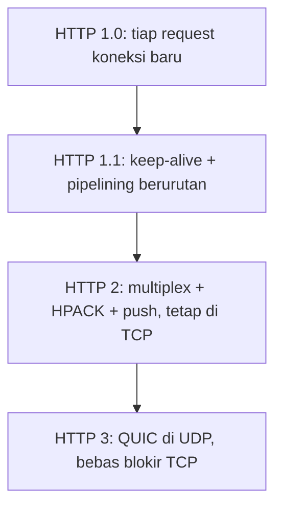
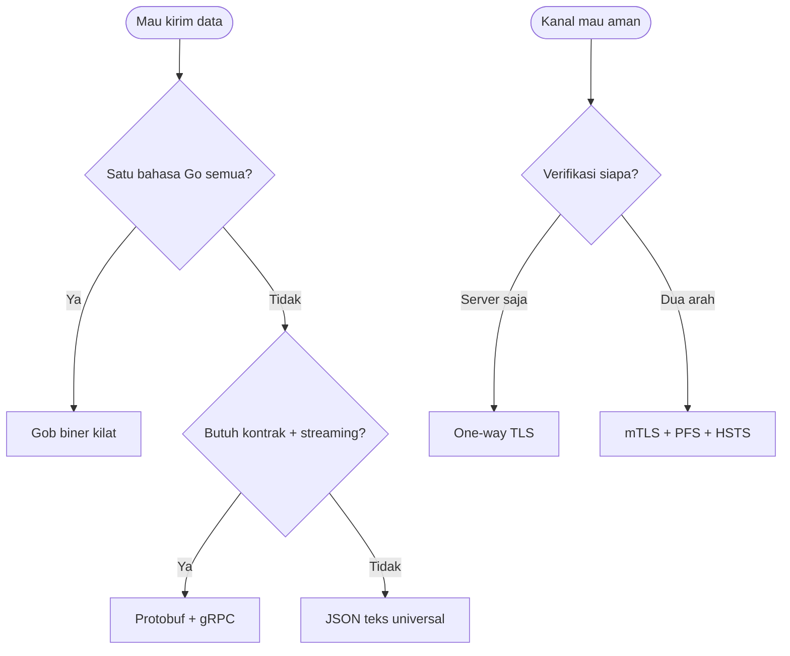
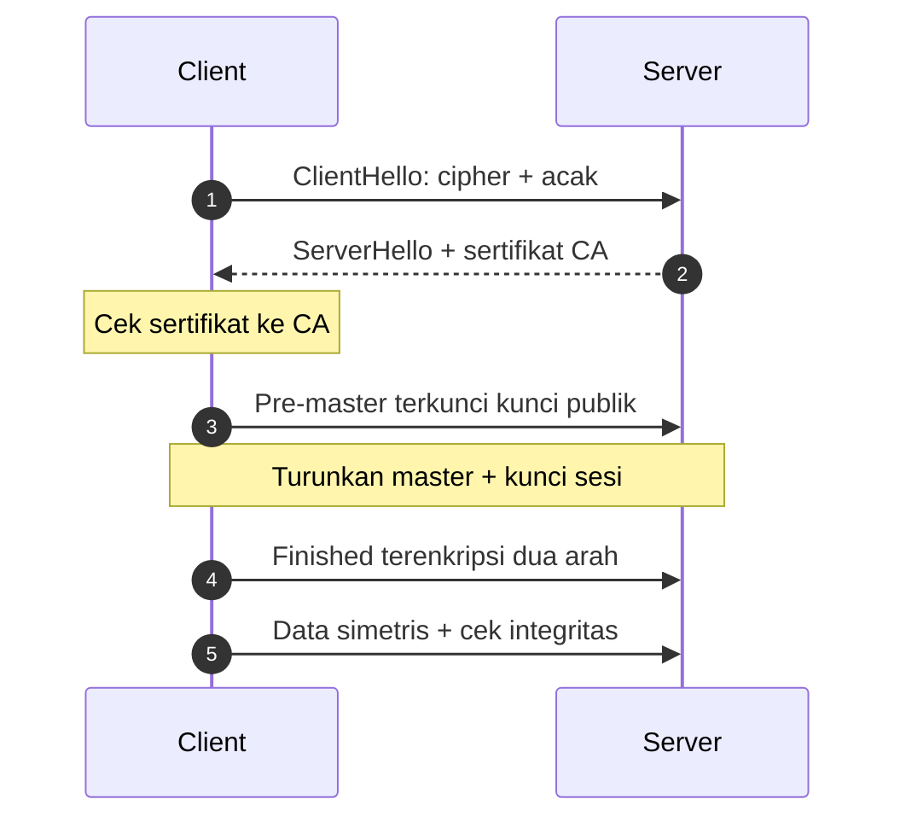

# Network and System Programming | Sesi 0: Kisi-Kisi UAS

> **Mata Kuliah:** Network and System Programming | **Sesi:** 0 | **Status:** Materi UAS

---

## 🔑 Cues

- Koneksi persisten lawan buka-tutup
- Antrean respons berurutan
- Multipleks aliran sejalur
- Kompresi kepala HPACK
- Dorongan proaktif server
- QUIC di atas UDP
- Jabat kripto TLS
- Enkripsi hibrida ganda
- Rahasia masa lalu anti-bocor
- Verifikasi searah dan dua arah
- Kepala pemaksa HTTPS
- Kompresi musuh enkripsi
- Tiga jurus serialisasi
- Kontrak titik-proto
- Studi fintech dan migrasi

---

## 📖 Materi Utama

### 1. Bank Soal: Evolusi HTTP

- **1.1** — Bedakan HTTP/1.0 vs HTTP/1.1 dalam pengelolaan koneksi TCP, dan jelaskan mengapa bedanya menentukan performa web.
- **1.2** — Apa itu head-of-line blocking di HTTP/1.1? Bagaimana HTTP/2 menanganinya, dan apakah tuntas? Jelaskan.
- **1.3** — Sebutkan dan jelaskan minimal 3 fitur baru HTTP/2 beserta manfaatnya.
- **1.4** — HTTP/3 berganti transport protocol. Apa yang berubah, mengapa, dan apa untungnya?
- **1.5** — Satu halaman butuh 30 resource (CSS, JS, gambar). Bandingkan penanganan HTTP/1.1 vs HTTP/2 — mana lebih efisien dan mengapa?

### 2. Bank Soal: HTTPS / SSL / TLS

- **2.1** — Apa itu TLS, mengapa SSL dipensiunkan, dan versi TLS mana yang dianjurkan?
- **2.2** — Uraikan TLS handshake lengkap: pesan yang dipertukarkan beserta maksud tiap pesan.
- **2.3** — Mengapa handshake dituduh menambah latency? Mekanisme apa yang memangkas overhead pada koneksi berikutnya?
- **2.4** — Peran enkripsi asymmetric vs symmetric di TLS, dan mengapa keduanya dipakai bersama?
- **2.5** — Apa itu Perfect Forward Secrecy (PFS)? Skenario serangan apa yang ditutupnya dan bagaimana caranya?
- **2.6** — Bedakan one-way authentication vs mutual authentication (mTLS): kapan dipakai dan contoh nyatanya?
- **2.7** — Sebutkan minimal 5 best practice pengamanan data in-transit via TLS.
- **2.8** — Mengapa kompresi + enkripsi TLS berbahaya? Serangan apa yang mengintai?

### 3. Bank Soal: API dan Serialisasi

- **3.1** — Apa itu serialisasi dalam network programming? Sebutkan 3 metodenya beserta karakteristiknya.
- **3.2** — Diberikan struct `Person` (Name/Age/Email + tag `json:"..."`) yang di-`json.Marshal`: (a) apa kerja `Marshal`, (b) fungsi struct tag, (c) output `string(jsonData)`, (d) apa berubah bila tag dibuang?
- **3.3** — Bedakan `encoding/json` vs `encoding/gob`: kapan pilih mana, dan apa batas utama gob?
- **3.4** — Apa itu Protocol Buffers dan mengapa unggul atas JSON untuk microservice multi-bahasa?
- **3.5** — Apa itu gRPC, hubungannya dengan protobuf, dan fitur pembedanya dari REST?
- **3.6** — Langkah membangun gRPC service Go sederhana, dari definisi hingga server-client jalan.
- **3.7** — Diberikan `.proto` (`MyService.SayHello`, `HelloRequest.name = 1`, `HelloResponse.greeting = 1`): (a) makna tiap bagian, (b) arti `= 1`, (c) command generate Go, (d) hasil generate.

### 4. Bank Soal: Studi Kasus

- **4.1 (Fintech)** — Auth Service Go + Payment Java + Notification Python di private network: (a) format serialisasi antar-service, (b) pengamanan komunikasi internal + autentikasinya, (c) versi HTTP mobile app + fitur relevannya, (d) teknologi update real-time Notification←Payment plus contoh `.proto`-nya.
- **4.2 (Migrasi HTTPS)** — Dari HTTP polos ke HTTPS dengan 4 syarat: traffic terenkripsi; browser selalu diarahkan ke HTTPS; kunci bocor tak boleh membuka rekaman lama; partner API diautentikasi kriptografis. Solusi tiap syarat + cara kerjanya.
- **4.3 (Bedah kode gRPC)** — Server (`net.Listen :50051`, `grpc.NewServer`, `Serve` tanpa cek error) dan client (`grpc.Dial` + `WithInsecure` tanpa cek error/close, RPC tanpa cek error): (a) semua masalah + bahayanya, (b) makna `WithInsecure` — kapan boleh vs haram, (c) tulis ulang keduanya dengan benar.
- **4.4 (StreamGo)** — Halaman video (1 HTML + 4 CSS + 8 JS + 15 thumbnail + 1 manifest = 29 resource) lambat di HTTP/1.1 padahal bandwidth lega: (a) mengapa HTTP/1.1 jadi bottleneck, (b) versi pengganti + fitur penolongnya, (c) 3 optimasi tambahan, (d) apa yang needed untuk pengamanan + hubungannya dengan pilihan (b).

#### **[Visualisasi Konsep]**



---

## Library Diagram & Arsitektur

### Peta pilih senjata: format kiriman dan kanal aman



### Alur handshake versi ujian



---

## 🛠️ Use Case / Implementasi Nyata

- **Skenario:** Jawaban studi kasus diringkas menjadi keputusan arsitektur: protobuf untuk tiga service beda bahasa; mTLS dengan sertifikat CA internal untuk traffic privat; HTTP/2 untuk aplikasi mobile (multiplex + HPACK + persisten, praktisnya menuntut HTTPS); gRPC server-side streaming untuk status transaksi real-time.
- **Masalah yang Diatasi:** Gob buta lintas bahasa; API key tanpa kriptografi bisa dipalsukan siapa pun di jaringan; HTTP/1.1 mengantrekan puluhan resource; polling status memboroskan request.
- **Keuntungan:** Satu skema `.proto` untuk Go/Java/Python; hanya pemegang sertifikat sah yang tersambung; puluhan panggilan paralel dalam satu koneksi; update mengalir tanpa polling.

```proto
syntax = "proto3";
service PaymentService {
  rpc StreamTransactionStatus (TransactionRequest) returns (stream TransactionUpdate);
}
message TransactionRequest {
  string transaction_id = 1;
  string user_id = 2;
}
message TransactionUpdate {
  string transaction_id = 1;
  string status = 2;
  string timestamp = 3;
  string message = 4;
}
```

---

## 🗂️ Konsep Kunci

| Istilah | Definisi | Contoh / Catatan |
|---------|----------|-----------------|
| Keep-alive | Satu TCP untuk banyak request berurutan | HTTP/1.1 |
| HOL blocking | Respons antre di belakang yang lambat | HTTP/1.1 wajib urut |
| Multiplexing | Banyak stream paralel se-koneksi | Binary framing + nomor stream |
| HPACK | Kompresi header via Huffman + tabel | Header repetitif menyusut |
| Server push | Server kirim sebelum diminta | `index.html` ditemani CSS/JS |
| QUIC | Transport UDP pengganti TCP | 0-RTT/1-RTT, migrasi koneksi |
| Hybrid encryption | Asimetris antar kunci, simetris antar data | Inti TLS |
| Session resumption | Pakai ulang sesi via ID/ticket | Hemat 1 RTT |
| PFS | Sesi lama aman walau kunci bocor | DHE/ECDHE, kunci dibuang |
| mTLS | Sertifikat dua arah | Service-mesh, API partner |
| HSTS | Header `Strict-Transport-Security` | Anti downgrade |
| CRIME/BREACH | Tebak rahasia dari ukuran kompresi | Jangan kompres-terenkripsi |
| Field number | Identitas biner field protobuf | Jangan ubah pasca-production |

---

## 📊 Tabel Ringkasan

### Pembahasan 1.x — HTTP dalam angka

| Butir | Kunci jawaban |
|-------|---------------|
| 1.1 | 1.0 buka-tutup koneksi per request (mahal handshake); 1.1 keep-alive (+pipelining) untuk banyak request sejalur — latency total anjlok |
| 1.2 | HOL 1.1: respons wajib urut, satu lambat menahan semua; HTTP/2 multiplex via frame ber-stream — tuntas di level HTTP, tersisa di level TCP (satu paket hilang menahan semua stream) → dijawab HTTP/3/QUIC |
| 1.3 | Multiplexing (paralel se-koneksi); HPACK (header repetitif dikompres Huffman+tabel); server push (kirim sebelum diminta); bonus binary framing (parse mesin efisien) |
| 1.4 | TCP diganti QUIC/UDP: stream independen (hilang satu tak blokir lain), handshake gabungan 0-RTT/1-RTT, connection migration (pindah WiFi–seluler tak putus) |
| 1.5 | 1.1: ~6 koneksi paralel per domain → 30 resource antre ~5 batch + overhead handshake + solusi tempel domain sharding; 2: 30 request multiplex satu koneksi + push + HPACK — jauh lebih efisien |

### Pembahasan 2.x — TLS dalam angka

| Butir | Kunci jawaban |
|-------|---------------|
| 2.1 | TLS = sampul kripto (confidentiality, integrity, authentication); SSL pensiun (SSL 3.0 rentan POODLE, RFC 7568 Juni 2015; 1.0/1.1 ikut deprecated); minimal TLS 1.2, terbaik 1.3; matikan SSLv2/v3, TLS 1.0/1.1 |
| 2.2 | ClientHello → ServerHello → sertifikat → verifikasi CA → pre-master terkunci → master diturunkan independen → kunci sesi → Finished dua arah → data simetris |
| 2.3 | Biaya: TCP 1 RTT + TLS 1–2 RTT (total 2–3 RTT) + komputasi asimetris; peringan: resumption (ID/ticket, hemat 1 RTT) dan TLS 1.3 (1-RTT, 0-RTT lanjutan) |
| 2.4 | Asimetris = kurir kunci (lambat, sekali pakai); simetris = kurir data (cepat, massal); hanya-satu gagal di kecepatan atau di distribusi kunci awal |
| 2.5 | PFS: kunci sesi independen (DHE/ECDHE, dibuang usai pakai; private key hanya tanda tangan) — rekaman curian bertahun-tahun tetap buntu, mis. cipher `ECDHE-RSA-AES256-GCM-SHA384` |
| 2.6 | One-way: server unjuk sertifikat (browsing umum); mTLS: +CertificateRequest dan sertifikat client (microservice, API partner, finansial) |
| 2.7 | TLS 1.2+; cipher kuat (AES-GCM/ChaCha20, buang RC4/DES/3DES/NULL); PFS; HSTS; validasi + OCSP (+mTLS); tanpa kompresi; rotasi ticket bijak |
| 2.8 | Kompresi mengganti repetisi dengan pendek — penyerang selipkan tebakan, ukuran menyusut = tebakan benar; token terkuras tanpa dekripsi (CRIME/BREACH) |

### Pembahasan 3.x — Serialisasi dalam angka

| Butir | Kunci jawaban |
|-------|---------------|
| 3.1 | Serialisasi = objek menjadi format simpan/kirim; JSON (teks, lintas bahasa, lambat-besar, `Marshal`/`Unmarshal`); Gob (biner Go-only, cepat, `NewEncoder`/`NewDecoder`); Protobuf (biner lintas bahasa, `.proto` + `protoc`, tercepat-terkecil) |
| 3.2 | (a) Struct menjadi byte slice JSON; (b) tag memetakan nama field ke kunci; (c) `{"name":"Alice","age":25,"email":"alice@example.com"}`; (d) tanpa tag kunci = nama Go (`{"Name":...,"Age":...,"Email":...}`) |
| 3.3 | JSON untuk API lintas bahasa/browser/debug; Gob untuk Go-ke-Go internal/persistensi Go; batas Gob: tak terbaca bahasa lain |
| 3.4 | Protobuf: satu `.proto` → kode Go/Java/Python/C++; biner cepat-kecil; typed ketat; field number = evolusi tanpa breaking |
| 3.5 | gRPC = panggil fungsi remote seolah lokal via protobuf IDL; beda REST: HTTP/2, kontrak wajib, generate otomatis, streaming dua arah, flow control, auth pluggable |
| 3.6 | Tulis `.proto` → `protoc` (lihat command di Materi Sesi 11) → struct implementasi + `Register` + `Listen`/`Serve` → `Dial` + stub `NewMyServiceClient` → server dulu baru client |
| 3.7 | (a) `proto3`, package/namespace, service+rpc, dua message; (b) field number identitas biner + kompatibilitas; (c-d) command `protoc` → `service.pb.go` (struct+marshal) dan `service_grpc.pb.go` (interface server, client, register) |

### Pembahasan 4.x — Studi kasus dalam angka

| Kasus | Keputusan + alasan |
|-------|-------------------|
| 4.2 migrasi | Enkripsi: HTTPS TLS 1.2+ sertifikat CA + cipher kuat; paksa: HSTS `max-age=31536000; includeSubDomains; preload`; arsip: PFS ECDHE; partner: mTLS via CA internal + CertificateRequest |
| 4.3 bedah kode | Server: error `Serve` tak dicek + tanpa graceful shutdown; client: error `Dial` tak dicek (nil conn → panic), tanpa `defer Close` (bocor), error RPC tak dicek (nil response → panic), `WithInsecure` plaintext; `WithInsecure` boleh di localhost/testing/VPN/mesh, haram di production terbuka |
| 4.4 StreamGo | (a) 29 resource antre di ~6 koneksi paralel (~5 batch) + handshake + HOL + header repetitif; (b) HTTP/2: multiplex semua + HPACK + push; (c) CDN edge, `Cache-Control max-age=31536000` untuk aset statis, minify+bundling+gzip/brotli; (d) browser menuntut HTTPS untuk HTTP/2 → sertifikat (mis. Let's Encrypt) + TLS 1.2+ + HSTS + session resumption |

---

## ⚠️ Catatan Penting

> **[Enam lawan lima]** — Ingat pasangan angka ujian: browser membuka ~6 koneksi per domain, sehingga 30 resource HTTP/1.1 antre ~5 batch — sedangkan HTTP/2 menampung semuanya dalam satu koneksi.

> **[Tanpa tag, PascalCase menang]** — Struct Go tanpa tag JSON memuntahkan `{"Name":...}`; satu huruf kapital bisa menggagalkan kontrak dengan konsumen lowercase.

> **[Insecure = telanjang]** — `grpc.WithInsecure()` mematikan TLS; man-in-the-middle bisa membaca dan mengubah seluruh RPC — hanya sah di localhost, testing, atau balik kanal aman lain.

---

## 📝 Materi Tambahan (Visual Insights)

- Perbaikan kode 4.3 intinya tiga disiplin: cek tiap error (`Listen`, `Dial`, `Serve`, RPC), `defer connection.Close()` setelah Dial sukses, dan ganti `WithInsecure` dengan kredensial transport TLS di production — plus log alamat listen agar kegagalan terlihat, bukan sunyi.
- Server gRPC versi benar mencetak `gRPC server running on :50051` dan menggagalkan proses (`log.Fatalf`) bila `Serve` error; client versi benar mencetak `Server response: %s` hanya setelah error RPC dipastikan nihil.
- StreamGo dan fintech adalah soal yang sama dengan kostum beda: bottleneck paralelisme (HTTP/1.1 vs multiplex), keamanan berlapis (HTTPS/PFS/mTLS), dan kontrak lintas bahasa (protobuf) — kuasai ketiganya maka semua studi kasus runtuh ke pola yang sama.

#### Pasangan Serangan Kompresi

- CRIME menyerang kompresi level TLS, BREACH menyerang kompresi HTTP (gzip) — keduanya membaca rahasia dari ukuran, dan keduanya gugur oleh satu aturan: jangan kompres data terenkripsi yang bercampur input penyerang.

---

## ✅ Standar Visual & Orisinalitas (bar jual — wajib untuk semua catatan)

- **Sintesis orisinal**: struktur, diagram, dan contoh milik sendiri. Sumber (materi aslab/dosen) hanya referensi fakta. Jangan cerminkan urutan langkah, nama contoh, atau naskah sumber.
- **Konsistensi visual**: judul `# MK | Sesi N: Judul`, callout pembuka, cues ≤15 dalam toggle, tabel selalu ber-header, blok kode ≤2000 char (lebih = pecah), ikon + cover judul terisi otomatis saat import.
- **Jujur provenance**: bila sumber hanya kerangka/tanpa isi, tulis di Sumber bahwa isi disusun dari dokumentasi umum.
