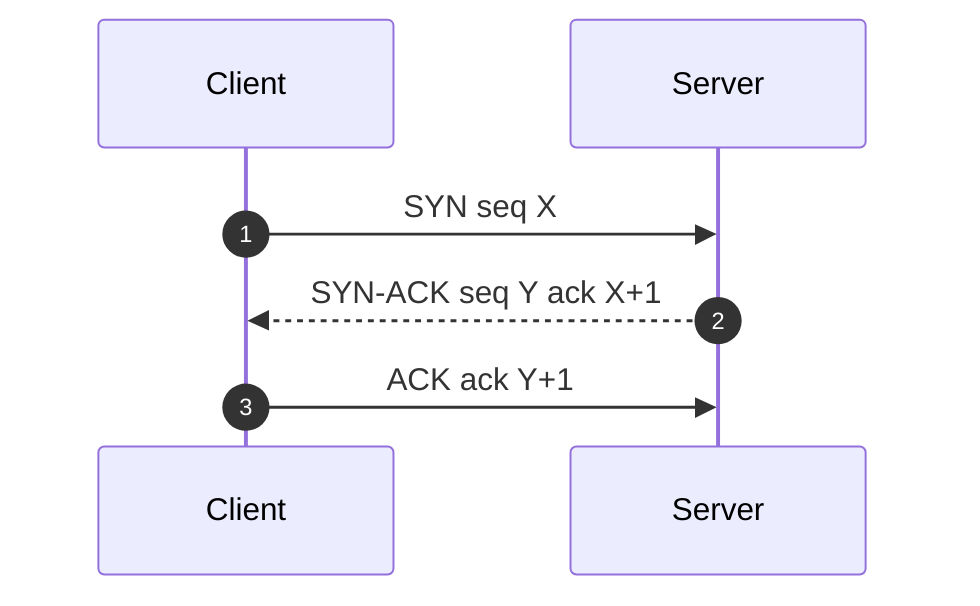
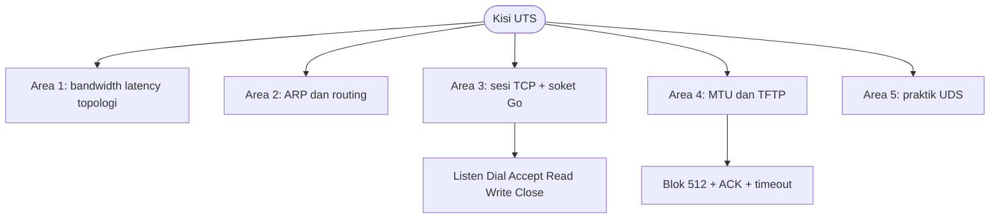
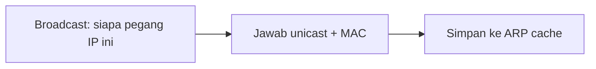

# Network and System Programming | Sesi 0: Kisi-Kisi UTS

> **Mata Kuliah:** Network and System Programming | **Sesi:** 0 | **Status:** Materi UTS

---

## 🔑 Cues

- Daya tampung dan jeda respons
- Enam pola keterhubungan
- Penerjemah IP ke MAC
- Protokol rute dalam dan luar
- Jabat tangan tiga langkah
- Alur soket Go
- Batas muatan dan pecah paket
- Andalkan UDP via TFTP
- Obrolan satu mesin
- Port dan perintah wajib hafal

---

## 📖 Materi Utama

### 1. Kapasitas, Respons, dan Pola Jaringan

- **Bandwidth** adalah transfer maksimum per satuan waktu; awas satuan `B` (Byte) vs `b` (bit) — 1 Byte = 8 bit. Rumus waktu transfer: `Waktu = Ukuran File (bit) / Bandwidth (bps)`.
- **Latency** adalah jeda kirim-permintaan sampai terima-respons; **ping** mengukur **RTT** (pergi + proses di tujuan + pulang).
- Enam topologi: **point-to-point** (sepasang node langsung), **bus** (satu link bersama, semua mengintip traffic), **ring** (tiap node dua tetangga, satu gagal semua kena), **star** (hub pusat, mudah kelola tapi single point of failure), **mesh** (semua-ke-semua, paling andal tapi mahal), **hybrid** (racikan fleksibel).

### 2. Dari Alamat ke Rute

- **ARP** hidup di Layer 2 + 3: menerjemahkan IP (L3) ke MAC (L2) via Broadcast Request → Target Reply → ARP Cache.
- **Static routing** manual dan kaku untuk jaringan kecil; **dynamic routing** otomatis-adaptif dengan overhead protokol.
- **OSPF** (link-state, IGP, Dijkstra, konvergensi cepat), **EIGRP** (distance vector, IGP, proprietary Cisco, konvergensi cepat), **BGP** (path vector, EGP, routing antar-AS — "layanan pos internet").

### 3. Sesi TCP dan Soket Go

- **Three-way handshake**: SYN (client mengetuk) → SYN-ACK (server menyetujui) → ACK (client mengunci).
- **Server**: `net.Listen` → `Accept` → `Read/Write` → `Close`. **Client**: `net.Dial` → `Write/Read` → `Close`. Tipe network: `"tcp"`, `"udp"`, `"unix"`.
- Selalu `defer conn.Close()` segera usai koneksi terbuka — anti bocor resource dan file descriptor.

### 4. Fragmentasi dan UDP yang Diandalkan

- **MTU** adalah muatan maksimum paket; standar Ethernet **1500 bytes**. Paket lebih besar dipecah; satu fragment hilang berarti paket gagal total.
- UDP defaultnya connectionless dan unreliable; **TFTP** mengandalkannya di lapis aplikasi: ACK per blok **512 bytes** plus kirim-ulang saat timeout.

### 5. Soket Satu Mesin

- **UDS** adalah IPC penghuni mesin yang sama: jalan di kernel tanpa overhead network stack, beralamat path berkas.
- Praktiknya: tutup via `defer`, bersihkan berkas `.sock` basi sebelum bind, dan set permission soket dengan tepat.

#### **[Visualisasi Konsep]**

---

## Library Diagram & Arsitektur

### Peta kisi UTS: lima area satu pandang

### Siklus ARP

---

## 🛠️ Use Case / Implementasi Nyata

- **Skenario:** Simulasi ujian: hitung waktu transfer berkas 80 Mb lewat link 10 Mbps, lalu jelaskan mengapa dua PC satu switch perlu ARP sebelum TCP handshake.
- **Masalah yang Diatasi:** Satuan Byte/bit yang tertukar mengacaukan hitungan; tanpa ARP, frame tak tahu MAC tujuan sehingga handshake tak pernah mulai.
- **Keuntungan:** `80.000.000 / 10.000.000 = 8 detik` (dengan 1 Byte = 8 bit sebagai kunci konversi), dan cache ARP membuat koneksi berikutnya tanpa broadcast ulang.

---

## 🗂️ Konsep Kunci

| Istilah | Definisi | Contoh / Catatan |
|---------|----------|-----------------|
| Bandwidth | Transfer maksimum per waktu | Rumus waktu = ukuran/bandwidth |
| RTT | Waktu pergi-pulang request | Diukur via ping |
| MTU | Muatan maksimum paket | Ethernet: 1500 bytes |
| IGP | Protokol routing dalam AS | OSPF, EIGRP, RIP |
| EGP | Protokol routing antar-AS | BGP |
| ARP cache | Tabel IP-ke-MAC hasil resolusi | Buah broadcast + reply |
| UDS | Soket IPC satu mesin | Beralamat path berkas |

---

## 📊 Tabel Ringkasan

| Fitur | IPv4 | IPv6 |
|-------|------|------|
| Panjang alamat | 32-bit | 128-bit |
| Notasi | Dotted-decimal | Hexadecimal |
| IPsec | Opsional | Wajib bawaan |
| Kapasitas | Sekitar 4 miliar | Sekitar 340 undecillion |

| Aspek | TCP | UDP |
|-------|-----|-----|
| Koneksi | Oriented, handshake | Connectionless |
| Keandalan | Ya, ACK + retransmisi | Tidak, best effort |
| Urutan | Ya, sequence number | Tidak |
| Laju | Lambat ber-overhead | Cepat ringan |

| Layanan | Port | Transport |
|---------|------|-----------|
| TFTP | 69 | UDP |
| HTTP | 80 | TCP |
| HTTPS | 443 | TCP |
| SSH | 22 | TCP |

---

## ⚠️ Catatan Penting

> **[Byte lawan bit]** — Salah kapital satu huruf menggeser jawaban 8× lipat; selalu konversi ke bit sebelum membagi dengan bandwidth bps.

> **[Defer itu tameng]** — `defer conn.Close()` tepat setelah koneksi sukses adalah satu baris pembeda antara program bersih dan kebocoran file descriptor.

---

## 📝 Materi Tambahan (Visual Insights)

- MTU dan fragmentasi bertalian sebab-akibat: payload melewati batas MTU memaksa network layer memecah paket mengikuti kapasitas media fisik — dan satu fragment hilang menggugurkan seluruh paket.
- UDS tercepat justru untuk yang tak pernah keluar mesin; memaksanya lintas host adalah salah alamat konsep.

#### Port Sebagai Alamat Pintu

- Hafalkan kuartetnya: 69 untuk TFTP, 80 HTTP, 443 HTTPS, 22 SSH — transport-nya (UDP vs TCP) ikut menentukan sifat layanan.

---

## ✅ Standar Visual & Orisinalitas (bar jual — wajib untuk semua catatan)

- **Sintesis orisinal**: struktur, diagram, dan contoh milik sendiri. Sumber (materi aslab/dosen) hanya referensi fakta. Jangan cerminkan urutan langkah, nama contoh, atau naskah sumber.
- **Konsistensi visual**: judul `# MK | Sesi N: Judul`, callout pembuka, cues ≤15 dalam toggle, tabel selalu ber-header, blok kode ≤2000 char (lebih = pecah), ikon + cover judul terisi otomatis saat import.
- **Jujur provenance**: bila sumber hanya kerangka/tanpa isi, tulis di Sumber bahwa isi disusun dari dokumentasi umum.
