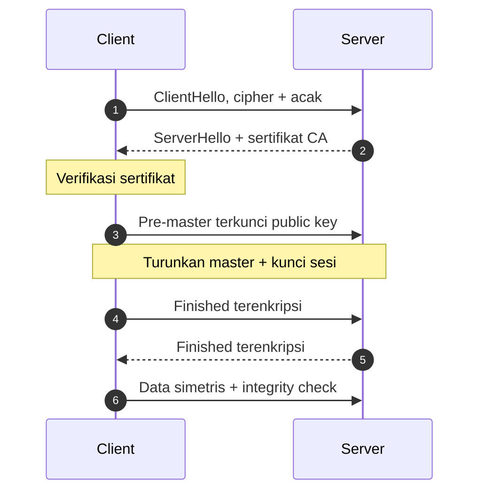
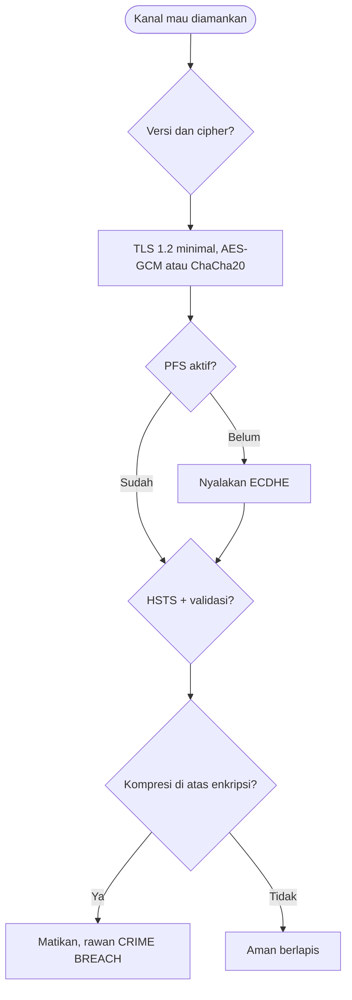
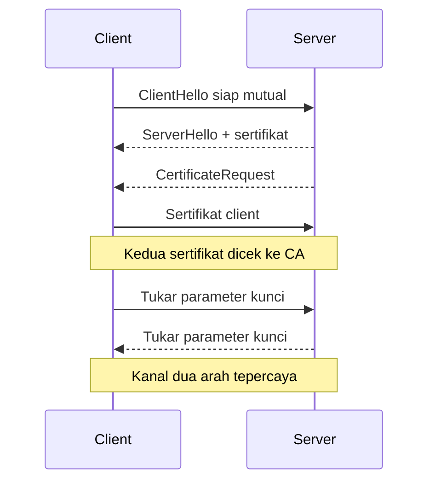

# Network and System Programming | Sesi 10: Mengamankan Komunikasi dengan TLS

> **Mata Kuliah:** Network and System Programming | **Sesi:** 10 | **Status:** Materi UAS

---

## 🔑 Cues

- Protokol sampul kripto
- Pengganti SSL yang pensiun
- Perkenalan ClientHello ServerHello
- Tukar kunci lalu kunci sesi
- Enkripsi ganda hibrida
- Pakai ulang sesi lama
- Kunci bocor, masa lalu aman
- Verifikasi dua arah
- Kepala pemaksa HTTPS
- Kompresi lawan enkripsi

---

## 📖 Materi Utama

### 1. Sampul Kripto Pengganti SSL

**Transport Layer Security (TLS)** adalah protokol kriptografi pembungkus komunikasi jaringan agar **confidential** (terenkripsi), **berintegritas** (utak-atik terdeteksi), dan **terautentikasi** (lawan bicara terverifikasi). Ia penerus **SSL** yang independen-aplikasi sejak **RFC 2246 (1999)**; SSL 3.0 yang retak dipensiunkan via **RFC 7568 (Juni 2015)**. Aturan versi: minimal **TLS 1.2**, idealnya **TLS 1.3** (handshake 1-RTT, bahkan 0-RTT untuk sesi lanjutan); matikan SSLv2, SSLv3, TLS 1.0, dan TLS 1.1.

### 2. Perkenalan Aman: Handshake Satu Arah

1. **ClientHello** — client menyapa dengan versi TLS, daftar cipher suite, dan bilangan acak buatannya.
2. **ServerHello** — server memilih satu cipher suite bersama dan menyumbang bilangan acaknya.
3. **Server Certificate** — server menunjukkan sertifikat digital (public key + tanda tangan **Certificate Authority/CA**).
4. **Verifikasi sertifikat** — client memeriksa sertifikat memakai public key CA tepercaya; lolos berarti server memang yang diklaim.
5. **Key exchange** — client meramu **pre-master secret**, menguncinya dengan public key server, lalu mengirimnya; hanya pemegang private key yang bisa membuka.
6. **Master secret** — kedua pihak menurunkan **master secret** secara independen dari pre-master plus dua bilangan acak, lalu menurunkan **session keys** simetris.
7. **Finished** — pesan pamungkas terenkripsi dari kedua pihak sebagai bukti handshake genap.
8. **Transfer data** — seluruh muatan dienkripsi kunci sesi simetris plus integrity check.
9. **Perpisahan** — pesan "Goodbye" dua arah menutup koneksi secara sopan.

### 3. Dua Enkripsi yang Saling Melengkapi

- **Asimetris** (kunci publik vs privat): lambat dan berat, dipakai sekali — mengantar pre-master secret dengan aman antar pihak yang belum pernah bertemu.
- **Simetris** (satu kunci sesi dua arah): ringan dan gesit, dipakai untuk seluruh muatan aktual.
- Kawin keduanya disebut **hybrid encryption**: hanya-asimetris terlalu lambat untuk data besar; hanya-simetris tak punya cara aman berbagi kunci pertama kali.

### 4. Memangkas Biaya Perkenalan

Handshake menambah **1–2 RTT** di atas handshake TCP (total 2–3 RTT sebelum data jalan) plus komputasi asimetris yang berat. Dua peringannya:

- **Session resumption** — client menyimpan session ID/ticket; koneksi berikutnya cukup menyodorkannya agar server melompat langsung ke pembuatan kunci sesi (hemat 1 RTT). Tiket jangan berumur terlalu panjang dan kuncinya dirotasi berkala.
- **TLS 1.3** — merancang ulang handshake menjadi 1-RTT (0-RTT untuk sesi lanjutan).

### 5. Kunci Bocor, Masa Lalu Tetap Aman

**Perfect Forward Secrecy (PFS)** menjamin kunci sesi tiap koneksi tak bisa diturunkan dari private key jangka-panjang server. Skenarionya: penyerang merekam traffic bertahun-tahun lalu mencuri private key — tanpa PFS seluruh rekaman bisa dibuka; dengan pasangan kunci **ephemeral DHE/ECDHE** yang dibuang usai sesi (misalnya cipher suite `ECDHE-RSA-AES256-GCM-SHA384`), rekaman lama tetap buntu. Private key di sini hanya dipakai menandatangani, bukan membuka pre-master.

### 6. Satu Arah Lawan Dua Arah

- **One-way**: hanya server unjuk sertifikat; cocok untuk browsing umum (bank memverifikasi diri ke browser, user login di lapis aplikasi).
- **Mutual (mTLS)**: server menyelipkan **CertificateRequest**, client membalas **Client Certificate** yang ikut diverifikasi — kedua pihak terverifikasi kriptografis. Wajib untuk mesin-ke-mesin: antar microservice (tiap service mengantongi sertifikat CA internal), API partner bisnis, dan transaksi antar institusi finansial.

### 7. Checklist Pengamanan Data In-Transit

1. Paksa HTTPS (HTTP over TLS) untuk semua yang sensitif; ambil sertifikat dari CA tepercaya.
2. Aktifkan cipher suite kuat (AES-GCM, ChaCha20-Poly1305); buang RC4, DES, 3DES, NULL.
3. Nyalakan PFS via DHE/ECDHE.
4. Pasang **HSTS** (`Strict-Transport-Security`) agar browser tak tergoda downgrade/SSL-stripping.
5. Validasi sertifikat dengan benar (cek kedaluwarsa, revokasi OCSP); mTLS untuk service-to-service.
6. Enkripsi kanal lain juga: SFTP untuk berkas, SSH untuk remote, SMTP+TLS untuk email.
7. Terminasi SSL di load balancer/reverse proxy agar server internal ringan — asal segmen internalnya memang tepercaya.
8. Audit dan monitoring rutin; hardening server (update, least privilege, firewall).
9. **Pantang kompresi di atas enkripsi**: serangan **CRIME** dan **BREACH** menebak token rahasia dari perubahan ukuran hasil kompresi — penyerang menyisipkan tebakan ke request, dan ukuran yang menyusut membocorkan bahwa tebakannya benar — tanpa perlu mendekripsi apa pun.

#### **[Visualisasi Konsep]**

---

## Library Diagram & Arsitektur

### Peta keputusan pengamanan kanal

### Verifikasi dua arah mTLS

---

## 🛠️ Use Case / Implementasi Nyata

- **Skenario:** Koperasi kampus membuka portal iuran; partner bank mengakses API tagihan; layanan internal (auth, billing, notifikasi) bercakap di jaringan privat.
- **Masalah yang Diatasi:** Form HTTP polos bisa disadap; user yang mengetik HTTP rentan di-downgrade; rekaman lama terancam bila kunci bocor; API key saja tak membuktikan identitas partner secara kriptografis.
- **Keuntungan:** HTTPS + HSTS menutup sadap dan downgrade; PFS melindungi arsip traffic; mTLS antar layanan dan untuk API partner memastikan hanya pemegang sertifikat sah yang bisa tersambung.

---

## 🗂️ Konsep Kunci

| Istilah | Definisi | Contoh / Catatan |
|---------|----------|-----------------|
| TLS | Sampul kripto komunikasi jaringan | Penerus SSL, RFC 2246 |
| CA | Penandatangan dan penjamin sertifikat | Rantai kepercayaan client |
| Pre-master secret | Rahasia awal dari client | Dikunci public key server |
| Master secret | Rahasia bersama turunan | Bahan kunci sesi |
| Hybrid encryption | Asimetris antar kunci, simetris antar data | Terbaik dari dua dunia |
| Session resumption | Pakai ulang parameter sesi lama | Hemat 1 RTT via ticket |
| PFS | Sesi lama aman walau kunci bocor | Via DHE/ECDHE ephemeral |
| HSTS | Header pemaksa HTTPS di browser | Anti downgrade |
| mTLS | Verifikasi sertifikat dua arah | Mesin-ke-mesin |
| CRIME/BREACH | Tebak rahasia via ukuran kompresi | Alasan larangan kompres-terenkripsi |

---

## 📊 Tabel Ringkasan

| Tahap | Pengirim | Isi | Maksud |
|-------|----------|-----|--------|
| 1 | Client ke server | ClientHello | Sodorkan cipher dan acak |
| 2 | Server ke client | ServerHello | Pilih cipher bersama |
| 3 | Server ke client | Sertifikat | Unjuk identitas |
| 4 | Client | Verifikasi CA | Pastikan server asli |
| 5 | Client ke server | Pre-master terkunci | Rintis rahasia bersama |
| 6 | Kedua pihak | Master + kunci sesi | Siap enkripsi simetris |
| 7 | Kedua pihak | Data terenkripsi | Komunikasi aman jalan |
| 8 | Kedua pihak | Goodbye | Tutup sopan |

| Aspek | One-way | Mutual (mTLS) |
|-------|---------|---------------|
| Diverifikasi | Server saja | Server dan client |
| Sertifikat | Milik server | Dua-duanya |
| Level | Standar | Tinggi |
| Cocok untuk | Browsing umum | Microservice, API partner, finansial |

---

## ⚠️ Catatan Penting

> **[Handshake selalu dari client]** — ClientHello membuka; server tak pernah memulai. Urutan ini membedakan handshake gagal vs serangan.

> **[Simetris untuk muatan]** — Asimetris hanya kurir kunci; data aktual selalu dienkripsi simetris karena jauh lebih efisien.

> **[Kompresi + enkripsi = bocor]** —CRIME/BREACH membuktikan ukuran paket bisa lebih cerewet daripada isinya; jangan kompres respons berisi rahasia yang bercampur input penyerang.

---

## 📝 Materi Tambahan (Visual Insights)

- Terminasi SSL di load balancer adalah tukar-tambah: server internal hemat CPU enkripsi, tetapi segmen dalam harus benar-benar tepercaya atau datanya telanjang di sana.
- Private key pada setup PFS turun pangkat jadi "tanda tangan saja" — pergeseran peran inilah yang membuat rekaman lama tak bisa dibuka dari kunci curian.
- Rotasi session ticket key yang malas sama dengan membiarkan kunci cadangan tergeletak — batasi umurnya dan putar berkala.

#### Resep Cipher Suite Sehat

- Pola yang aman: pertukaran ephemeral (ECDHE) + enkripsi terautentikasi (AES-GCM/ChaCha20-Poly1305) + hash modern (SHA-384/keluarga SHA-2) — contoh konkretnya `ECDHE-RSA-AES256-GCM-SHA384`.

---

## ✅ Standar Visual & Orisinalitas (bar jual — wajib untuk semua catatan)

- **Sintesis orisinal**: struktur, diagram, dan contoh milik sendiri. Sumber (materi aslab/dosen) hanya referensi fakta. Jangan cerminkan urutan langkah, nama contoh, atau naskah sumber.
- **Konsistensi visual**: judul `# MK | Sesi N: Judul`, callout pembuka, cues ≤15 dalam toggle, tabel selalu ber-header, blok kode ≤2000 char (lebih = pecah), ikon + cover judul terisi otomatis saat import.
- **Jujur provenance**: bila sumber hanya kerangka/tanpa isi, tulis di Sumber bahwa isi disusun dari dokumentasi umum.
