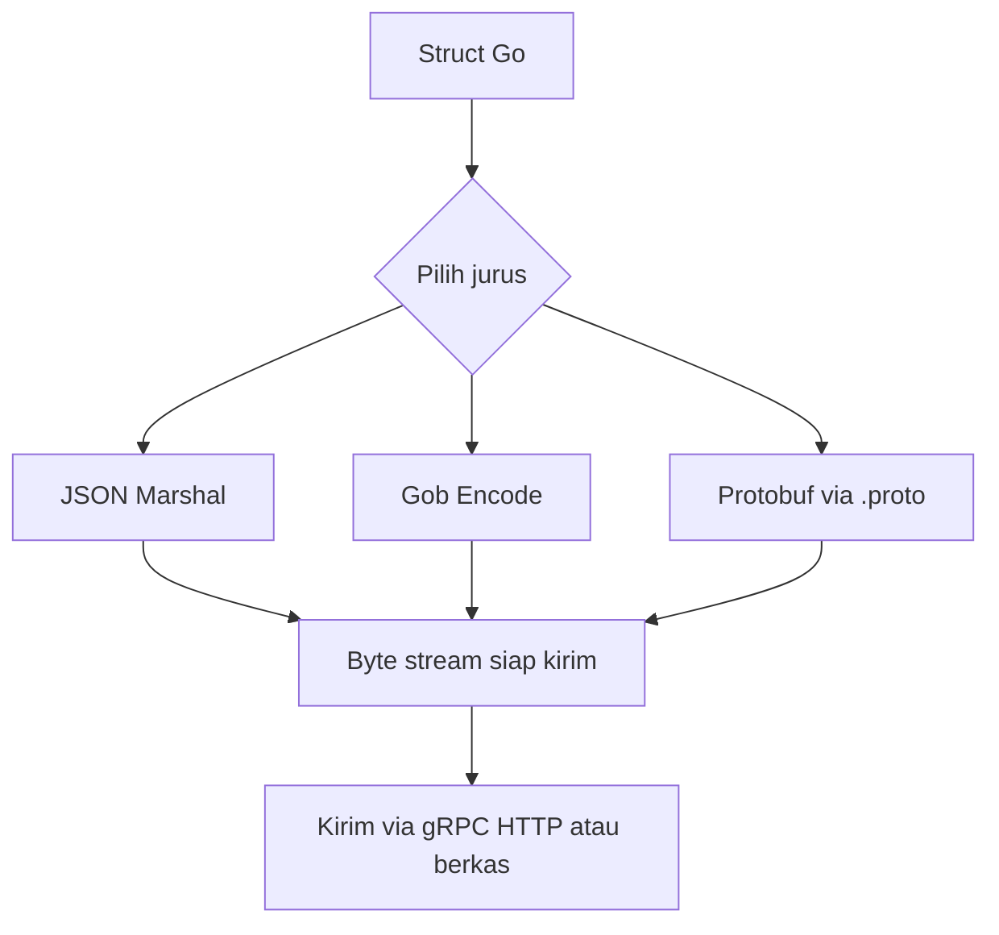
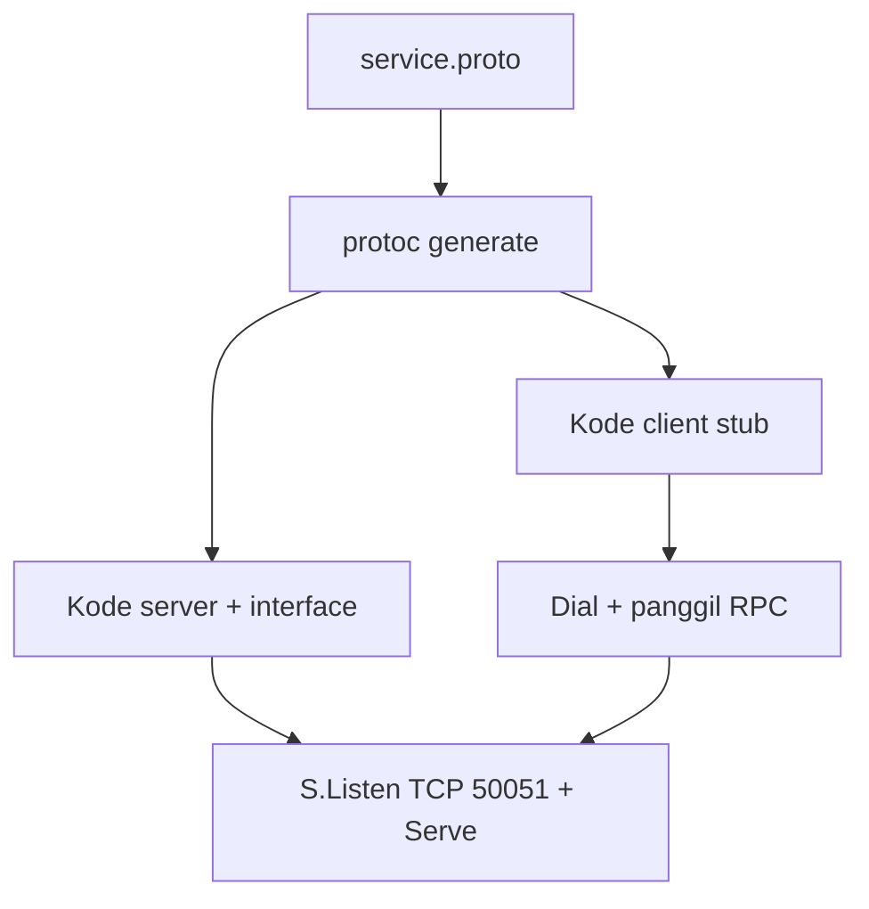
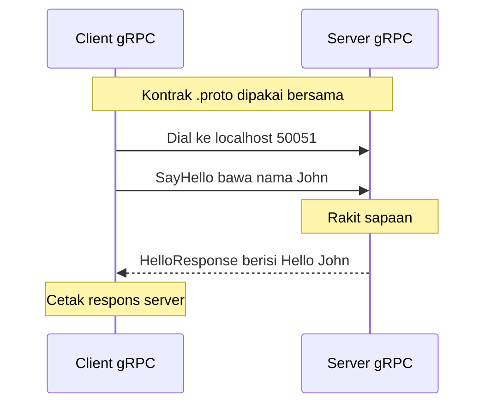

# Network and System Programming | Sesi 11: Serialisasi Data

> **Mata Kuliah:** Network and System Programming | **Sesi:** 11 | **Status:** Materi UAS

---

## 🔑 Cues

- Ubah objek jadi kiriman
- Marshal struct ke JSON
- Tag pemeta nama field
- Gob biner khusus Go
- Protobuf biner lintas bahasa
- Berkas definisi titik-proto
- Nomor field warisan kompatibel
- RPC ala fungsi lokal

---

## 📖 Materi Utama

### 1. Membekukan Objek untuk Dikirim

**Serialization** mengubah state objek di memori menjadi format yang bisa disimpan (persistence), ditransmisikan (network communication), atau diteruskan antar-proses (IPC) — lalu direkonstruksi kembali (deserialization) di ujung sana. Tiga jurusnya di course ini: JSON (`encoding/json`), Gob (`encoding/gob`), dan Protocol Buffers.

### 2. JSON: Teks yang Dibaca Semua Bangsa

- `json.Marshal` menyulap struct Go menjadi byte slice ber-encoding JSON.
- **Struct tag** (misalnya `` `json:"name"` ``) memetakan nama field Go (PascalCase) ke kunci JSON (lowercase); tanpa tag, kunci mengikuti nama field asli.

```go
type Person struct {
    Name  string `json:"name"`
    Age   int    `json:"age"`
    Email string `json:"email"`
}

person := Person{Name: "John Doe", Age: 30, Email: "john@example.com"}
jsonData, err := json.Marshal(person)
if err != nil {
    fmt.Println("Error:", err)
    return
}
fmt.Println(string(jsonData))
```

Output: `{"name":"John Doe","age":30,"email":"john@example.com"}`. Hapus tag-nya dan output berubah menjadi `{"Name":"John Doe","Age":30,"Email":"john@example.com"}` — berpotensi mismatch dengan sistem lain.

### 3. Gob: Biner Kilat Khusus Go

```go
person := Person{Name: "Alice", Age: 25, Email: "alice@example.com"}
var buffer bytes.Buffer
encoder := gob.NewEncoder(&buffer)
err := encoder.Encode(person)
if err != nil {
    fmt.Println("Error:", err)
    return
}
fmt.Println(buffer.Bytes())
```

- `gob.NewEncoder(&buffer)` + `encoder.Encode(person)` menumpahkan struct ke format biner via buffer; `buffer.Bytes()` mengambil hasilnya.
- Imbalannya cepat dan compact, harganya eksklusif: **hanya Go-ke-Go**, buta total bagi Python, Java, dan bahasa lain.

### 4. Protobuf: Biner Kilat Lintas Bangsa

**Protocol Buffers** memakai encoding biner (lebih ringkas dan cepat dari JSON) namun **language-neutral** — satu skema melahirkan kode Go, Java, Python, C++ sekaligus. Developer menulis pesan di berkas **`.proto`**, mengompilasinya dengan `protoc`, dan memakai struct hasil generate. Materi memakai **proto3**.

```proto
message Chore {
  bool complete = 1;
  string description = 2;
}
```

Angka `= 1` adalah **field number**: identitas biner field saat serialize, bukan sekadar nomor urut. Jangan ubah setelah production — kompatibilitas mundur (field baru menyatu tanpa merusak client lama) bertumpu padanya.

### 5. gRPC: Memanggil Fungsi Seberang Jaringan

**gRPC** adalah framework RPC open-source ber-performa tinggi untuk distributed system: client memanggil fungsi server seolah fungsi lokal. Protobuf berperan ganda sebagai **Interface Definition Language** (mendefinisikan service + message) dan format kawatnya. Pembeda dari REST: transport HTTP/2, kontrak `.proto` yang wajib, code generation otomatis, dan **bi-directional streaming** plus flow control plus autentikasi pluggable.

```proto
syntax = "proto3";
package myservice;
service MyService {
  rpc SayHello (HelloRequest) returns (HelloResponse);
}
message HelloRequest { string name = 1; }
message HelloResponse { string greeting = 1; }
```

Alur bikin layanan: tulis `.proto` → generate → implementasi server → implementasi client → jalankan server dulu baru client.

```bash
protoc --go_out=. --go_opt=paths=source_relative --go-grpc_out=. --go-grpc_opt=paths=source_relative service.proto
```

Hasil generate: `service.pb.go` (struct tiap message + marshal/unmarshal) dan `service_grpc.pb.go` (interface `MyServiceServer`, client `MyServiceClient`, fungsi `RegisterMyServiceServer`).

```go
func (s *myServiceServer) SayHello(ctx context.Context, req *myservice.HelloRequest) (*myservice.HelloResponse, error) {
    greeting := fmt.Sprintf("Hello, %s!", req.GetName())
    return &myservice.HelloResponse{Greeting: greeting}, nil
}

func main() {
    listener, err := net.Listen("tcp", ":50051")
    if err != nil {
        log.Fatalf("Failed to listen: %v", err)
    }
    server := grpc.NewServer()
    myservice.RegisterMyServiceServer(server, &myServiceServer{})
    log.Println("gRPC server is running on :50051")
    if err := server.Serve(listener); err != nil {
        log.Fatalf("Failed to serve: %v", err)
    }
}
```

```go
func main() {
    connection, err := grpc.Dial("localhost:50051", grpc.WithInsecure())
    if err != nil {
        log.Fatalf("Failed to connect: %v", err)
    }
    defer connection.Close()
    client := myservice.NewMyServiceClient(connection)
    request := &myservice.HelloRequest{Name: "John"}
    response, err := client.SayHello(context.Background(), request)
    if err != nil {
        log.Fatalf("Failed to call SayHello: %v", err)
    }
    fmt.Printf("Server response: %s\n", response.GetGreeting())
}
```

Jalankan: `go run server.go`, lalu client-nya. Catatan produksi: `grpc.WithInsecure()` berarti tanpa TLS — boleh untuk localhost/testing, haram untuk production; selalu `defer connection.Close()`.

#### **[Visualisasi Konsep]**



---

## Library Diagram & Arsitektur

### Dari definisi ke sambungan hidup



### Tarian request-response gRPC



---

## 🛠️ Use Case / Implementasi Nyata

- **Skenario:** Rental konsol kampus punya kasir Go, gudang Java, dan bot notifikasi Python yang saling bertukar data stok.
- **Masalah yang Diatasi:** JSON boros bandwidth untuk traffic stok intensif; Gob tak bisa dibaca Java/Python; REST tanpa kontrak membuat tipe data sering selip.
- **Keuntungan:** Satu `.proto` melahirkan struct ketiga bahasa, payload biner memangkas ukuran dan waktu parse, field number menjaga client lama tetap jalan saat skema bertambah, dan gRPC streaming membuka opsi update stok real-time.

---

## 🗂️ Konsep Kunci

| Istilah | Definisi | Contoh / Catatan |
|---------|----------|-----------------|
| Serialization | Objek menjadi format kirim/simpan | Lawannya deserialization |
| `json.Marshal` | Struct Go menjadi byte slice JSON | Tag atur nama kunci |
| Struct tag | Anotasi pemeta field | `` `json:"name"` `` |
| Gob | Serialisasi biner khusus Go | `gob.NewEncoder`, `Encode` |
| Protobuf | Serialisasi biner lintas bahasa | Perlu `.proto` + `protoc`, proto3 |
| Field number | Identitas biner tiap field | Tulang kompatibilitas mundur |
| gRPC | RPC performa tinggi via protobuf+HTTP/2 | Streaming dua arah, flow control |
| `protoc` | Kompiler definisi proto | Melahirkan stub client-server |

---

## 📊 Tabel Ringkasan

| Format | Terbaca manusia | Lintas bahasa | Laju | Cocok untuk |
|--------|-----------------|---------------|------|-------------|
| JSON | Ya | Ya | Sedang | API umum, web, browser |
| Gob | Tidak | Tidak, Go saja | Cepat | Antar-service Go |
| Protobuf | Tidak | Ya | Sangat cepat | Microservice lintas bahasa, gRPC |

| REST | gRPC |
|------|------|
| Umumnya HTTP/1.1 | HTTP/2 |
| JSON teks | Protobuf biner |
| Kontrak opsional (OpenAPI) | Kontrak wajib (.proto) |
| Streaming tak native | Streaming dua arah native |
| Kode tulis manual | Generate otomatis |

---

## ⚠️ Catatan Penting

> **[Tag menentukan kunci]** — Tanpa struct tag, Go memakai nama field asli; beda kapitalisasi saja cukup merusak kontrak dengan konsumen lain.

> **[Nomor field itu janji]** — Field number protobuf tak boleh diganti setelah production; mengubahnya sama dengan memutus masa lalu.

> **[Insecure hanya di rumah]** — `grpc.WithInsecure()` untuk localhost/testing atau di balik kanal aman lain (service mesh mTLS, VPN) — jangan pernah di production terbuka.

---

## 📝 Materi Tambahan (Visual Insights)

- Pesan `Chore` (`bool complete = 1; string description = 2;`) adalah contoh minimal anatomi message: tipe, nama, dan nomor field — tiga serangkai yang tak terpisahkan.
- Server wajib hidup sebelum client menelepon; urutan `go run server.go` lalu client bukan ritual, melainkan syarat Dial menemukan listener di `:50051`.
- Fitur gRPC melampaui contoh dasar: streaming dua arah, penanganan error kaya, dan ragam tipe data — definisi `.proto` tinggal diperluas mengikuti use case.

#### Lima Langkah Menara gRPC

- Definisikan service di `.proto` → generate via `protoc` → implementasi struct server + register ke `grpc.NewServer` → Dial + stub di client → panggil RPC seolah lokal.

---

## ✅ Standar Visual & Orisinalitas (bar jual — wajib untuk semua catatan)

- **Sintesis orisinal**: struktur, diagram, dan contoh milik sendiri. Sumber (materi aslab/dosen) hanya referensi fakta. Jangan cerminkan urutan langkah, nama contoh, atau naskah sumber.
- **Konsistensi visual**: judul `# MK | Sesi N: Judul`, callout pembuka, cues ≤15 dalam toggle, tabel selalu ber-header, blok kode ≤2000 char (lebih = pecah), ikon + cover judul terisi otomatis saat import.
- **Jujur provenance**: bila sumber hanya kerangka/tanpa isi, tulis di Sumber bahwa isi disusun dari dokumentasi umum.
