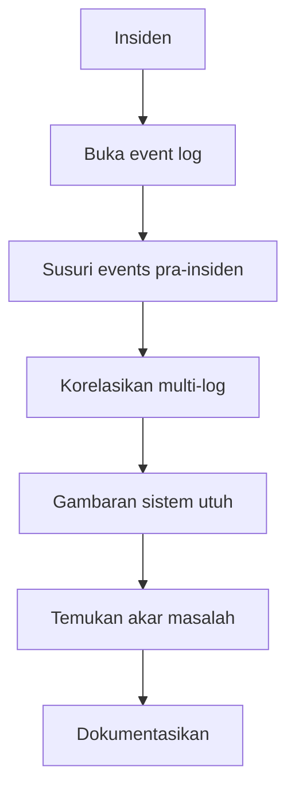
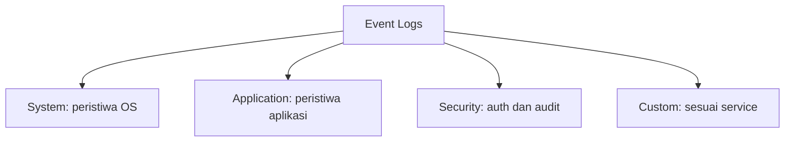
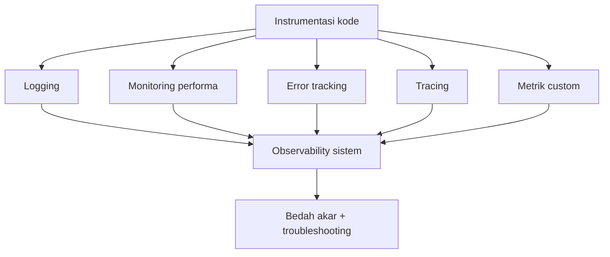

# Network and System Programming | Sesi 12: Logging dan Metrik

> **Mata Kuliah:** Network and System Programming | **Sesi:** 12 | **Status:** Materi UAS

---

## 🔑 Cues

- Jejak peristiwa jaringan
- Isi sebutir log
- Bedah akar masalah
- Cermin batin sistem
- Empat kasta log
- Menara penanganan log
- Menanam instrumen di kode
- Privasi dan retensi

---

## 📖 Materi Utama

### 1. Jejak Peristiwa: Definisi dan Isi

**Event log** adalah sumber daya dasar berisi informasi traffic, usage, dan kondisi jaringan — bahan mentah bagi security professional maupun sistem keamanan otomatis, serta kompas network administrator dalam security, performance, dan transparency. Sebutir log lazimnya memuat: tanggal-waktu kejadian, deskripsi aktual, **severity** (tingkat keparahan), aplikasi/proses terlibat, kode identifikasi event, plus info relevan seperti IP address atau username. Pembacanya lintas tim: **ITOps, DevOps, dan SecOps** — untuk menjawab apakah sistem crash, disusupi, atau infrastrukturnya yang gagal.

### 2. Mengapa Log Menentukan Bedah Akar Masalah

**Root cause analysis** — menelusuri sumber utama insiden (hardware fault, OS error, security breach, application failure, performance degradation) — paling efektif dilakukan dengan menyusuri events sebelum insiden. Satu log jarang cukup: troubleshooter mengagregasi dan mengorelasikan banyak log lintas komponen hingga terbangun gambaran lengkap. Manajemen log modern justru hidup dari ingestion massal untuk mengendus tren, anomali, dan pola — suatu keharusan di distributed system yang kompleks. Kemampuan membaca state internal dari data yang dihasilkan sistem inilah yang disebut **system observability**.

### 3. Menara Penanganan Log

- **Akses** — di Windows lewat Event Viewer (ketik di Start menu).
- **Kenali kasta** — System (OS), Application (aplikasi), Security (keamanan), Custom (buatan service sendiri).
- **Review rutin** —endus issue, error, dan insiden; waspadai pola berulang.
- **Filter dan search** — persempit berdasar tanggal, tipe, source.
- **Perkakas manajemen** — pertimbangkan log management pihak ketiga untuk sentralisasi dan fitur advanced.
- **Alert** — bunyikan notifikasi untuk critical event atau pola tertentu.
- **Analisis** — tafsirkan sekuens events menuju insiden.
- **Korelasi** — hubungkan antar-log untuk troubleshooting.
- **Retensi** — tetapkan **log retention policy** demi compliance dan forensik.
- **Amankan** — kunci akses log dari tampering; audit rutin event keamanan.
- **Otomasi** — automated log analysis untuk skala besar.
- **Dokumentasi** — catat temuan dan tindakan; detail langkah merujuk dokumentasi tiap platform/OS.

### 4. Menanam Instrumen di Dalam Kode

**Instrumenting code** adalah menyisipkan kode tambahan pengumpul data performance, usage, dan behavior — bekal monitoring dan debugging di dunia nyata:

- **Logging** — statement strategis: nilai variabel, pemanggilan fungsi.
- **Performance monitoring** — execution time, memory usage; buru bottleneck.
- **Error tracking** — rekam detail exception runtime agar cepat ditangani.
- **Custom metrics** — metrik sesuai goal: interaksi user, feature usage.
- **Profiling** — bedah runtime behavior; tandai hotspot untuk optimasi.
- **Code coverage** — pastikan testing benar-benar mengeksekusi kode.
- **Tracing** — ikuti aliran eksekusi lintas komponen.
- **Security instrumentation** — catat auth failure, access violation, potensi vuln.
- **User analytics** — petakan user journey dan adopsi fitur bila relevan.
- **Environment monitoring** — rekam konfigurasi sistem, status jaringan, dependensi eksternal.
- **Disiplin pendukung** — naming convention konsisten agar data terbaca; patuhi **privacy regulation** dan user consent untuk data identifiable; dokumentasikan tiap titik instrumen, tujuannya, dan pemakaian datanya. Teknik konkret selalu merujuk dokumentasi bahasa/framework masing-masing.

#### **[Visualisasi Konsep]**

---

## Library Diagram & Arsitektur

### Kasta log dalam satu pohon

### Instrumen mengalir menjadi observability

---

## 🛠️ Use Case / Implementasi Nyata

- **Skenario:** Platform praktikum kampus crash tiap jam sibuk tanpa pesan error jelas.
- **Masalah yang Diatasi:** Satu log aplikasi hanya menunjukkan crash, bukan pemicunya; menebak tanpa data membuang waktu seluruh tim.
- **Keuntungan:** Korelasi log aplikasi (lonjakan request), log sistem (memori menipis), dan metrik custom (antrean tugas) menunjuk akar yang sama — lalu alert dipasang agar insiden berikutnya melapor sendiri sebelum pengguna sadar.

---

## 🗂️ Konsep Kunci

| Istilah | Definisi | Contoh / Catatan |
|---------|----------|-----------------|
| Event log | Arsip traffic, usage, kondisi sistem | Bahan ITOps/DevOps/SecOps |
| Severity | Derajat keparahan event | Prioritas respons |
| Root cause analysis | Lacak sumber utama insiden | Via events pra-insiden |
| Observability | Ukur batin sistem dari datanya | Termasuk log |
| Retention policy | Aturan lama simpan log | Untuk compliance/forensik |
| Instrumentasi | Kode tambahan pengumpul data | Logging, metrik, trace |
| Profiling | Bedah runtime cari hotspot | Dasar optimasi |
| Tracing | Ikuti aliran eksekusi | Lintas komponen |
| Code coverage | Porsi kode tereksekusi testing | Ukur menyeluruh tidaknya test |

---

## 📊 Tabel Ringkasan

| Kasta | Isi | Dipakai untuk |
|-------|-----|---------------|
| System | Peristiwa OS | Diagnosis level OS |
| Application | Peristiwa aplikasi | Debugging aplikasi |
| Security | Peristiwa keamanan | SecOps dan audit |
| Custom | Buatan service sendiri | Fleksibel per kebutuhan |

| Aspek instrumen | Tujuan | Contoh |
|-----------------|--------|--------|
| Logging | Rekam eksekusi | Nilai variabel, panggilan fungsi |
| Performance monitoring | Temukan bottleneck | Waktu eksekusi, memori |
| Error tracking | Tangkap exception | Log error runtime |
| Custom metrics | Ukur goal spesifik | Interaksi dan fitur |
| Profiling | Analisis runtime | Hotspot performa |
| Code coverage | Validasi test | Cakupan eksekusi |
| Tracing | Petakan aliran | Interaksi komponen |
| Security instrumentation | Deteksi ancaman | Auth gagal, pelanggaran akses |
| User analytics | Pahami perilaku | User journey |
| Environment monitoring | Konteks runtime | Konfig, jaringan, dependensi |

---

## ⚠️ Catatan Penting

> **[Satu log itu rabun]** — Distributed system yang kompleks tak bisa didiagnosis dari satu sumber; observability lahir dari korelasi, bukan dari satu berkas.

> **[Privasi bukan opsional]** — Instrumen yang menyentuh data identifiable wajib tunduk pada regulasi dan consent; telemetri yang melanggar privasi adalah liabilitas.

> **[Tanpa catat sama dengan tak terjadi]** — Temuan tanpa dokumentasi menguap; insiden berikutnya mengulang pelajaran yang sama dari nol.

---

## 📝 Materi Tambahan (Visual Insights)

- Severity yang konsisten adalah bahasa bersama: tanpanya, alert untuk "critical" tiap tim berarti hal berbeda dan respons ikut kacau.
- Naming convention titik instrumen terdengar sepele sampai analisis massal tiba — nama acak membuat agregasi metrik mustahil disatukan.
- Teknik instrumentasi tak universal; profiler Go, tracer framework web, dan coverage tool tiap bahasa punya idiom sendiri — selalu rujuk dokumentasi lingkungan yang dipakai.

#### Dua Belas Anak Tangga Penanganan

- Akses → kenali kasta → review rutin → filter/search → perkakas sentral → alert → analisis sekuens → korelasi → retensi → amankan akses → otomasi → dokumentasikan. Urutan ini memastikan log mentah berubah menjadi keputusan.

---

## ✅ Standar Visual & Orisinalitas (bar jual — wajib untuk semua catatan)

- **Sintesis orisinal**: struktur, diagram, dan contoh milik sendiri. Sumber (materi aslab/dosen) hanya referensi fakta. Jangan cerminkan urutan langkah, nama contoh, atau naskah sumber.
- **Konsistensi visual**: judul `# MK | Sesi N: Judul`, callout pembuka, cues ≤15 dalam toggle, tabel selalu ber-header, blok kode ≤2000 char (lebih = pecah), ikon + cover judul terisi otomatis saat import.
- **Jujur provenance**: bila sumber hanya kerangka/tanpa isi, tulis di Sumber bahwa isi disusun dari dokumentasi umum.
