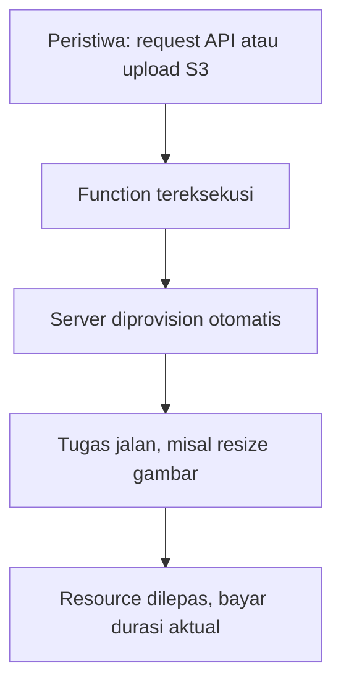
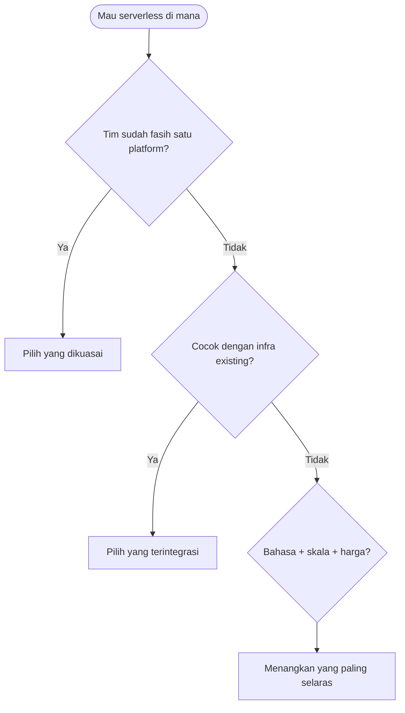
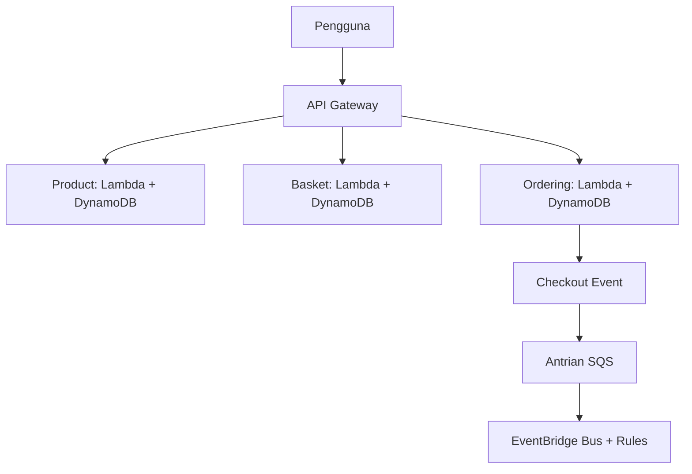

# Network and System Programming | Sesi 13: Pindah ke Cloud

> **Mata Kuliah:** Network and System Programming | **Sesi:** 13 | **Status:** Materi UAS

---

## 🔑 Cues

- Komputasi tanpa kelola server
- Fungsi picu-peristiwa
- Skala otomatis dua arah
- Bayar sesuai pakai
- Lambda dan 200 pemicu
- Fungsi ala Google
- Ekosistem menyeluruh Azure
- Kompas pilih provider

---

## 📖 Materi Utama

### 1. Era Tanpa Server: Konsep Inti

**Serverless computing** mengabstraksi infrastruktur: developer menulis kode, provider mengurus provisioning, scaling, dan maintenance. Polanya **event-driven** — fungsi diam hingga ada peristiwa (request API, upload berkas, update tabel) lalu dieksekusi di server yang diprovision **hitungan milidetik**, misalnya me-resize gambar di bucket. Konsekuensinya: **automatic scaling** mengikuti request (hampir tak terbatas, turun-naik sendiri, bahkan scale-to-zero saat sepi), **pay-as-you-go** (bayar per request + durasi eksekusi aktual), dan unit kecil single-purpose yang pas untuk **microservices**.

### 2. AWS Lambda

Layanan compute on-demand yang bisa dipicu **200+ AWS services** dan aplikasi SaaS — alih-alih mesin yang siaga mendengar request, logika tersimpan sebagai function di AWS.

- **Serverless** — fokus ke kode, operasional menyusut.
- **Event-driven** — dipicu S3, update DynamoDB table, HTTP via API Gateway.
- **Multi-language** — Node.js, Python, Java, C#, Go, dan lainnya.
- **Integrasi** — API Gateway untuk RESTful API, S3 untuk storage, DynamoDB untuk NoSQL.
- **Operasional** — develop/deploy kilat untuk prototyping dan iterasi; maintenance rendah; replikasi otomatis lintas **availability zones** (satu zone down, zone lain menanggung); deploy multi-region untuk jangkauan global dan latency rendah.
- **Observability bawaan** — logging dan monitoring via **Amazon CloudWatch** (lacak eksekusi, pasang alarm).
- Catatan arsitektur: pola real-world-nya microservices e-commerce — User → API Gateway → tiga microservice (Product, Basket, Ordering, masing-masing Lambda + DynamoDB); Ordering memancarkan Checkout Event → SQS Queue → EventBridge Event Bus + Rules; deployment via CDK CloudFormation Stack.

### 3. Google Cloud Functions

Compute serverless GCP untuk function pemicu-peristiwa tanpa kelola infrastruktur — senjata alami bagi yang sudah berumah di ekosistem Google.

- **Bahasa** — Node.js, Python, Go, Java, .NET, dan lainnya.
- **Scaling** — otomatis mengikuti request, sanggup konkuren tinggi, dan **scale down to zero** saat traffic nol sehingga biaya minimal untuk beban tak menentu.
- **Trigger dan binding** — trigger menentukan peristiwa pemicu; binding menghubungkan function ke layanan GCP lain secara serverless.
- **Environment variables** — untuk config, API key, dan rahasia.
- **Monitoring** — Cloud Monitoring + Cloud Logging untuk visibilitas eksekusi, alert, dan analisis log.

### 4. Microsoft Azure

Platform cloud komprehensif — public cloud Microsoft berupa jaringan data center global dengan koleksi layanan PaaS, IaaS, dan managed database:

- **Compute** — Virtual Machines, AKS (orkestrasi container), Azure Functions (serverless), Batch (paralel skala besar).
- **Storage** — Blob (object), File (file shares), Table (NoSQL), Queue (messaging antar-komponen).
- **Database** — SQL Database (relasional), Cosmos DB (multi-model terdistribusi global), Redis Cache (in-memory).
- **Networking** — Virtual Network, Load Balancer, VPN Gateway, Application Gateway, CDN.
- **Identity** — Azure Active Directory untuk autentikasi-otorisasi aplikasi dan user.
- **Security dan compliance** — Security Center (threat protection), Policy (compliance), Key Vault (kunci dan secret kriptografis).
- **AI/ML** — Machine Learning (bangun-latih-deploy model), Cognitive Services (kapabilitas AI siap pakai).
- **IoT** — IoT Hub, IoT Central, Sphere untuk solusi aman dan scalable.
- **Analytics** — HDInsight (Hadoop/Spark terkelola), Data Lake Storage, Databricks (analitik Spark kolaboratif), Synapse Analytics (eks SQL Data Warehouse).

### 5. Kompas Memilih Provider

Keputusan bergantung requirement, infrastruktur existing, preferensi tim, dan fitur tiap platform:

1. **Platform familiarity** — tim yang sudah fasih di satu platform lebih murah bertahan; hitung skill set yang ada.
2. **Integrasi** — selaraskan ekosistem layanan dengan infrastruktur kini dan rencana.
3. **Dukungan bahasa** — pastikan bahasa pilihan (termasuk Go untuk course ini) didukung nyaman.
4. **Scalability dan performance** — uji scaling, eksekusi konkuren, dan latency pemicu.
5. **Pricing** — bandingkan tarif compute, request, dan execution time dengan budget serta pola pakai.

#### **[Visualisasi Konsep]**

---

## Library Diagram & Arsitektur

### Alur pilih provider sebagai pohon keputusan

### Kios microservices di atas Lambda

---

## 🛠️ Use Case / Implementasi Nyata

- **Skenario:** Panitia wisuda butuh backend pendaftaran yang sepi 11 bulan lalu meledak seminggu.
- **Masalah yang Diatasi:** Server siaga setahun penuh mahal dan mubazir; traffic spike pendaftaran menuntut skala instan tanpa intervensi manual.
- **Keuntungan:** Function pemicu-API Gateway tidur gratis saat sepi (scale-to-zero), bangun milidetik saat pendaftar datang, replikasi antar availability zone menjaga layanan tetap hidup, dan tagihan hanya menutup request + durasi aktual.

---

## 🗂️ Konsep Kunci

| Istilah | Definisi | Contoh / Catatan |
|---------|----------|-----------------|
| Serverless | Tanpa kelola server langsung | Provider urus infra |
| Event-driven | Kode jalan karena peristiwa | Request, upload, update tabel |
| Auto scaling | Resource ikut beban otomatis | Naik-turun sendiri |
| Pay-as-you-go | Bayar per pakai aktual | Request + durasi |
| Availability zone | Data center terpisah se-region | Basis fault tolerance |
| PaaS / IaaS | Platform / infra sebagai layanan | Keduanya ada di Azure |
| API Gateway | Membangun dan mengelola API | Pemicu favorit Lambda |
| CloudWatch | Monitoring-logging bawaan AWS | Lacak eksekusi Lambda |
| Cold start | Jeda bangun pertama usai idle | Perhatian khusus serverless |

---

## 📊 Tabel Ringkasan

| Aspek | AWS Lambda | Google Cloud Functions | Azure Functions |
|-------|-----------|------------------------|-----------------|
| Posisi | Compute on-demand, 200+ pemicu | Serverless di ekosistem GCP | Serverless di ekosistem luas Azure |
| Bahasa | Node.js, Python, Java, C#, Go | Node.js, Python, Go, Java, .NET | Mengikuti ekosistem Azure |
| Skala | Otomatis dua arah | Otomatis, scale-to-zero | Mengikuti fabric Azure |
| Observability | CloudWatch | Cloud Monitoring + Logging | Monitor + Security Center |
| Data pendamping | S3, DynamoDB | Layanan GCP terkait | Blob/File/Table/Queue, Cosmos DB |

| Faktor pilih | Pertimbangan |
|--------------|--------------|
| Familiaritas | Skill tim yang sudah ada |
| Integrasi | Selaras infra kini dan rencana |
| Bahasa | Dukungan sesuai kebutuhan |
| Skala dan performa | Konkuren, scaling, latency |
| Harga | Tarif compute, request, execution time |

---

## ⚠️ Catatan Penting

> **[Cold start itu nyata]** — Panggilan pertama usai idle membayar jeda bangun; desain latency-kritis wajib memperhitungkannya, bukan mengabaikannya.

> **[Scale-to-zero pedang dua sisi]** — Hemat maksimal saat sepi (khas Google Cloud Functions), tetapi pola traffic spiky ekstrem perlu uji beban agar bangun massal tak gagap.

> **[Luas belum tentu pas]** — Azure paling lengkap (compute, storage, DB, AI, IoT, analitik), tetapi kelengkapan tanpa keselarasan kebutuhan hanya menambah kompleksitas tagihan.

---

## 📝 Materi Tambahan (Visual Insights)

- Ketiga platform mendukung **Go** — relevan langsung dengan course network programming ini; function Go yang sama secara konsep bisa hidup di Lambda, Cloud Functions, maupun Azure Functions.
- Microservices + event-driven adalah pasangan pola real-world serverless: function kecil single-purpose dirangkai lewat gateway di depan dan bus/queue di belakang (contoh e-commerce di atas).
- Logo-logo provider di slide (Lambda oranye, hexagon Cloud Functions, "A" Azure) murni branding — satu-satunya gambar substantif adalah diagram arsitektur microservices yang sudah diterjemahkan ke mermaid di atas.

#### Jejak Eksekusi Lambda

- Event terjadi → function terpicu → server terprovision milidetik → tugas dieksekusi → resource dilepas dan tagihan dihitung dari durasi aktual.

---

## ✅ Standar Visual & Orisinalitas (bar jual — wajib untuk semua catatan)

- **Sintesis orisinal**: struktur, diagram, dan contoh milik sendiri. Sumber (materi aslab/dosen) hanya referensi fakta. Jangan cerminkan urutan langkah, nama contoh, atau naskah sumber.
- **Konsistensi visual**: judul `# MK | Sesi N: Judul`, callout pembuka, cues ≤15 dalam toggle, tabel selalu ber-header, blok kode ≤2000 char (lebih = pecah), ikon + cover judul terisi otomatis saat import.
- **Jujur provenance**: bila sumber hanya kerangka/tanpa isi, tulis di Sumber bahwa isi disusun dari dokumentasi umum.
