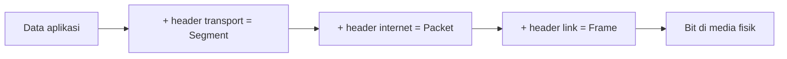
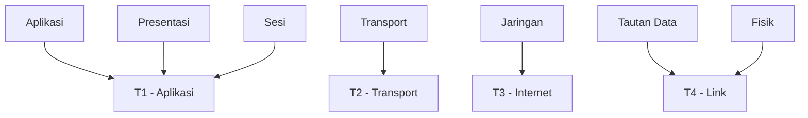
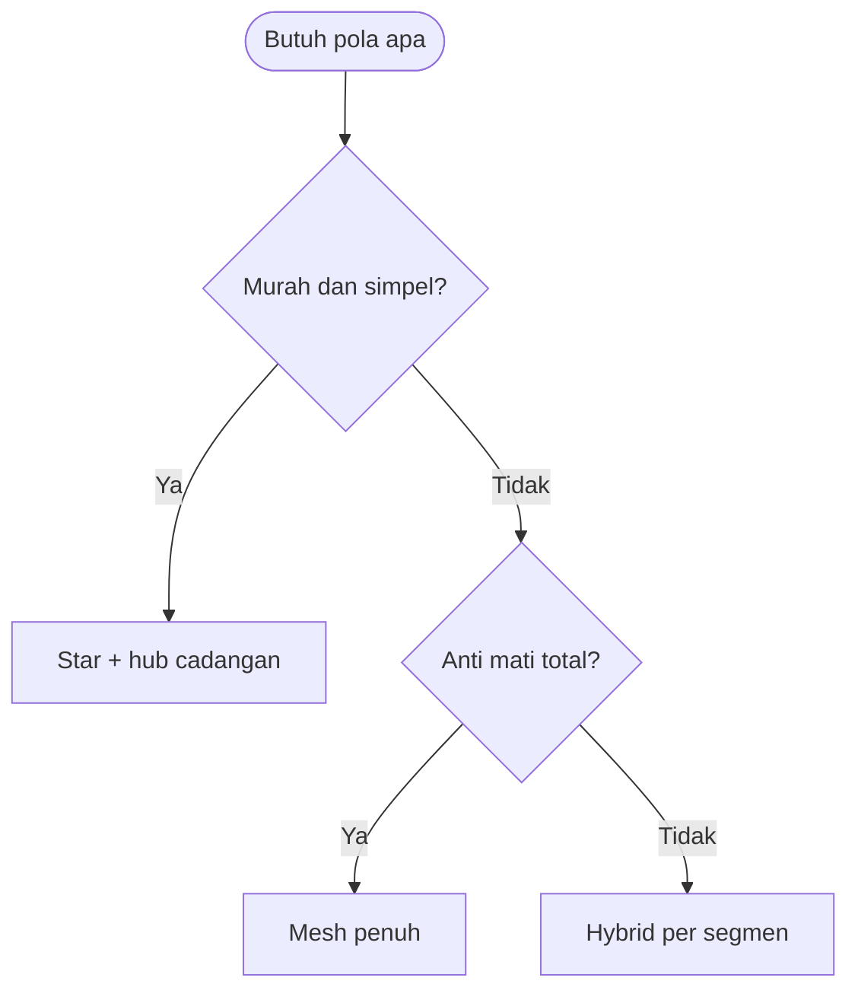

# Network and System Programming | Sesi 1: Gambaran Umum Sistem Jaringan

> **Mata Kuliah:** Network and System Programming | **Sesi:** 1 | **Status:** Materi UTS

---

## 🔑 Cues

- Bentuk keterhubungan node dan jalur datanya
- Lompatan perantara antar titik jauh
- Daya tampung kirim lawan jeda respons
- Kerangka acuan berlapis tujuh tingkat
- Model praktis empat lapis internet
- Kecerdasan di ujung, jaringan tetap sederhana
- Pembungkusan data tiap turun lapis

---

## 📖 Materi Utama

### 1. Cara Node Saling Terhubung

Pola keterhubungan menentukan rute data, titik lemah, dan biaya pembangunan jaringan.

- **Titik-ke-titik**: satu jalur khusus untuk tepat dua node. Rangkaian beberapa jalur semacam ini disebut *daisy chain*; data menuju tujuan jauh wajib transit lewat node perantara, tiap transit dihitung sebagai satu *hop*.
- **Bus**: seluruh node menumpang satu jalur bersama. Ini pola logis di balik jaringan nirkabel; pada kabel fisik, semua node bisa mengintip traffic sehingga enkripsi menjadi kebutuhan.
- **Ring**: tiap perangkat hanya menyambung ke dua tetangga hingga membentuk lingkaran; data beredar satu arah. Satu titik putus melumpuhkan seluruh lingkaran, dan menambah anggota baru tidak mudah.
- **Star**: semua perangkat bermuara ke satu concentrator (hub/switch); semua percakapan lewat pusat. Pusat yang mati mematikan semua — lazimnya ditangani dengan perangkat pusat cadangan.
- **Mesh**: tiap node tersambung ke semua node lain sehingga tersedia banyak rute alternatif dan tidak ada titik tunggal kegagalan. Konsekuensinya, biaya dan kerumitan meledak seiring jumlah node.
- **Hybrid**: racikan beberapa pola di atas (misalnya Star-Ring, Star-Bus, Mesh-Tree) agar tiap segmen memakai pola yang paling pas — keandalan, skalabilitas, dan fleksibilitas sekaligus dikejar.

### 2. Kapasitas Lawan Responsivitas

- **Bandwidth** adalah volume data yang bisa lewat dalam satu interval waktu. Satuannya: 1 Kbps = 1.000 bps, 1 Mbps = 1.000.000 bps. Bandwidth menjawab "seberapa banyak yang bisa dikirim".
- **Latency** adalah jeda antara permintaan dikirim dan respons diterima (misalnya klik tautan sampai halaman tampil). Penyumbangnya: jarak client–server, waktu baca data store, waktu rakit konten dinamis di server, dan waktu render browser.
- Kaidahnya: pipa besar tidak otomatis terasa cepat. Bandwidth kecil ber-latency rendah bisa terasa lebih responsif daripada bandwidth besar ber-latency buruk.

### 3. Tumpukan Protokol: Acuan Tujuh Lapis dan Praktik Empat Lapis

- **Protocol** adalah kesepakatan format dan urutan data antar pihak yang berkomunikasi.
- **Model OSI** adalah kerangka konseptual tujuh lapis abstraksi untuk fungsi telekomunikasi.
- **Model TCP/IP** adalah implementasi ringkas empat lapis yang mendasari internet, dirancang dengan **End-to-End Principle**: inti jaringan dibuat seminimal mungkin (hanya kirim dan rutekan bit), kecerdasan ditaruh di ujung.
  1. **Link** — sambungan fisik dan framing (mencakup Physical + Data Link OSI). Protokol: Ethernet, Wi-Fi (802.11), PPP.
  2. **Internet** — pengalamatan logis, routing, fragmentasi dan reassembly (mencakup Network OSI). Protokol: IP untuk alamat/rute, ICMP untuk diagnosa dan laporan error (dipakai perintah `ping`).
  3. **Transport** — komunikasi ujung-ke-ujung, deteksi/koreksi error, kontrol aliran (mencakup Transport OSI). Protokol: **TCP** (andal, connection-oriented) dan **UDP** (ringan, connectionless).
  4. **Application** — layanan langsung untuk pengguna akhir (mencakup Session + Presentation + Application OSI). Protokol: HTTP, FTP, SMTP, DNS.
- **Encapsulation**: tiap kali data turun satu lapis, lapis tersebut membungkusnya dengan header kontrolnya — Data menjadi Segment, lalu Packet, lalu Frame, akhirnya Bit di kabel.
- Keandalan TCP dibangun dari **ACK dan retransmission**: penerima wajib mengonfirmasi tiap kiriman; pengirim yang tak kunjung menerima ACK mengirim ulang.

#### **[Visualisasi Konsep]**

---

## Library Diagram & Arsitektur

### Silsilah lapisan: acuan tujuh lapis diringkas ke empat lapis praktik

### Memilih pola keterhubungan berdasar prioritas

---

## 🛠️ Use Case / Implementasi Nyata

- **Skenario:** Jaringan kos dengan satu switch pusat melayani 20 kamar.
- **Masalah yang Diatasi:** Satu kabel kamar putus tidak boleh melumpuhkan kamar lain — alasan menolak pola bus/ring untuk kasus ini.
- **Keuntungan:** Gangguan terisolasi di satu node, penambahan kamar tinggal colok switch, dan satu switch cadangan menghilangkan titik tunggal kegagalan.

---

## 🗂️ Konsep Kunci

| Istilah | Definisi | Contoh / Catatan |
|---------|----------|-----------------|
| Protocol | Kesepakatan format dan urutan pertukaran data | TCP mewajibkan ACK tiap kiriman |
| Hop | Satu transit lewat node perantara | Lewat dua node perantara = 2 hops |
| End-to-End Principle | Inti jaringan seminimal mungkin, kecerdasan di ujung | Jaringan hanya kirim dan rutekan bit |
| Encapsulation | Pembungkusan data dengan header tiap lapis | Data → Segment → Packet → Frame → Bit |
| Fault tolerance | Ketahanan terhadap matinya satu komponen | Mesh tertinggi, ring terendah |
| ICMP | Protokol diagnosa dan laporan error | Dipakai perintah `ping` |

---

## 📊 Tabel Ringkasan

| Ciri TCP/IP | Penjelasan |
|-------------|------------|
| Terdesentralisasi | Tumbuh dari protokol nyata yang berevolusi mandiri per lapis |
| Ringkas | Tujuh lapis acuan dipadatkan jadi empat lapis operasional |
| Berfokus internet | Didesain untuk kebutuhan evolusi internet modern |
| Dominan | Fondasi universal LAN maupun WAN |

| Pola | Titik lemah | Harga |
|------|-------------|-------|
| Point-to-point | Hanya melayani dua node | Murah per jalur |
| Bus | Satu jalur bersama, mudah disadap | Murah |
| Ring | Satu putus, semua mati | Sedang |
| Star | Hub pusat mati, semua mati | Sedang + cadangan |
| Mesh | Hampir tidak ada | Mahal, rumit |
| Hybrid | Tergantung racikan | Menyesuaikan segmen |

---

## ⚠️ Catatan Penting

> **[Kecepatan semu]** — *"Faster doesn't always mean greater performance."* Responsivitas yang dirasakan pengguna ditentukan bandwidth sekaligus latency, bukan bandwidth saja.

> **[ACK wajib]** — Tanpa acknowledgment dari penerima, pengirim TCP menganggap kiriman gagal dan melakukan retransmit.

---

## 📝 Materi Tambahan (Visual Insights)

- Racikan hybrid seperti Star-Bus lazim di area luas: tiap gedung memakai star untuk labnya, antar-gedung dihubungkan satu backbone bersama.
- Pada ring, pengiriman bersifat serial — node lain menunggu giliran (token passing). Dual-ring menjadi penawar agar satu putusan tidak mematikan semua.
- Di lapis internet, IP berperan sebagai kurir (alamat logis + rute terbaik) sedangkan ICMP berperan sebagai pelapor kendala dan alat diagnosa.

#### Redundansi Itu Wajib di Star

- Satu hub tanpa cadangan adalah bom waktu; switch cadangan yang siaga membuat kegagalan pusat tidak berujung pada lumpuhnya seluruh jaringan.

---

## ✅ Standar Visual & Orisinalitas (bar jual — wajib untuk semua catatan)

- **Sintesis orisinal**: struktur, diagram, dan contoh milik sendiri. Sumber (materi aslab/dosen) hanya referensi fakta. Jangan cerminkan urutan langkah, nama contoh, atau naskah sumber.
- **Konsistensi visual**: judul `# MK | Sesi N: Judul`, callout pembuka, cues ≤15 dalam toggle, tabel selalu ber-header, blok kode ≤2000 char (lebih = pecah), ikon + cover judul terisi otomatis saat import.
- **Jujur provenance**: bila sumber hanya kerangka/tanpa isi, tulis di Sumber bahwa isi disusun dari dokumentasi umum.
