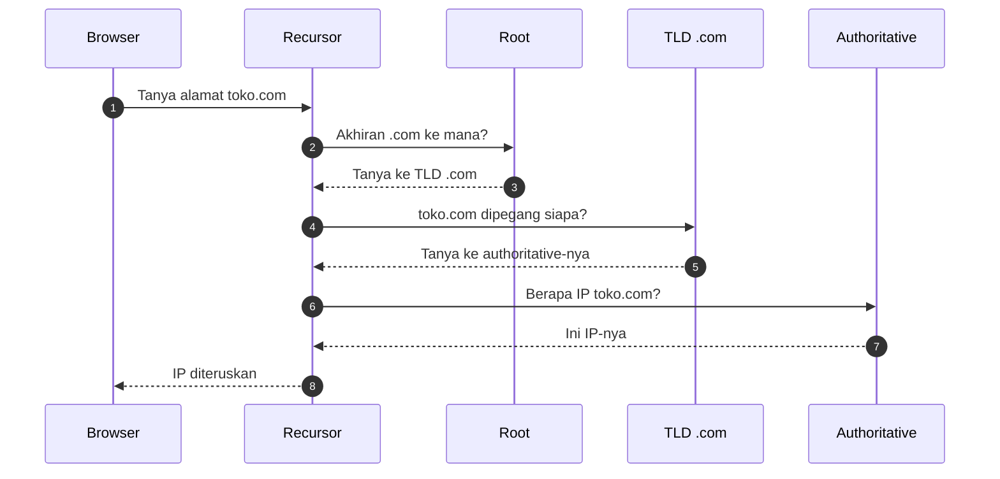
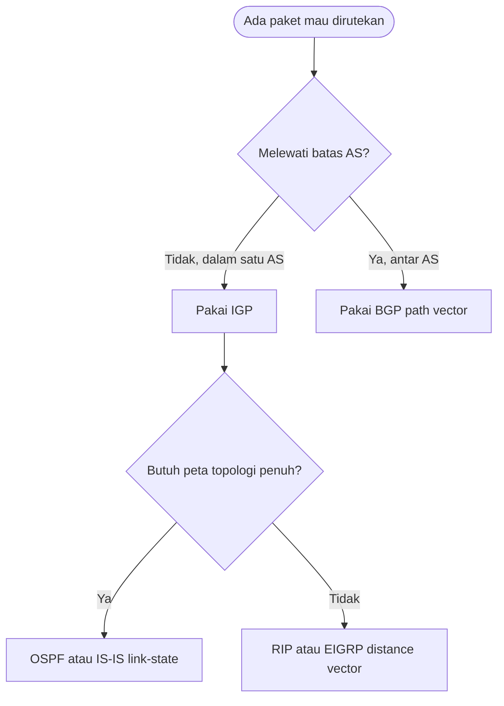
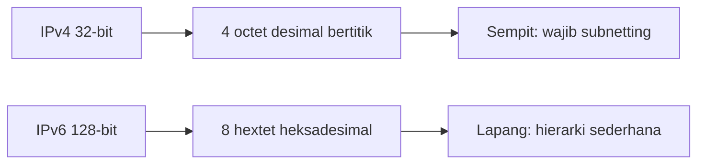

# Network and System Programming | Sesi 2: Lokasi Resource dan Perutean Traffic

> **Mata Kuliah:** Network and System Programming | **Sesi:** 2 | **Status:** Materi UTS

---

## 🔑 Cues

- Aturan alamat dan rute paket
- Alamat 32-bit empat oktet
- Alamat 128-bit delapan hextet
- Kumpulan jaringan satu kendali
- Protokol rute dalam satu kendali
- Protokol rute antar kendali
- Penerjemah nama jadi angka

---

## 📖 Materi Utama

### 1. Aturan Main Paket di Internet

**Internet Protocol (IP)** adalah kesepakatan pengalamatan dan perutean agar potongan data (**packet**) bisa berpindah antar jaringan dan tiba di tujuan yang tepat. Tiap paket ditempeli informasi IP yang dibaca router untuk menentukan lompatan berikutnya.

- **IPv4**: alamat 32-bit dalam empat grup 8-bit (**octet**) ber-notasi desimal bertitik, misalnya 192.168.0.1. Ruangnya terbatas — sekitar 4 miliar alamat unik.
- **IPv6**: alamat 128-bit dalam delapan grup 16-bit (**hextet**) ber-notasi heksadesimal, misalnya 2001:0db8:85a3::0370:7334. Ruangnya di atas 340 undecillion (2^128) alamat, dan dukungan **IPsec** bersifat bawaan/wajib (di IPv4 hanya opsional).
- Rangkaian nol berurutan pada IPv6 boleh disingkat dengan `::`, tetapi hanya satu kali dalam satu alamat agar tetap terbaca.

### 2. Siapa Mengatur Rute ke Mana

**Autonomous System (AS)** adalah himpunan jaringan di bawah satu kendali organisasi dengan satu kebijakan routing. Jenis protokol routing ditentukan oleh batas AS:

- **IGP (di dalam satu AS)**:
  - **OSPF** — link-state ber-algoritma Dijkstra, menimbang bandwidth/biaya; konvergensi cepat.
  - **IS-IS** — link-state varian Dijkstra untuk pemilihan jalur yang layak.
  - **RIP** — distance vector ber-algoritma Bellman-Ford, menimbang hop count.
  - **EIGRP** — distance vector ber-algoritma Diffusing Update, menimbang reliability, load, bandwidth, dan delay; lahir sebagai proprietary Cisco dengan konvergensi cepat.
- **EGP (antar AS)**:
  - **BGP (Border Gateway Protocol)** — path vector antar-AS, dijuluki "layanan pos internet": memilih jalur terbaik lintas AS agar data tiba efisien, sekaligus membantu mitigasi serangan DDoS. Kriterianya bukan sekadar jarak fisik, melainkan kestabilan jalur dan kebijakan bisnis antar ISP.

### 3. Dari Nama yang Dihafal ke Angka yang Dirutekan

Manusia mengingat nama domain, mesin merutekan angka IP — **DNS** menjembatani keduanya secara hierarkis dan terdistribusi.

1. **Recursor** — pelayan pertama yang menerima kueri browser; bertindak sebagai pustakawan pencari informasi.
2. **Root nameserver** — indeks perpustakaan tingkat pertama; hanya menunjuk ke pengelola akhiran yang relevan.
3. **TLD nameserver** — pengelola akhiran seperti .com dan .net.
4. **Authoritative nameserver** — pemegang rekaman asli; bila cocok, ia memulangkan IP address ke recursor untuk diteruskan ke browser.

#### **[Visualisasi Konsep]**

---

## Library Diagram & Arsitektur

### Pohon keputusan protokol routing

### Kasta alamat: sempit lawan lapang

---

## 🛠️ Use Case / Implementasi Nyata

- **Skenario:** Warung online "toko.com" pindah hosting sehingga IP servernya berubah.
- **Masalah yang Diatasi:** Pengunjung tetap mengetik nama yang sama padahal angka di belakangnya berganti; tanpa penerjemah nama-ke-angka, semua bookmark akan mati.
- **Keuntungan:** Cukup perbarui rekaman di authoritative nameserver — recursor di seluruh dunia mengambil alamat baru secara otomatis, dan antar-AS paket tetap sampai berkat BGP tanpa konfigurasi ulang di tiap router.

---

## 🗂️ Konsep Kunci

| Istilah | Definisi | Contoh / Catatan |
|---------|----------|-----------------|
| Packet | Potongan kecil data siap transmisi | Tiap paket ditempeli info IP |
| Octet | Grup 8-bit pada IPv4 | 192.168.0.1 punya 4 octet |
| Hextet | Grup 16-bit (4 digit hex) pada IPv6 | Delapan hextet per alamat |
| Subnetting | Pemecahan jaringan jadi segmen kecil | Vital di IPv4 karena keterbatasan alamat |
| IPsec | Kerangka pengaman komunikasi | Opsional di IPv4, wajib di IPv6 |
| AS | Kumpulan jaringan satu kendali routing | Batas AS menentukan IGP vs EGP |

---

## 📊 Tabel Ringkasan

| Fitur | IPv4 | IPv6 |
|-------|------|------|
| Panjang alamat | 32-bit | 128-bit |
| Notasi | Dotted-decimal | Hexadecimal |
| IPsec | Opsional | Wajib bawaan |
| Subnetting | Kompleks karena keterbatasan | Hierarkis, lebih sederhana |

| Protokol | Kasta | Algoritma | Patokan utama |
|----------|-------|-----------|---------------|
| OSPF | IGP | Dijkstra | Bandwidth dan cost |
| IS-IS | IGP | Varian Dijkstra | Kesesuaian jalur |
| RIP | IGP | Bellman-Ford | Hop count |
| EIGRP | IGP | Diffusing Update | Reliability, load, bandwidth, delay |
| BGP | EGP | Path vector | Kebijakan antar-AS |

---

## ⚠️ Catatan Penting

> **[Root tidak tahu segalanya]** — Root tidak menyimpan IP `toko.com`; ia hanya tahu siapa pemegang `.com`. Hierarki inilah yang membuat DNS tahan skala internet.

> **[BGP itu kurir logistik]** — Seperti memilih lewat pelabuhan atau bandara mana kargo transit antar-benua, BGP memilih jalur antar-AS berdasar kestabilan dan kebijakan, bukan sekadar jarak terpendek.

---

## 📝 Materi Tambahan (Visual Insights)

- Selain panjang alamat, header IPv6 disederhanakan dengan membuang kolom yang jarang dipakai — router memproses paket lebih cepat.
- BGP tidak sekadar mencari rute; ia menegakkan kebijakan bisnis antar penyedia layanan, sehingga rute "terbaik" bisa berarti paling stabil atau paling sesuai kontrak, bukan paling pendek.

#### Singkatan Nol IPv6

- Rangkaian grup nol boleh diganti `::` tepat satu kali per alamat; dua kali pemakaian membuat alamat ambigu dan dilarang.

---

## ✅ Standar Visual & Orisinalitas (bar jual — wajib untuk semua catatan)

- **Sintesis orisinal**: struktur, diagram, dan contoh milik sendiri. Sumber (materi aslab/dosen) hanya referensi fakta. Jangan cerminkan urutan langkah, nama contoh, atau naskah sumber.
- **Konsistensi visual**: judul `# MK | Sesi N: Judul`, callout pembuka, cues ≤15 dalam toggle, tabel selalu ber-header, blok kode ≤2000 char (lebih = pecah), ikon + cover judul terisi otomatis saat import.
- **Jujur provenance**: bila sumber hanya kerangka/tanpa isi, tulis di Sumber bahwa isi disusun dari dokumentasi umum.
