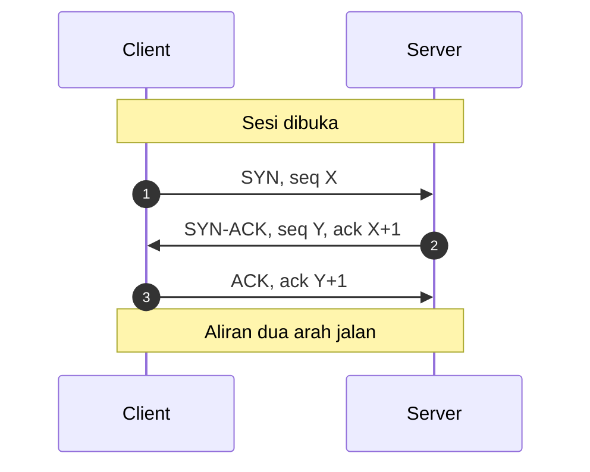
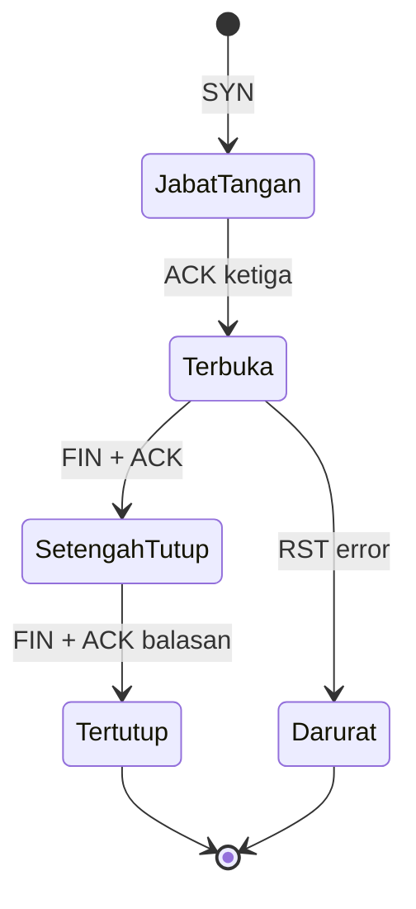
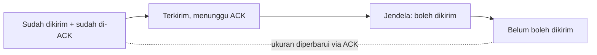

# Network and System Programming | Sesi 3: Aliran Data TCP yang Andal

> **Mata Kuliah:** Network and System Programming | **Sesi:** 3 | **Status:** Materi UTS

---

## 🔑 Cues

- Standar tukar pesan antar aplikasi
- Jabat tangan tiga langkah
- Nomor urut dan konfirmasi
- Penampung sementara penerima
- Jendela kendali aliran
- Jendela geser adaptif
- Penutupan sopan dua arah
- Pustaka `net` Go

---

## 📖 Materi Utama

### 1. Standar Pengiriman yang Bisa Dipegang

**Transmission Control Protocol (TCP)** adalah standar — ditetapkan Internet Engineering Task Force (IETF) — yang memungkinkan aplikasi dan perangkat bertukar pesan dengan jaminan integritas: data dipecah jadi paket, dikirim lewat internet, lalu disusun ulang secara utuh di tujuan. Sebuah **sesi TCP** membuka aliran data (stream) berukuran berapa pun sekaligus memberi konfirmasi penerimaan, sehingga pengirim tak membuang waktu mengirim muatan besar yang ternyata tak pernah diterima.

### 2. Membuka Sesi: Jabat Tangan Tiga Langkah

1. **SYN** — client mengetuk: paket ber-flag Synchronize beserta nomor urut awal pilihannya (X).
2. **SYN-ACK** — server menyambut: paket ber-flag Synchronize + Acknowledge, membawa nomor urutnya sendiri (Y) dan pengakuan atas X (ack X+1).
3. **ACK** — client mengunci: paket Acknowledge atas Y (ack Y+1). Sesi resmi terbuka dua arah.

**Sequence number** di tiap paket memungkinkan penerima mengurutkan paket yang datang acak dan mendeteksi yang hilang — fondasi keandalan sekaligus komunikasi full-duplex.

### 3. Menjaga Arus: Buffer dan Jendela

- **Receive buffer** adalah memori penampung data masuk sebelum aplikasi sempat memprosesnya — peredam gejolak kecepatan kirim.
- **Window size** adalah jumlah byte yang boleh melayang (in-flight) sebelum pengirim wajib berhenti menunggu ACK — rem kendali aliran sekaligus pencegah kongesti.
- **Sliding window**: kedua pihak saling mengintip ukuran jendela lawan dan memperbaruinya lewat tiap paket ACK, sehingga pemakaian bandwidth selalu optimal mengikuti kondisi terkini.

### 4. Menutup Sesi: Perpisahan yang Sopan

1. Lapisan aplikasi meminta tutup.
2. Pihak pertama mengirim flag **FIN** sebagai niat berpisah.
3. Lawan menjawab **ACK** — sesi masuk kondisi **half-closed**: satu arah sudah tutup, arah sebaliknya masih boleh mengalir.
4. Pihak kedua mengirim **FIN**-nya sendiri, dijawab **ACK** terakhir. Sesi resmi berakhir.
5. Flag **RST** adalah jalur darurat: memutus paksa saat terjadi error, bukan perpisahan sopan.

### 5. Membuka Sesi dari Kode Go

Pustaka standar `net` menyediakan semuanya; **binding** adalah momen OS mengikat satu port pada satu IP secara eksklusif untuk listener.

- `net.Listen` melahirkan listener (implementasi `net.Listener`); `Accept` memblokir sampai ada koneksi masuk; `Close` wajib dipanggil — ideally via `defer` — agar tak bocor file descriptor dan goroutine tak menggantung selamanya di `Accept`.
- `net.Listen("tcp", "127.0.0.1:0")` meminta OS memilihkan port acak yang bebas.
- Tiap koneksi yang diterima idealnya ditangani goroutine tersendiri supaya listener tetap bisa menyambut pendatang baru.

#### **[Visualisasi Konsep]**

---

## Library Diagram & Arsitektur

### Siklus hidup sesi: buka, alirkan, tutup

### Jendela geser menjaga arus tetap pas

---

## 🛠️ Use Case / Implementasi Nyata

- **Skenario:** Layanan unduh kampus memakai listener Go yang menerima ratusan mahasiswa bersamaan.
- **Masalah yang Diatasi:** Tanpa jendela aliran, pengirim cepat menenggelamkan buffer penerima lambat; tanpa `Close` yang disiplin, file descriptor bocor tiap sesi usai.
- **Keuntungan:** Sliding window menyesuaikan laju kirim per penerima, goroutine per koneksi menjaga listener tetap responsif, dan `defer Close` memastikan tiap sesi tutup bersih.

---

## 🗂️ Konsep Kunci

| Istilah | Definisi | Contoh / Catatan |
|---------|----------|-----------------|
| SYN | Flag sinkronisasi pembuka sesi | Paket pertama client, seq X |
| ACK | Flag pengakuan penerimaan | Mengunci tiap langkah handshake |
| FIN | Flag niat menutup sesi | Perpisahan sopan dua tahap |
| RST | Flag pemutus paksa | Dipakai saat error |
| Sliding window | Jendela aliran yang diperbarui via ACK | Menakar data in-flight |
| Binding | Pengikatan eksklusif port ke listener oleh OS | Via `net.Listen` |

---

## 📊 Tabel Ringkasan

| Flag | Nama lengkap | Peran |
|------|--------------|-------|
| SYN | Synchronize | Buka sesi dan selaraskan nomor urut |
| ACK | Acknowledgment | Akui tiap paket yang tiba |
| FIN | Finish | Tutup sesi secara sopan |
| RST | Reset | Putus paksa saat error |

| Langkah | Pengirim | Isi | Maksud |
|---------|----------|-----|--------|
| 1 | Client | SYN | Minta sesi dibuka |
| 2 | Server | SYN-ACK | Setuju sekaligus menyapa balik |
| 3 | Client | ACK | Kunci pembuka, sesi jalan |

---

## ⚠️ Catatan Penting

> **[Tutup itu wajib]** — Listener yang tak pernah di-`Close` membuat `Accept` menggantung selamanya dan menguras file descriptor sistem operasi.

> **[Urutan = keandalan]** — Nomor urut membuat penerima bisa merakit ulang paket yang datang tak berurutan dan mencium paket yang raib di jalan.

---

## 📝 Materi Tambahan (Visual Insights)

- Port `0` pada `net.Listen` bukan error — itu cara meminta port bebas acak ke OS, berguna untuk pengujian dan layanan efemeral.
- Half-closed state sering disalahpahami sebagai "sudah tutup": sebenarnya satu arah masih mengalir, sehingga aplikasi harus tetap membaca sisi yang tersisa sebelum menutup total.

#### Integritas dan Keterkiriman

- TCP menjamin dua hal sekaligus: isi tak berubah (integritas) dan sampai ke tujuan (delivery ujung-ke-ujung).

---

## ✅ Standar Visual & Orisinalitas (bar jual — wajib untuk semua catatan)

- **Sintesis orisinal**: struktur, diagram, dan contoh milik sendiri. Sumber (materi aslab/dosen) hanya referensi fakta. Jangan cerminkan urutan langkah, nama contoh, atau naskah sumber.
- **Konsistensi visual**: judul `# MK | Sesi N: Judul`, callout pembuka, cues ≤15 dalam toggle, tabel selalu ber-header, blok kode ≤2000 char (lebih = pecah), ikon + cover judul terisi otomatis saat import.
- **Jujur provenance**: bila sumber hanya kerangka/tanpa isi, tulis di Sumber bahwa isi disusun dari dokumentasi umum.
